# Project in 60 Seconds

**Dataset.** GSE200164 (Piehl et al. 2022, *Cell*): 70,391 CSF immune cells from 59
individuals.

**Comparison.** Two ways to represent a cell: PCA on SCTransformed expression, and a
frozen, zero-shot scGPT embedding.

**Main question.** Which representation organizes cells into cleaner,
donor-independent cell populations, and do those populations correspond to real
immune cell types?

**Analysis sequence.**

```text
Published workflow reproduction        (Stages 01–03)
  → PCA vs scGPT representations       (Stage 04–05)
  → Harmony donor correction           (Stage 06, 09)
  → silhouette comparison              (Stage 07)
  → PCA-512 dimensionality control     (Stages 10–11)
  → WCSS/elbow supporting analysis     (Stage 08)
  → RNA marker validation              (Stages 12–14)
  → broad cell-type annotation         (Stage 15)
  → NEXT: T-cell and monocyte subclustering
```

**Main result so far.** The PCA arm now follows the authors' normalization as closely
as possible (SCT residuals, the quantity their integration consumes). On that footing
neither representation wins on geometry: each partition scores best in its own space
(PCA 0.176 in PCA space, scGPT 0.220 in scGPT space), and that holds at matched 512
dimensions. After Harmony PCA mixes donors better locally (0.969 against 0.866), with
lower donor NMI (0.038 against 0.051). Both arms recover the same broad cell types,
within 119 cells for every identity.

**What remains unknown.** Whether the arms differ in biology at finer resolution:
T-cell and monocyte subtypes.

**Immediate next step.** Recluster the T cells, then the monocytes, in both arms, and
compare the subtype annotations.

Code lives in [`02_CODE/`](../02_CODE/). Results are organized by question in
[`03_RESULTS/`](../03_RESULTS/README.md). The full technical and audit record this
document was condensed from is [`ARCHIVE/FULL_ANALYSIS_LOG.md`](../ARCHIVE/FULL_ANALYSIS_LOG.md).

---

# The Analysis

## 1. Dataset and published workflow reproduction

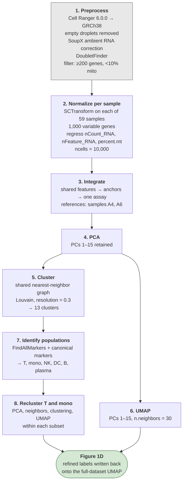

*Above: the authors' workflow. Step 1 was already applied to the public GEO matrix, so
this project starts at step 2.*

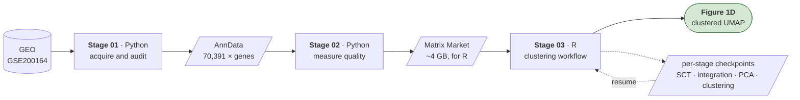

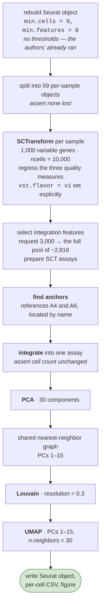

### What was done

- **Download and audit (Stage 01).** Downloaded the GEO matrix and verified that the
  sparse conversion preserved every value exactly. The values are SoupX-corrected and
  fractional, and they are never rounded.
- **Quality measures, no filtering (Stage 02).** Computed the three quality measures
  but removed no cells. The matrix is already the authors' QC-filtered output.
- **Clustering (Stage 03).** Reran the authors' steps 2–6 with their parameters:
  SCTransform v1 per sample, anchor integration, PCs 1–15, Louvain at 0.3.

One deliberate departure: the reproduction requests the *full* ~2,816-gene pool of integration
features rather than 2,000. Only ~2,816 genes are shared by all 59 samples here, and
cutting to 2,000 discarded the rare-population markers and lost the small clusters.

**Code.** `02_CODE/01_download_audit_build_anndata.py`, `02_CODE/02_prepare_figure1d.py`,
`02_CODE/03_reproduce_figure1d.py` (drives `03_reproduce_figure1d.R`).


Result: 12 clusters over all 70,391 cells, ranging from 18,533 cells down to 787. The
paper reports 13.

### Conclusion

The published clustering workflow reproduces from the public data, with the rare
populations retained. The one-cluster difference is not chased by tuning resolution,
because cluster count is a diagnostic here, not a target.

The authors' marker panel, used later in section 7:

```text
CD3D, CD4, CD8A, CD8B, FOXP3    T cells and regulatory T cells
NKG7, GNLY                      NK cells
FCER1A                          dendritic cells
CD68, CD14, FCGR3A              monocytes
CD19, JCHAIN                    B cells and plasma cells
```

Figure 1D's final labels (CD4+, CD8+, CD4+/CD8+ and Treg T cells; classical,
intermediate and non-classical monocytes) come from step 8, the reclustering, which
has not been done yet.

---

## 2. scGPT representation

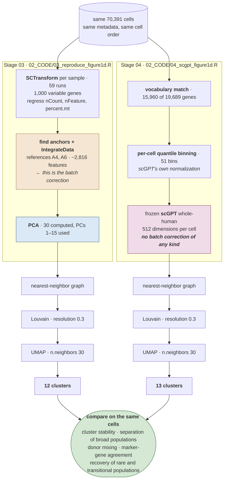

### What was done

- **Embedding.** Each cell was embedded with the frozen whole-human scGPT model: 512
  dimensions, no fine-tuning, no batch correction.
- **Downstream.** The same Seurat code and settings as the PCA arm then ran on the
  embedding. Only the representation differs. All 512 dimensions are used, because an
  embedding has no variance ordering to truncate by.
- **Gene coverage (Stage 05).** scGPT's gene vocabulary was checked for dropped genes.

**Code.** `02_CODE/04_scgpt_figure1d.py` (drives `.R`), `02_CODE/05_audit_scgpt_gene_coverage.py`.


Result: 13 clusters, splitting finer at the small end. Five clusters are under 1,000
cells (the smallest is 103), against two in the PCA arm.

| | genes | share of total expression |
| --- | --- | --- |
| kept | 15,960 (81.1%) | **98.862%** |
| dropped | 3,729 (18.9%) | **1.138%** |

### Conclusion

The vocabulary gap does not matter for this comparison. It is 1.1% of expression, and
none of 65 canonical immune markers is lost. The dropped genes are mostly clone-based
loci, lncRNAs and renamed symbols.

One caveat to remember: the loss is concentrated in histones and tRNA synthetases, so
any cell-cycle-defined cluster is seen more weakly by scGPT. Also, the scGPT arm is
uncorrected while the PCA arm is anchor-corrected, so the two aren't yet comparable.

---

## 3. Making PCA and scGPT comparable: Harmony

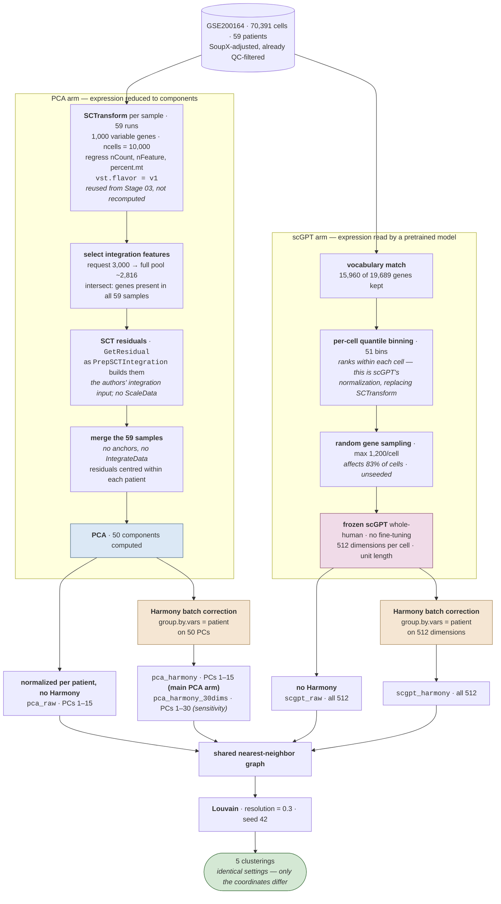

### What was done

- **Why this was needed.** Stage 03 was corrected with anchors and Stage 04 not at
  all, so a difference between them could be donor structure rather than
  representation.
- **Rebuilding the PCA arm.** PCA was rebuilt without anchors (the same per-sample SCT
  fits, merged; this is *not* Stage 03's PCA). Reusing Stage 03's PCA would have
  corrected it twice. The input is SCT **residuals**, built the way the authors'
  `PrepSCTIntegration` builds them (stored `scale.data` for each sample's 1,000
  variable genes, model-derived residuals for the rest), with no `ScaleData` step. The
  PCA arm therefore follows the authors' normalization as closely as a comparison
  without anchors allows. An earlier version used the SCT `data` layer, which the
  authors never use, and the whole arm came out dominated by depth and gene count.
- **A partly adjusted baseline.** Residuals are centred within each patient, so the
  arm without Harmony is *normalized per patient, no Harmony*, not raw. `percent.mt`
  is reduced in the PCA arm, not removed: only the 1,000 variable genes were
  regressed on it.
- **Correcting both arms.** Harmony was applied by patient to both representations
  equally. Five arms were then clustered identically: each representation with and
  without Harmony, plus PCA at 30 dims as a sensitivity check.
- **What was measured.** Donor NMI: how much of a clustering patient identity
  explains. Donor mixing: the fraction of a cell's 30 neighbours from other patients,
  against a ceiling of 0.9726.

The two arms carried forward are `pca_harmony` (15 PCs, as the authors used; 12
clusters) and `scgpt_harmony` (11).

**Code.** `02_CODE/06_benchmark_representations.py` (drives `.R`); the donor-coloured
layout is from `02_CODE/09_pca_raw_umap.R`.

| arm | dims | clusters | smallest | donor mixing | donor NMI |
| --- | --- | --- | --- | --- | --- |
| `pca_raw` (per patient, no Harmony) | 15 | 10 | 206 | 0.883 | 0.049 |
| `pca_harmony` | 15 | 12 | 217 | **0.969** | **0.038** |
| `pca_harmony_30dims` | 30 | 12 | 226 | 0.967 | 0.038 |
| `scgpt_raw` | 512 | 12 | 103 | 0.806 | 0.072 |
| `scgpt_harmony` | 512 | 11 | 105 | 0.866 | 0.051 |

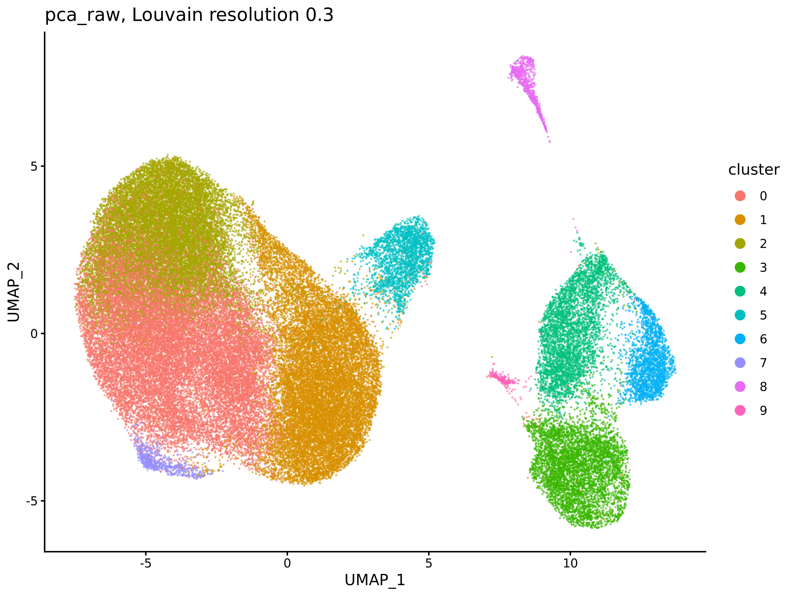

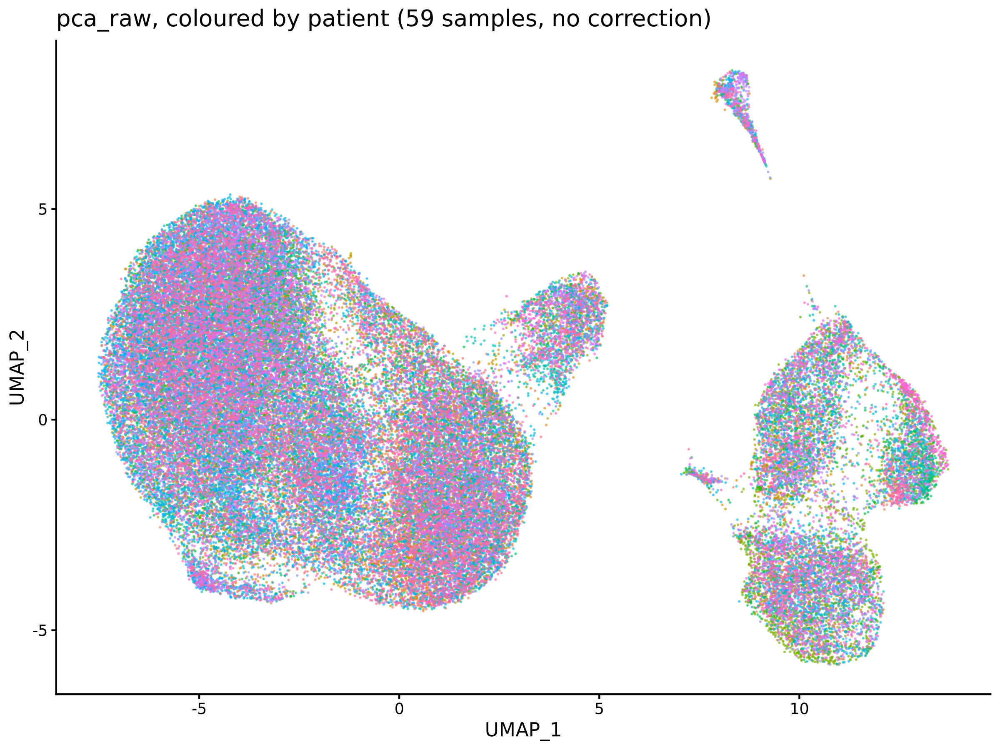

*PCA arm without Harmony, coloured by patient (donor NMI 0.049). Residuals are already
centred within each patient, so little patient structure remains to see.*

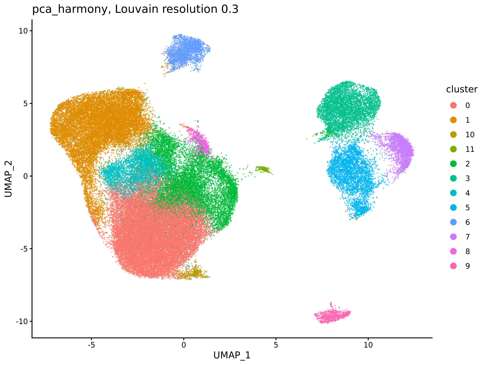

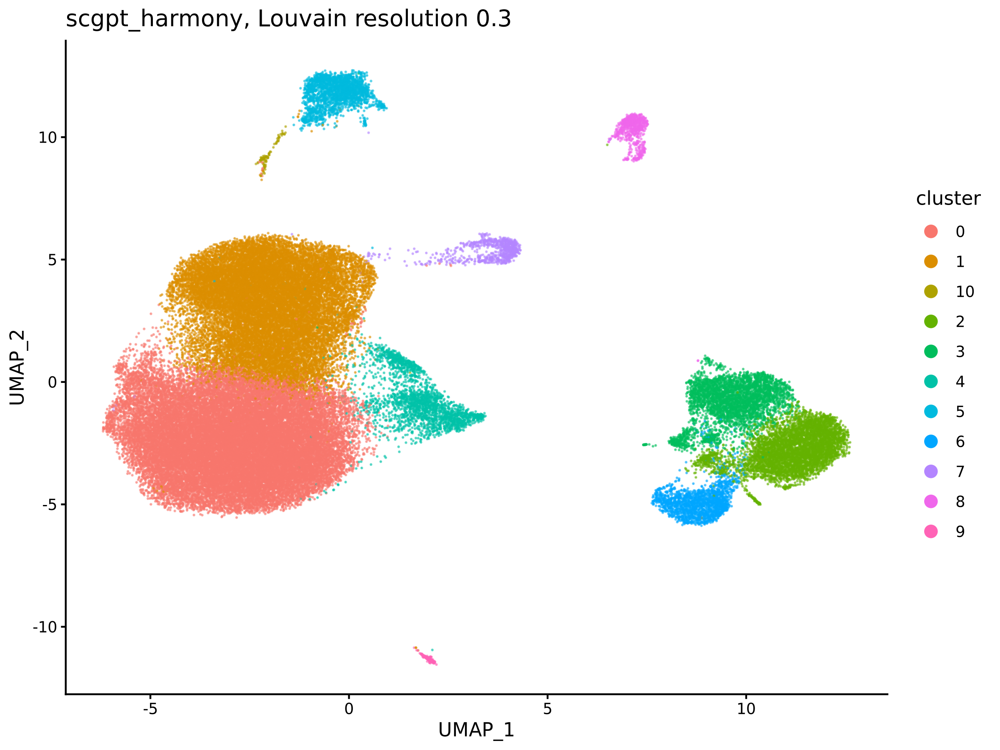

*Each UMAP is its own coordinate system, so compare groupings, not positions or colours.*

### Conclusion

- **Without Harmony** the PCA arm already leaks little patient identity (donor NMI
  0.049, scGPT 0.072), but that is not a like-for-like batch-robustness comparison:
  per-patient residuals are partly donor-adjusted by construction, and the scGPT input
  has no such step. No claim about batch robustness before correction is made.
- **After Harmony,** PCA's donor NMI is 0.038 and scGPT's 0.051.
- **Local donor mixing is better for PCA** (0.969 against 0.866), so scGPT is **not**
  better at batch correction.
- **Rare populations survive in both arms:** PCA's smallest cluster is 206 cells
  without Harmony and 217 with it; scGPT's are 103 and 105.
- **The two corrected arms agree moderately** (ARI 0.543, NMI 0.641).
- **`scgpt_harmony` moved slightly from the earlier run.** Its labels differ from the
  superseded run for 975 cells (ARI 0.958); `scgpt_raw` is identical. Harmony is
  bit-reproducible on this machine (two same-seed runs agree exactly), so the cause is
  not within-run noise and has not been traced.

**Caveat.** Age, sex and diagnosis are constant within a patient, so Harmony also
removes all aging and cognitive-impairment signal. These coordinates are for grouping
cells by type only.

---

## 4. Cluster separation: silhouette

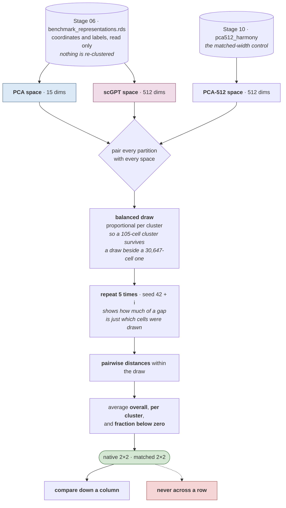

### What was done

Both corrected partitions (PCA-15, 12 clusters; scGPT, 11 clusters) were scored in
*both* spaces, using balanced subsamples (12,000 cells, 5 repeats) so small clusters
count. Comparisons are only valid within one space, because distances in 15 and 512
dimensions are different quantities.

**Code.** `02_CODE/07_silhouette_comparison.py` (drives `.R`).

| partition | space | | clusters | mean silhouette | sd across draws | negative fraction |
| --- | --- | --- | --- | --- | --- | --- |
| `pca_labels` | pca | *native* | 12 | **0.176** | 0.0015 | **13.1%** |
| `scgpt_labels` | pca | cross | 11 | 0.151 | 0.0016 | 18.8% |
| `pca_labels` | scgpt | cross | 12 | 0.100 | 0.0019 | 24.1% |
| `scgpt_labels` | scgpt | *native* | 11 | **0.220** | 0.0008 | **5.3%** |

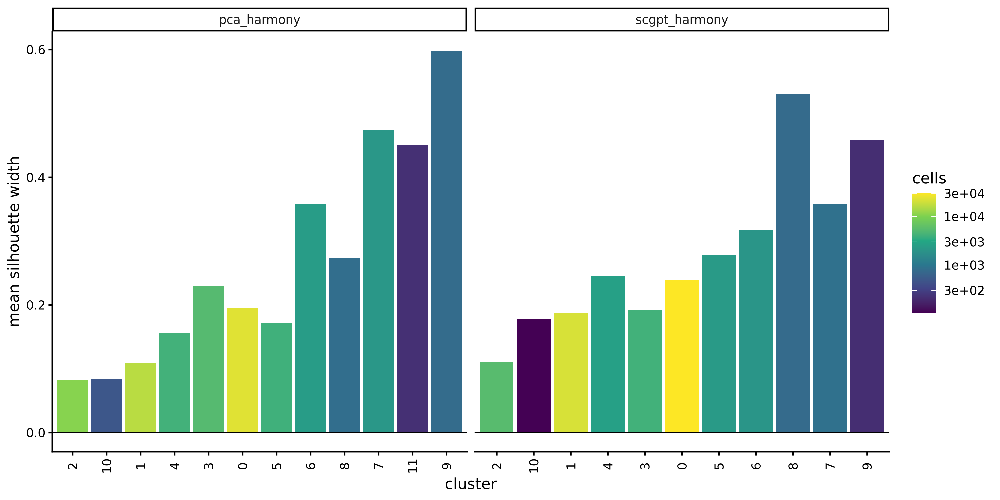

### Conclusion

- **In PCA space** PCA's own partition scores higher (0.176 against 0.151), with all
  12 of its clusters positive; scGPT's partition has 10 of 11.
- **In scGPT space** scGPT's own partition scores higher (0.220 against 0.100), with
  all 11 clusters positive, against 10 of 12 for PCA's.
- **Each partition wins in its own space.** Neither wins in both, so this comparison
  alone does not say one description is better defined. It says each description
  favours the clusters it produced.
- **Small clusters are among the best separated** (up to 0.599 for PCA, 0.530 for
  scGPT), while the large T-cell masses score lowest, and those are the populations
  the authors resolved by reclustering.

Because the two spaces differ in width, this pass alone cannot rule out a
dimensionality effect. Section 5 tests that.

---

## 5. PCA-512 dimensionality control

### What was done

To test whether scGPT wins only because it has 512 dimensions, PCA was extended to 512
components using exact SVD on the same residuals, Harmony-corrected, and clustered
fresh at identical settings. Both 512-dimension partitions were then scored with
silhouette, 25,000 cells per draw, with PCA-15 carried along as a control.

**Code.** `02_CODE/10_pca512_arm.py`, then `02_CODE/11_silhouette_dimension_matched.py` (each drives its `.R`).

| arm | dims | clusters | smallest |
| --- | --- | --- | --- |
| `pca_harmony` | 15 | 12 | 217 |
| `pca_harmony_30dims` | 30 | 12 | 226 |
| `scgpt_harmony` | 512 | 11 | 105 |
| **`pca512_harmony`** | **512** | **8** | **76** |

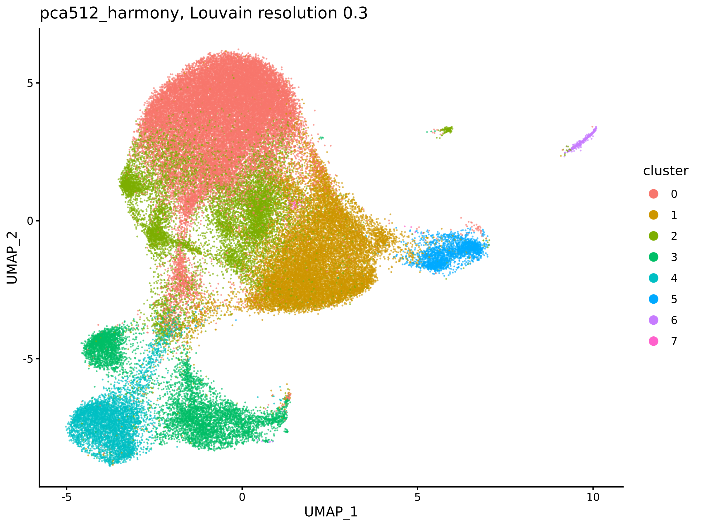

| partition | scored in PCA-512 | scored in scGPT-512 |
| --- | --- | --- |
| **PCA-512 labels** (8 clusters) | **0.053** *(native)* | 0.136 |
| **scGPT labels** (11 clusters) | −0.022 | **0.221** *(native)* |
| *PCA-15 labels* (12, carried) | *0.029* | *0.100* |

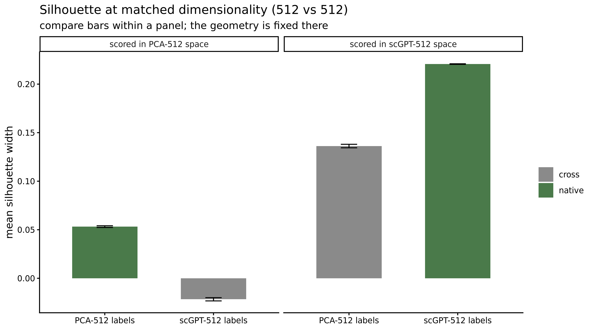

| | PCA-512 labels | scGPT labels |
| --- | --- | --- |
| clusters scoring above zero | 7 of 8 | 11 of 11 |
| largest cluster | 28,141 cells at 0.088 | 30,647 cells at 0.239 |
| smallest cluster | 76 cells at 0.073 | 105 cells at 0.178 |
| best cluster | 748 cells at 0.329 | 755 cells at 0.523 |

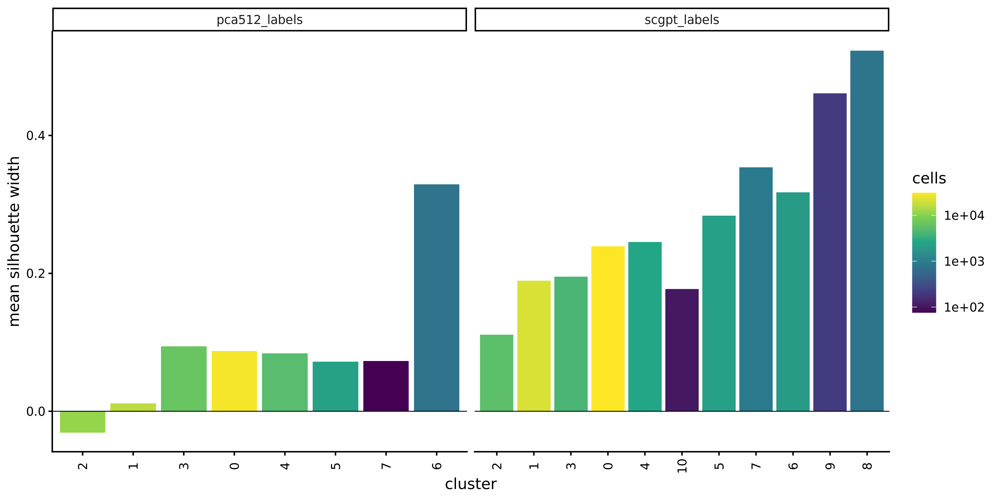

### Conclusion

**At matched dimensionality the pattern is the same as at native width: each partition
scores best in its own space.**
- **PCA-512 labels win in PCA-512 space** (0.053 against −0.022), and scGPT labels win
  in scGPT space (0.221 against 0.136). No partition wins in both spaces.
- **Adding dimensions to PCA changes the partition.** Going from 15 to 512 components
  cuts the clusters from 12 to 8, and the smallest from 217 to 76 cells. PCs 16–512 hold
  64.74% of the variance, spread across near-noise axes.
- **The PCA labels hold up better in scGPT space than before** (PCA-512 0.136, PCA-15
  0.100), but still below scGPT's own partition (0.221).
- **Cluster-count bias.** PCA-512 has the coarser partition (8 clusters against 11),
  which silhouette rewards, so its 0.053 native score is, if anything, flattered.

**Silhouette measures geometric separation, not biological correctness.** That is the
job of sections 7–8.

---

## 6. WCSS / elbow (supporting analysis only)

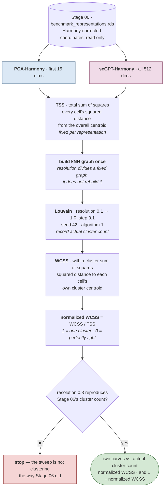

### What was done

Resolution 0.3 was inherited from the authors, not tuned. To see where it sits for
each representation, Louvain resolution was swept from 0.1 to 1.0 on a fixed kNN graph
and normalized WCSS (WCSS/TSS) was plotted against the cluster count each setting
produced.

**Code.** `02_CODE/08_wcss_resolution_sweep.py` (drives `.R`).

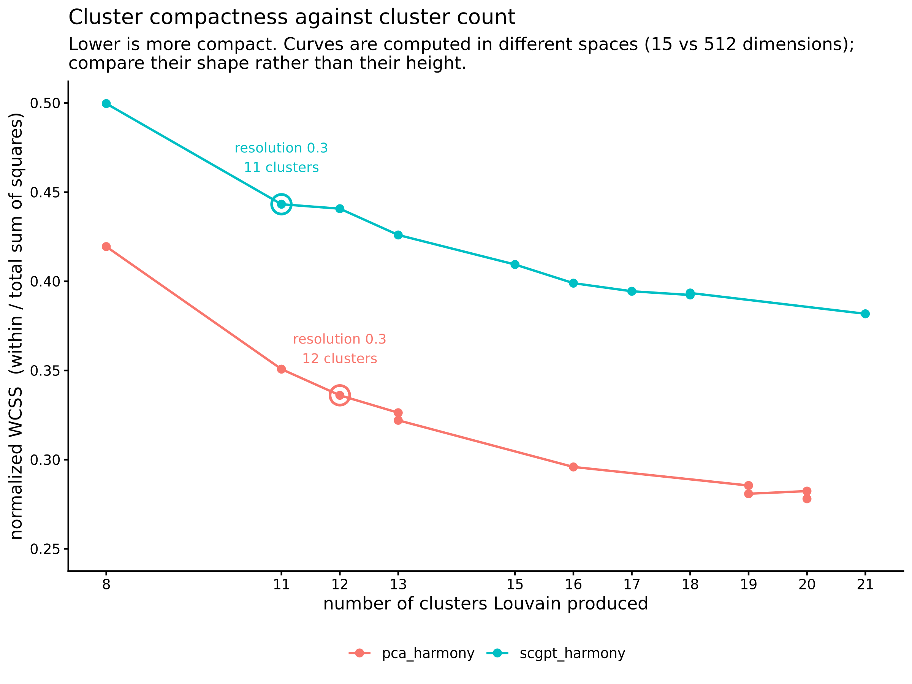

| | PCA-Harmony | scGPT-Harmony |
| --- | --- | --- |
| WCSS at 8 clusters | 0.4195 | 0.4997 |
| WCSS at 20–21 clusters | 0.2781 | 0.3818 |
| total drop across the sweep | **0.141** | **0.118** |
| drop by 13 clusters | **0.097 (69% of total)** | 0.074 (62% of total) |

<details>
<summary>Full sweeps</summary>

**PCA-Harmony, 15 dimensions**

| resolution | clusters | normalized WCSS | dispersion explained |
| --- | --- | --- | --- |
| 0.1 | 8 | 0.4195 | 0.5805 |
| 0.2 | 11 | 0.3508 | 0.6492 |
| **0.3** | **12** | **0.3361** | **0.6639** |
| 0.4 | 13 | 0.3263 | 0.6737 |
| 0.5 | 13 | 0.3221 | 0.6779 |
| 0.6 | 16 | 0.2959 | 0.7041 |
| 0.7 | 19 | 0.2855 | 0.7145 |
| 0.8 | 19 | 0.2809 | 0.7191 |
| 0.9 | 20 | 0.2824 | 0.7176 |
| 1.0 | 20 | 0.2781 | 0.7219 |

**scGPT-Harmony, 512 dimensions**

| resolution | clusters | normalized WCSS | dispersion explained |
| --- | --- | --- | --- |
| 0.1 | 8 | 0.4997 | 0.5003 |
| 0.2 | 12 | 0.4407 | 0.5593 |
| **0.3** | **11** | **0.4432** | **0.5568** |
| 0.4 | 13 | 0.4260 | 0.5740 |
| 0.5 | 15 | 0.4094 | 0.5906 |
| 0.6 | 16 | 0.3990 | 0.6010 |
| 0.7 | 17 | 0.3944 | 0.6056 |
| 0.8 | 18 | 0.3923 | 0.6077 |
| 0.9 | 18 | 0.3935 | 0.6065 |
| 1.0 | 21 | 0.3818 | 0.6182 |

</details>

---

## 7. RNA marker validation

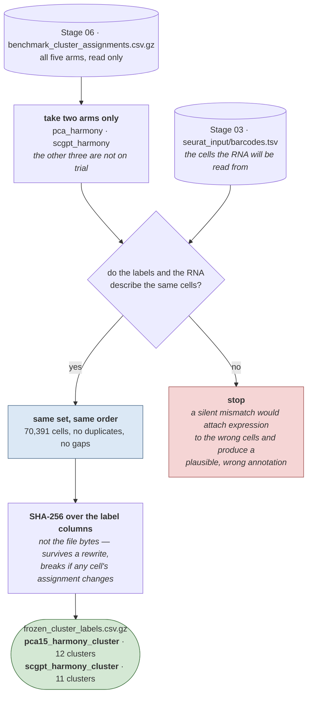

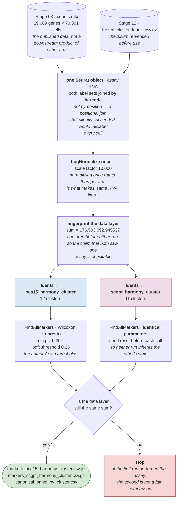

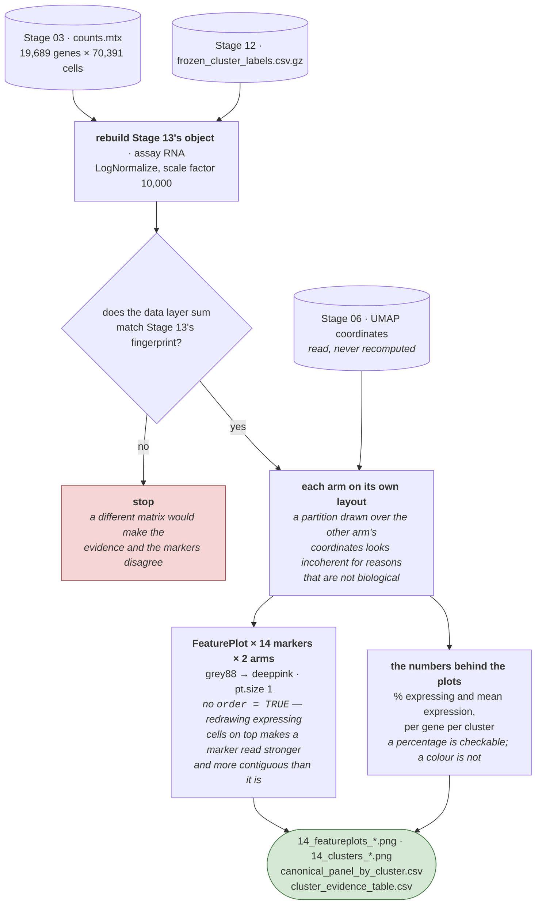

### What was done

Geometry can't say whether a cluster is a cell type, so the RNA was used to judge.
- **Freeze (Stage 12).** The two partitions were frozen and checksummed, so they
  can't move from here on.
- **Markers (Stage 13).** Marker discovery ran identically for both partitions on the
  same LogNormalized RNA matrix, so the only thing that differs is which cells carry
  which label. It used RNA rather than SCT because the per-sample SCT assays share
  only 9,013 of 19,689 genes, and the missing ones include rare-population markers.
- **Evidence (Stage 14).** The authors' canonical panel was drawn over each arm's own
  UMAP, along with a per-cluster evidence table: size, donors, top markers, and panel
  genes expressed.

**Code.** `02_CODE/12_freeze_cluster_labels.py`, `02_CODE/13_marker_discovery.py`,
`02_CODE/14_marker_evidence.py` (the last two drive `.R`).

The frozen partitions are largely nested: PCA clusters 3, 5, 6, 7, 9 and 11 each send
at least 90% of their cells to a single scGPT cluster. The disagreement is in the T
cells.

| PCA cluster | cells | where they land in scGPT |
| --- | --- | --- |
| 2 | 10,797 | 61% scGPT 0, 23% scGPT 1, 15% scGPT 4 |
| 4 | 4,134 | 66% scGPT 1, 33% scGPT 0 |
| 10 | 486 | 60% scGPT 1, 12% scGPT 10, rest scattered |

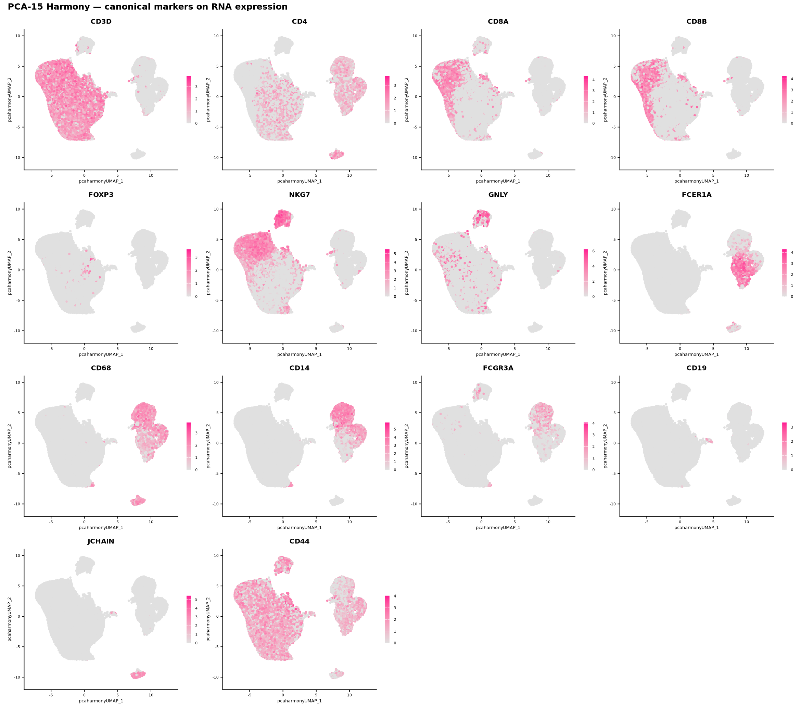

*PCA-15 Harmony, the authors' panel drawn on this arm's own layout.*

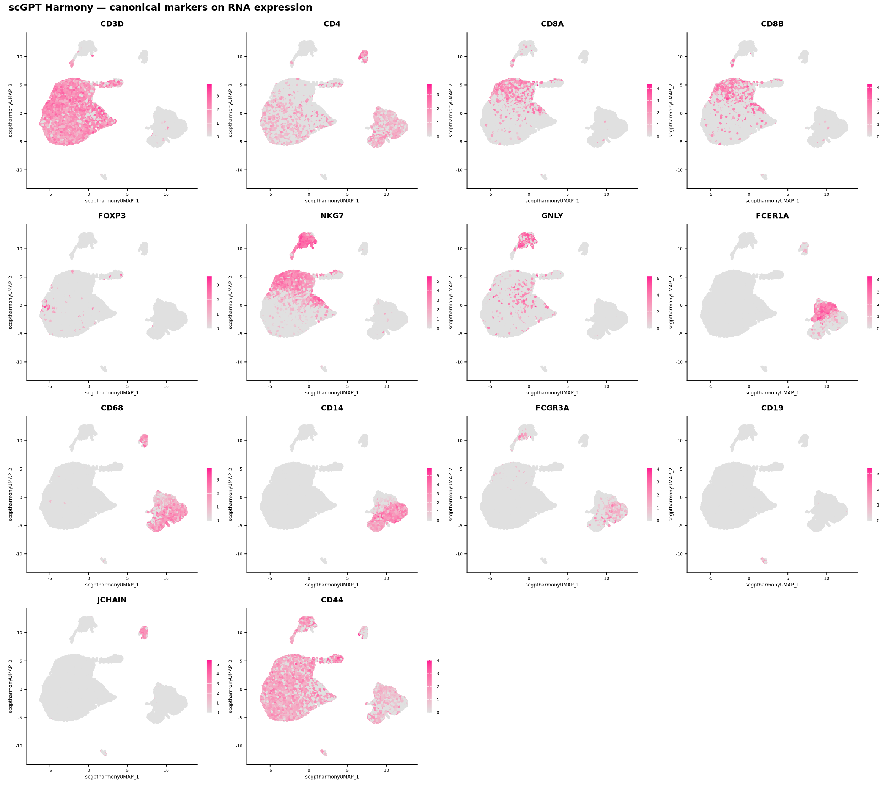

*scGPT Harmony: the same panel and the same cells, in the other layout.*

### Conclusion

Both arms were run through the same marker discovery and evidence stages on the
rebuilt PCA arm. The evidence tables are in `Age_trajectory/results/14_marker_evidence/`.
Reading them into cell types is Stage 15 (section 8).

---

## 8. Broad cell-type annotation

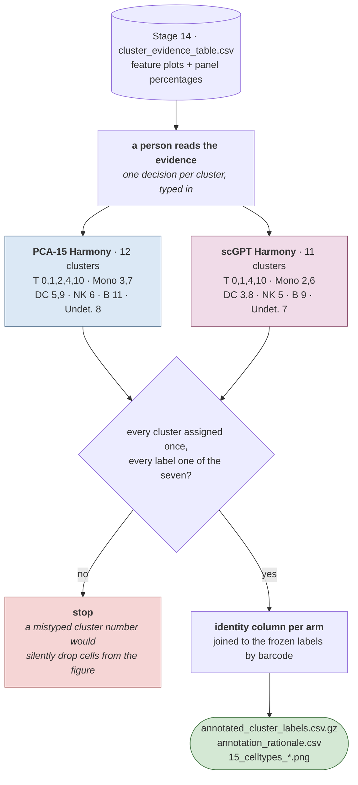

### What was done

Following the authors, each cluster was assigned by hand, from its evidence row and
feature plots, to one of their seven broad categories. This is only the authors' first
pass. Their finer labels come from reclustering, which has not been done yet. Cluster
numbers mean nothing across arms, so each arm was read from its own plots. The
assignments were made on the rebuilt PCA arm (SCT residuals) and the current
`scgpt_harmony` labels; the earlier annotation is superseded.

Two judgement calls:
- **PCA cluster 3** (5,267 cells: APOE, C1Q genes, LYVE1; CD14 and CD68 high) is
  macrophage-like. It is filed under Monocytes because the authors' categories have
  nothing closer.
- **PCA cluster 8** (821 cells) is dominated by XIST and long-transcript genes (SYNE2,
  MACF1, UTRN), with no canonical lineage marker above 50%. It spans 58 patients, so it
  is not one donor's cells. It is Undetermined, a category the authors also used. The
  same cells form scGPT cluster 7 (85% of PCA cluster 8 lands there), which gets the
  same label.

**Code.** `02_CODE/15_annotate_clusters.R`.

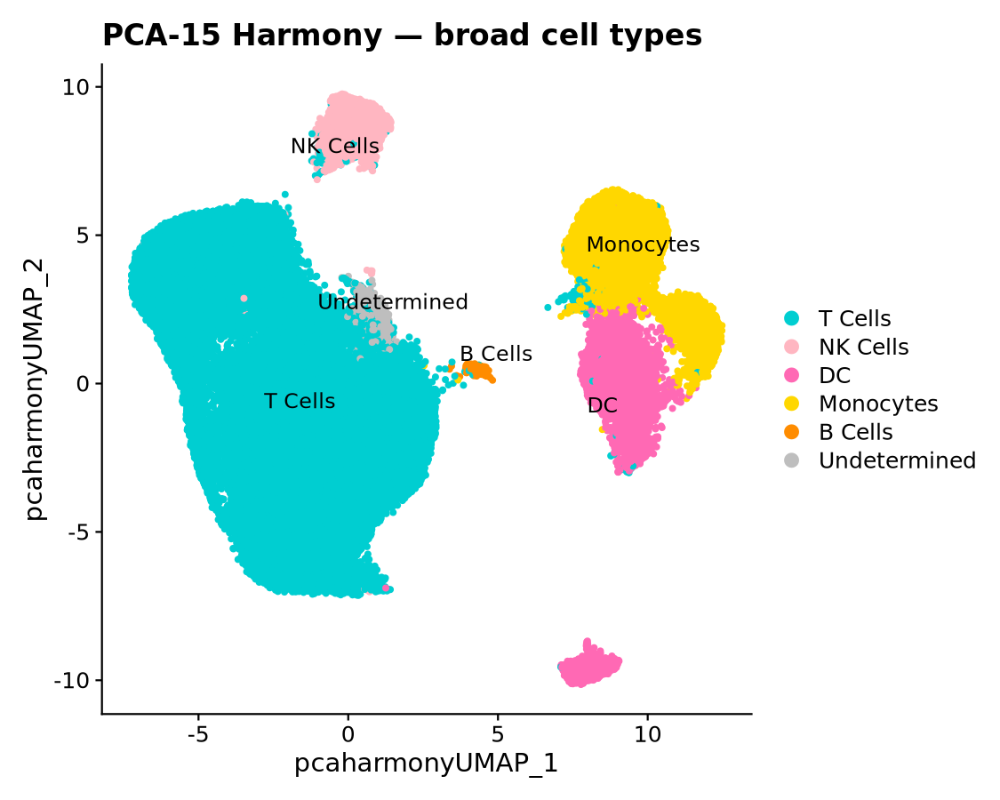

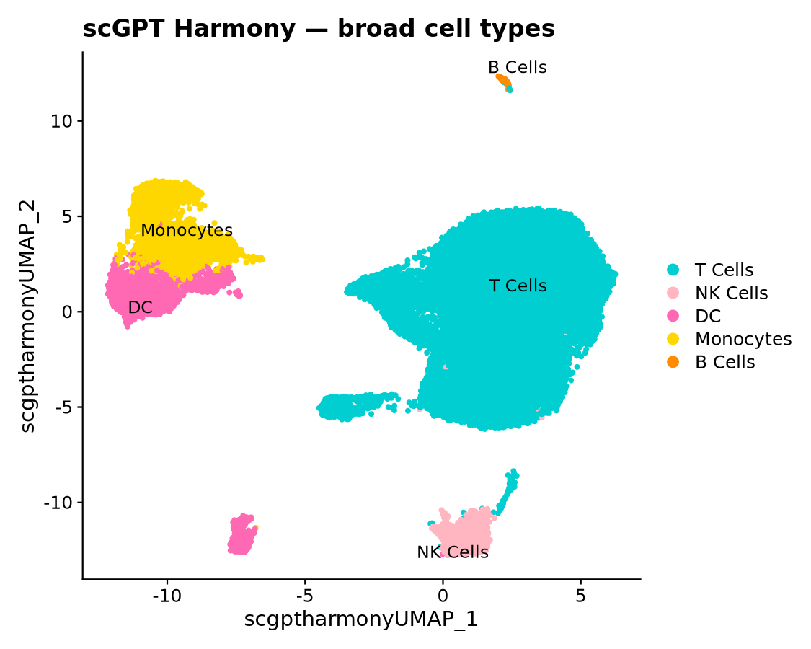

| identity | PCA-15 Harmony | scGPT Harmony | difference |
| --- | --- | --- | --- |
| T Cells | 54,803 | 54,684 | 119 |
| Monocytes | 7,387 | 7,470 | 83 |
| DC | 4,794 | 4,849 | 55 |
| NK Cells | 2,369 | 2,305 | 64 |
| B Cells | 217 | 208 | 9 |
| Undetermined | 821 | 875 | 54 |

### Conclusion

Both representations recover nearly identical broad immune populations, within 119
cells for every identity. `Plasma Cells` went unused in both arms. PCA's one extra
cluster is a subdivision *within* T cells (PCA cluster 10, cycling cells; scGPT's cycling
cluster 10 holds only 12% of them, and 60% sit in scGPT's large T cluster 1). At this resolution the arms are biologically equivalent.
Both labels rest on the same hand reading, so agreement here does not say which
partition is better.

---

# Where the Project Stands

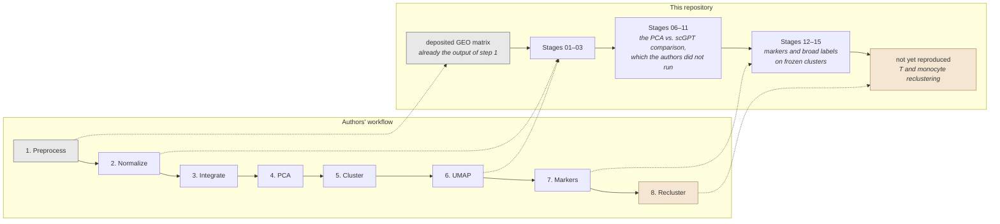

## Completed

- **Clustering reproduced.** Figure 1D's unsupervised clustering reproduced from
  the public data (authors' steps 2–7).
- **scGPT arm and batch correction.** A frozen scGPT arm, with both arms
  Harmony-corrected.
- **Separation tested.** Silhouette at native width, the PCA-512 dimensionality
  control, and the WCSS sweep, all rerun on the rebuilt PCA arm.
- **Biology checked.** Frozen partitions, RNA marker validation, and broad cell-type
  annotation for both arms, redone on the rebuilt PCA arm.

## Main conclusion so far

With the PCA arm rebuilt from SCT residuals, as the authors' integration builds them,
neither representation separates clusters better in both spaces: each partition scores
highest in its own, at native width and at matched 512 dimensions. After Harmony, PCA
has the lower donor NMI (0.038 against 0.051) and mixes donors better locally (0.969
against 0.866). An earlier claim that scGPT separates clusters better came from a PCA
arm built on the wrong layer and is withdrawn. Both arms recover the same broad cell types, so
whether they differ in biology awaits T-cell and monocyte subclustering.

## Next step

Recluster and annotate the T cells (CD4, CD8, CD4/CD8, Treg), then the monocytes
(classical, intermediate, non-classical), in both arms. This compares PCA and scGPT at
finer biological resolution and completes Figure 1D.

## What not to do

- **Aging and cognitive-impairment analysis** is out of scope for this paper. Harmony
  coordinates can't support it anyway.
- **Unrelated model development** (fine-tuning scGPT, new representations) is also
  out of scope.

## References

- Piehl N, et al. *Cerebrospinal fluid immune dysregulation during healthy brain aging and cognitive impairment.* Cell. 2022. DOI: 10.1016/j.cell.2022.11.019.
- Dataset: GEO accession **GSE200164**.
- Author code: `gatelabNW/csf_aging` (copies in [`05_REFERENCES/`](../05_REFERENCES/)).
