# Analysis Walkthrough

**Dataset.** GSE200164 (Piehl et al. 2022, *Cell*): 70,391 CSF immune cells from 59
patients.

**Question.** Can a frozen foundation model, used out of the box, match the authors'
published pipeline?

The two arms:
- **The authors' pipeline.** Their Figure 1D workflow, reproduced: SCTransform per
  patient, anchor integration across patients, PCA, PCs 1–15, Louvain at 0.3.
- **scGPT, out of the box.** The frozen whole-human scGPT model, no fine-tuning: 512
  dimensions per cell, clustered with the same Louvain settings.

**The authors' pipeline includes batch correction, and scGPT raw does not. That is
intended.** Anchor integration is part of what the authors published, so the
benchmark keeps it. "Out of the box" means scGPT gets no correction of any kind. The
question is whether a pretrained model, given nothing but the counts, already
organizes cells as well as a carefully tuned, batch-corrected pipeline. A gap in
patient NMI between the arms is therefore an expected part of the answer, not a flaw
in the design.

**Answer so far.** At the level of broad cell types, yes, and on some measures
scGPT does better. At the level of T-cell subtypes, no.
- **Biology.** scGPT's clusters follow SingleR's independent cell types more closely
  than the authors' do (biology NMI 0.587 against 0.501).
- **Patient.** scGPT's clusters carry more patient identity (patient NMI 0.072
  against 0.039). That is expected, because only the authors' pipeline corrects for
  patient.
- **Annotation.** Hand-annotated the same way, the two arms agree with SingleR about
  equally (95.8% against 95.3%). scGPT is ahead on NK cells and DCs, and resolves B
  cells that the authors' pipeline merges into its plasmacytoid DC cluster.
- **Shared weak point.** Both arms disagree with SingleR on the same boundary: about
  2,500 cells hand-annotated as monocytes that SingleR calls DCs.
- **Subtypes (the Figure 1D step).** Within the T cells, the authors' pipeline wins.
  - Where the arms disagree on a T-cell subtype, the raw marker counts side with
    the authors' arm.
  - scGPT finds no regulatory T cells, and its CD8+ group is much less pure (CD8A
    in 58% of cells, against 88%).
  - scGPT's subclusters carry nine times more patient identity (patient NMI 0.110
    against 0.012). Without correction, patient differences swamp the fine
    differences between T-cell subtypes.
  - The monocyte subtypes largely agree (78%).

**How to read this document.** Each numbered section answers one question. All
figures live in `Age_trajectory/results/figures/`. The pipeline stage numbers
(`02_CODE/NN_*`) are given in each section's **Code** line. For the figures and
tables alone, see [FIGURE_OVERVIEW.md](FIGURE_OVERVIEW.md).

| section | question | results folder | stages |
| --- | --- | --- | --- |
| 1 | Does the published clustering reproduce? | [01_PCA_BASELINE](../03_RESULTS/01_PCA_BASELINE/) | 01–03 |
| 2 | What does scGPT give, used out of the box? | [02_SCGPT_BASELINE](../03_RESULTS/02_SCGPT_BASELINE/) | 04–06 |
| 3 | What does the RNA say each cluster is? | [06_CELL_TYPE_MARKERS](../03_RESULTS/06_CELL_TYPE_MARKERS/) | 12–14 |
| 4 | Which broad cell type is each cluster, and do the arms group the same cells? | [07_CELL_TYPE_ANNOTATION](../03_RESULTS/07_CELL_TYPE_ANNOTATION/) | 15, 19 |
| 5 | Do the clusters follow biology or the patient? | [08_BIOLOGY_VS_PATIENT](../03_RESULTS/08_BIOLOGY_VS_PATIENT/) | 16–17 |
| 6 | *Supplementary:* how cleanly does each space separate the reference cell types? | `Age_trajectory/results/18_singler_silhouette/` | 18 |
| 7 | Do the arms find the same T-cell and monocyte subtypes? | `Age_trajectory/results/20_subclusters/`, `21_subtypes/` | 20–21 |
| A | *Appendix:* the earlier Harmony comparison | [03_BATCH_CORRECTION](../03_RESULTS/03_BATCH_CORRECTION/) and after | 06–11, 15 |

## The workflow

The guiding rule is to follow the authors' steps wherever possible. Departures are
made only where the comparison requires them, and each one is stated where it happens.

```text
GEO matrix: already QC-filtered, SoupX-corrected, doublets removed (authors' step 1)
│
├── Authors' pipeline (Section 1)
│     SCTransform v1 per patient ─ anchor integration ─ PCA ─ PCs 1–15 ─ Louvain 0.3
│
└── scGPT, out of the box (Section 2)
      per-cell quantile binning ─ frozen scGPT, 512 dims ─ no correction
      ─ all 512 dims ─ Louvain 0.3

Both arms ─ freeze labels ─ markers on the same RNA ─ hand annotation
          ─ check against SingleR reference labels
```

Everything after clustering is identical for the two arms. Both are marker-tested on
one shared RNA matrix, annotated by hand into the authors' broad categories, and
checked against SingleR labels that belong to neither arm.

---

## 1. Reproducing the published clustering

**Question.** Does the Figure 1D clustering workflow reproduce from the public data?

**Answer.** Yes: 12 clusters, against the paper's 13, with the rare populations kept.
This is the first arm of the comparison.

**What was done.**
- **Download and audit (Stage 01).** Downloaded the GEO matrix and confirmed the
  sparse conversion kept every value exactly. Values are SoupX-corrected and
  fractional, and are never rounded.
- **Quality measures (Stage 02).** Measured but removed no cells. The matrix is
  already the authors' filtered output.
- **Clustering (Stage 03).** The authors' steps with their parameters:
  - SCTransform v1 per patient (1,000 variable genes; nCount, nFeature and percent.mt
    regressed)
  - anchor integration with references A4 and A6
  - PCs 1–15, Louvain at resolution 0.3, UMAP

**Departures from the authors' code.**
- **Integration features.** The run requests 3,000 integration features, which here
  is the whole available pool of about 2,816. The authors requested 2,000, but in the
  current software a 2,000 cut discards the markers of rare cell types and loses the
  small clusters.
- **PCs computed.** 30 are computed instead of their 50; PCs 1–15 are used either way.

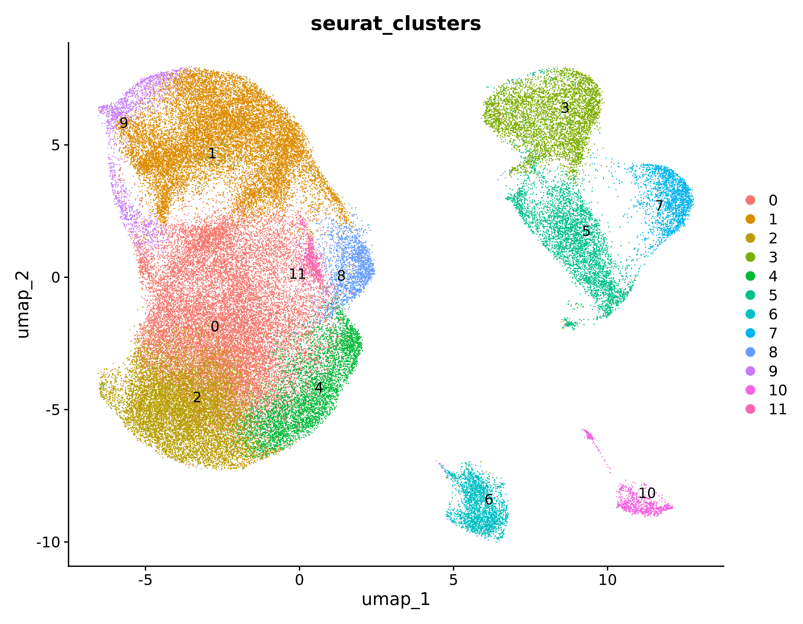

Clusters range from 18,533 cells down to 787. Cluster count is a diagnostic, not a
target, so the one-cluster difference is not chased by tuning resolution.

The authors' marker panel, used in Sections 3–4:

```text
CD3D, CD4, CD8A, CD8B, FOXP3    T cells and regulatory T cells
NKG7, GNLY                      NK cells
FCER1A                          dendritic cells
CD68, CD14, FCGR3A              monocytes
CD19, JCHAIN                    B cells and plasma cells
```

Figure 1D's final labels (CD4, CD8, CD4/CD8 and Treg T cells; three monocyte subtypes)
come from the authors' reclustering step, which is not done yet.

**Code.** `02_CODE/01_download_audit_build_anndata.py`, `02_CODE/02_prepare_figure1d.py`,
`02_CODE/03_reproduce_figure1d.py` (drives `.R`).

---

## 2. scGPT, out of the box

**Question.** What does a frozen scGPT embedding give, with no fine-tuning and no
correction?

**Answer.** 12 clusters, from 28,722 cells down to 103. scGPT resolves smaller groups
at the low end than the authors' pipeline does: four clusters are under 1,000 cells,
against two. Its gene vocabulary drops only 1.1% of expression.

**What was done.**
- **Embedding (Stage 04).** Each cell was embedded with the frozen whole-human scGPT
  model: 512 dimensions, no fine-tuning, no batch correction.
- **Clustering (Stage 06, `scgpt_raw`).** The same Seurat clustering settings as the
  authors' pipeline, on all 512 dimensions, because an embedding has no variance
  ordering to cut at.
- **Gene coverage (Stage 05).** Checked which genes scGPT's vocabulary drops.

| | genes | share of total expression |
| --- | --- | --- |
| kept | 15,960 (81.1%) | **98.862%** |
| dropped | 3,729 (18.9%) | **1.138%** |

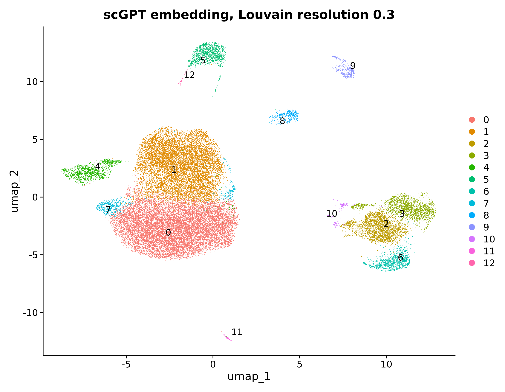

*The layout is Stage 04's UMAP of the same embedding; the colours are Stage 04's
clusters (see the note on the two runs below).*

**Notes.**
- **Which clustering is the arm.** Stage 04 and Stage 06 cluster the same embedding,
  byte for byte, with the same settings. Their partitions agree closely (ARI 0.979),
  but not exactly: Stage 04 splits a 344-cell group out of what Stage 06 keeps as one
  cluster, giving 13 clusters against 12. Stage 04 ran before this machine's linear
  algebra library was changed (OpenBLAS, 2026-08-18), which can move a
  nearest-neighbour graph slightly. The arm used throughout is Stage 06's `scgpt_raw`,
  the current run.
- **Vocabulary.** None of 65 canonical immune markers is dropped. The dropped genes
  are mostly clone-based loci, lncRNAs and renamed symbols. They are concentrated in
  histones and tRNA synthetases, so scGPT sees cell-cycle-defined clusters more
  weakly.
- **Gene sampling.** scGPT reads at most 1,200 genes per cell, sampled at random and
  unseeded. 83% of cells exceed that, so a re-embedding would differ slightly. How
  much has not been measured, so small differences between the arms should not be
  over-read.
- **Depth is handled; mitochondrial content is not.** scGPT bins each cell's values
  at that cell's own quantiles, which removes sequencing depth. It keeps a stressed
  cell's mitochondrial genes ranked high, whereas the authors' SCTransform regresses
  `percent.mt` on its variable genes.

**Code.** `02_CODE/04_scgpt_figure1d.py` (drives `.R`), `02_CODE/05_audit_scgpt_gene_coverage.py`,
`02_CODE/06_benchmark_representations.py` (drives `.R`; `scgpt_raw` arm).

---

## 3. RNA markers

**Question.** What does the RNA say each frozen cluster is?

**Answer.** Both partitions describe the same broad populations, and their marker
profiles line up cluster for cluster: T-cell subsets, NK, two monocyte populations
(classical, and macrophage-like), cDC2, plasmacytoid DC, and an XIST/long-transcript
cluster with no lineage marker. They differ at the small end. scGPT separates B cells
(215 cells) and cycling T cells (103) as clusters of their own. The authors' pipeline
has neither: its B cells appear to sit inside its plasmacytoid DC cluster (CD19 in 11%
of those cells).

**What was done.**
- **Freeze (Stage 12).** The authors' partition (`authors_pipeline_cluster`, 12
  clusters) and scGPT's (`scgpt_raw_cluster`, 12) were frozen and checksummed beside
  the two Harmony partitions, which were left exactly as they were.
- **Markers (Stage 13).** Marker discovery ran identically for every partition, on
  one LogNormalized RNA matrix, so only the labels differ. RNA was used rather than
  SCT because the per-patient SCT assays share only 9,013 of 19,689 genes, and the
  missing ones include rare-population markers. Wilcoxon test (presto), with the
  authors' thresholds.
- **Evidence (Stage 14).** The authors' marker panel was drawn on each arm's own UMAP:
  the authors' partition on Stage 03's integrated UMAP, scGPT's on Stage 04's UMAP of
  the uncorrected embedding. Alongside is a per-cluster evidence table: size,
  patients, top markers, and panel genes expressed.

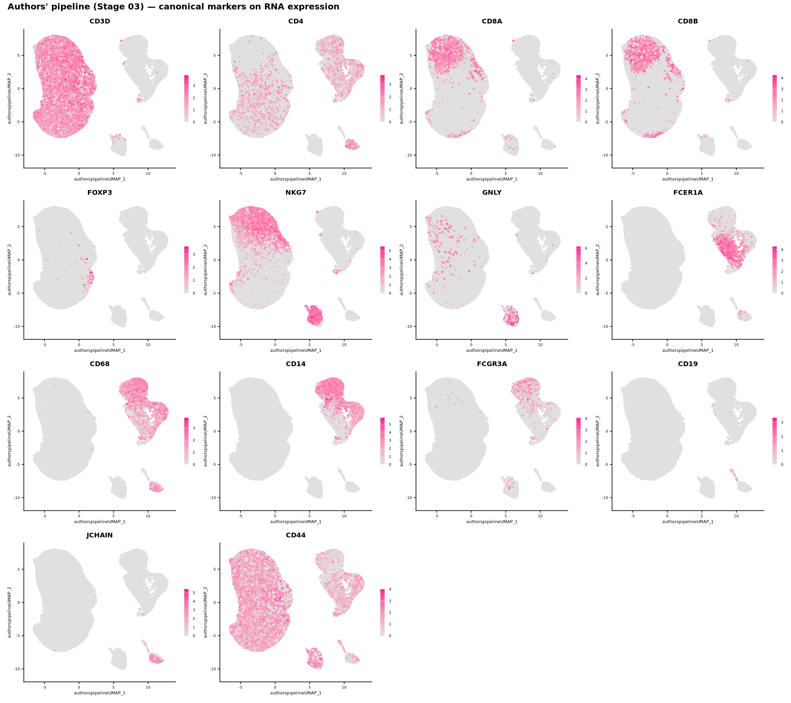

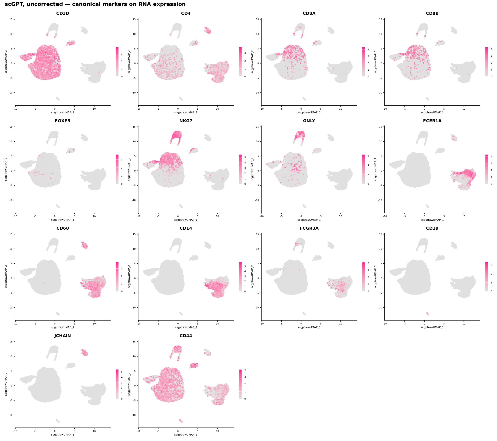

The evidence tables are in `Age_trajectory/results/14_marker_evidence/`. Single-gene
feature plots are in `Age_trajectory/results/figures/14_feature_plots/`.

**Code.** `02_CODE/12_freeze_cluster_labels.py`, `02_CODE/13_marker_discovery.py`,
`02_CODE/14_marker_evidence.py` (the last two drive `.R`).

---

## 4. Broad cell-type annotation

**Question.** Which broad cell type is each cluster, in each arm?

**Answer.** The two arms give the same broad cell types, within 500 cells for every
type except B cells. scGPT has a B-cell cluster and the authors' pipeline does not.

**What was done.** As the authors did, each cluster was assigned by hand to one of
their seven broad categories (T Cells, NK Cells, DC, Monocytes, B Cells, Plasma
Cells, Undetermined), from its evidence row and feature plots. Each arm was read from
its own plots, because cluster numbers mean nothing across arms. This is the authors'
first pass; their finer labels come from reclustering.

The annotation was read from the marker evidence alone. SingleR's labels were not
consulted, because Section 5 scores the annotation against them, and an annotation
that had seen them would be checking itself.

| identity | authors' pipeline (clusters) | scGPT raw (clusters) | difference |
| --- | --- | --- | --- |
| T Cells | 54,553 (0, 1, 2, 4, 8, 9) | 54,709 (0, 1, 4, 7, 11) | 156 |
| Monocytes | 7,124 (3, 7) | 7,359 (2, 6) | 235 |
| DC | 5,478 (5, 10) | 4,969 (3, 9) | 509 |
| NK Cells | 2,449 (6) | 2,336 (5) | 113 |
| B Cells | 0 | 215 (10) | 215 |
| Undetermined | 787 (11) | 803 (8) | 16 |

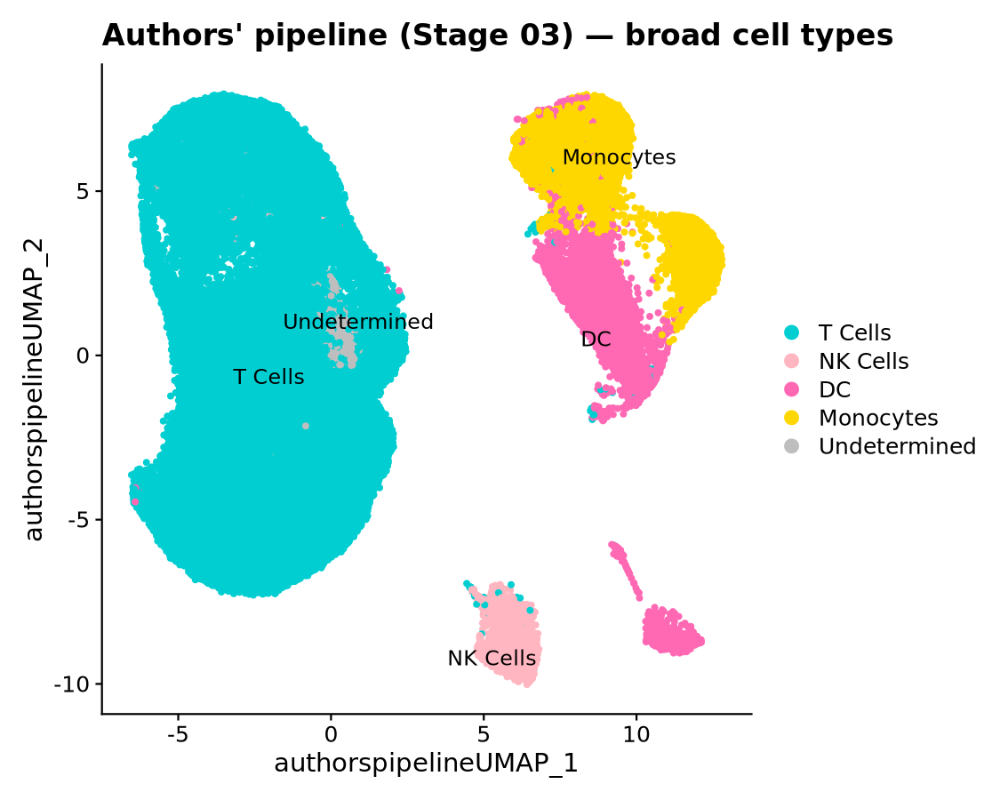

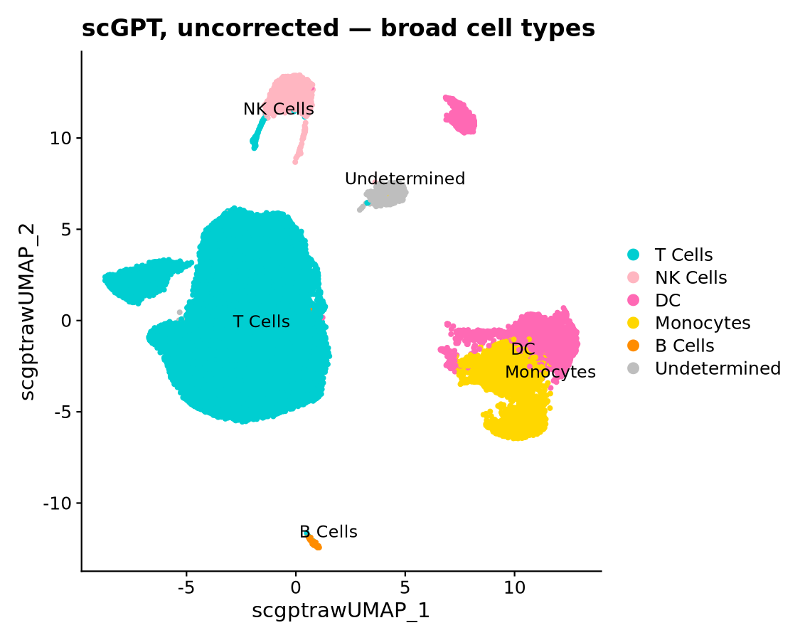

Five judgement calls:
- **Plasmacytoid DC goes under DC, not Plasma Cells** (authors' 10, 976 cells; scGPT
  9, 756). JCHAIN, the authors' plasma marker, is high in both. But the top markers
  are plasmacytoid DC genes (LRRC26, PTCRA, SCT, PTPRS, TCL1A), pDCs express JCHAIN
  too, and there's no plasma programme. Stage 16 also files pDCs under DC. The DC
  difference of 509 cells is mostly this cluster: the authors' version is larger
  because it also holds that arm's B cells.
- **No B Cells in the authors' arm.** Its B cells sit inside cluster 10, which stays
  DC. This is left visible as a real difference between the arms, not corrected.
- **Macrophage-like cells go under Monocytes** (authors' 3; scGPT 2). APOE, C1Q genes
  and LYVE1, with CD14 and CD68 high. The authors' categories have nothing closer.
- **The XIST/long-transcript cluster is Undetermined** (authors' 11; scGPT 8). No
  canonical marker above 50%, and spread across 54–57 patients, so it isn't one
  patient's cells.
- **scGPT 7 is T Cells, but one patient supplies 47% of it.** Its biology is clearly
  naive/central memory T (LEF1, IL7R, SELL). The concentration is what uncorrected
  scGPT leaves behind: part of one patient's cells kept together. Section 5 comes
  back to it.

scGPT's cluster 11 (103 cells) is cycling T cells (RRM2, UBE2C, BIRC5, TYMS; CD3D in
71%) and is filed under T Cells.

**How the two partitions correspond (Stage 19).** Matching totals don't show whether
the arms grouped the *same* cells. So the two frozen partitions were also
cross-tabulated, cell by cell, with no reference labels. The table shows where each
cluster of one arm lands in the other, in cells and as percentages in both
directions, plus a best match for every cluster. The cell-type labels are only there
to make the table readable.

Single summary scores (ARI, NMI between the arms) were tried and dropped. They add
nothing the table doesn't show, and they mislead here: both are dominated by the
largest groups, so the T-cell boundaries pulled ARI down to 0.40 while every other
population matched almost one to one.

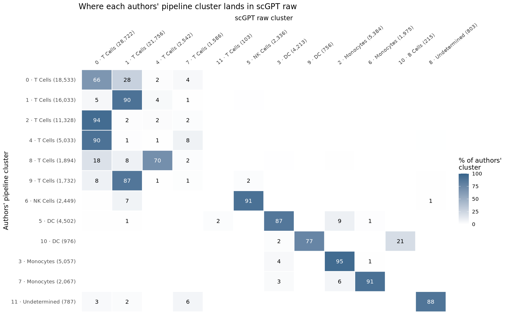

**Conclusions.**
- **Outside the T cells, the arms match almost one to one.**
  - NK: 91% of the authors' NK cluster is scGPT's NK cluster.
  - DC: 87% of the authors' cDC2 cluster matches.
  - Monocytes: 95% and 91% for the two monocyte clusters.
  - Undetermined: 88% for the XIST/long-transcript cluster.
- **The authors' plasmacytoid DC cluster is two scGPT clusters.** 77% is scGPT's pDC
  cluster and 21% is scGPT's B-cell cluster. 94% of scGPT's B cells come from it.
  This is the B-cell merge seen in Sections 3–5, now shown cell by cell.
- **scGPT's cycling cluster sits inside the authors' DC cluster.** 91 of scGPT's 103
  cycling cells are in the authors' cDC2 cluster 5. SingleR calls them T and NK cells
  (76 and 27), so the authors' pipeline folded a small cycling-lymphocyte group into
  its DCs. This accounts for some of the T and NK calls SingleR made inside that
  arm's DC group in Section 5.
- **The arms divide the T cells differently.**
  - The authors split T cells into six clusters; scGPT uses four main ones.
  - scGPT's largest cluster (28,722 cells) takes in nearly all of the authors'
    clusters 2 and 4 (94% and 90%) and two-thirds of cluster 0.
  - The authors' cluster 0 splits 66% / 28% between scGPT's two large T clusters.
  - Which division is right is a question for T-cell subclustering, not for this
    comparison.

**Code.** `02_CODE/15_annotate_clusters.R`, `02_CODE/19_arm_agreement.R`.

---

## 5. Biology vs. patient (SingleR)

**Question.** Does each arm's clustering follow cell type, or the patient a cell came
from? And does its annotation agree with independent labels?

**Answer.** Both arms follow cell type far more than patient. scGPT follows cell
type more closely (biology NMI 0.587 against 0.501). The authors' pipeline, which
corrects for patient, carries less patient identity (0.039 against 0.072). Both
hand annotations agree with SingleR for about 95% of cells, and for 99% once DC and
monocytes are merged.

**What was done.**
- **Independent labels (Stage 16).** SingleR labelled every cell against purified
  immune profiles (`celldex::MonacoImmuneData`, main labels, 18,817 shared genes). The
  labels come from expression alone and belong to neither arm. 530 cells (0.75%)
  stayed unassigned and are excluded from every biology comparison.
- **Scoring (Stage 17), for the two arms.**
  - Cluster agreement with SingleR (biology NMI), beside agreement with patient
    (patient NMI). Biology NMI is also computed with DC and Monocytes merged into
    Myeloid, the boundary SingleR is least sure of.
  - The hand annotation against SingleR, cell by cell, per cell type, with a
    confusion table.
  - For cells where the annotation and SingleR disagree on Monocyte against DC, the
    marker check. Four groups are compared on the share of cells expressing CD14,
    VCAN, S100A8, FCGR3A, FCER1A, CD1C, CLEC10A and LILRA4: the two kinds of
    disagreement, and the cells both sides call Monocytes or both call DC.
  - Checks before anything is scored: the RNA matrix must reproduce Stage 13's
    fingerprint; scGPT's frozen partition must equal Stage 06's `scgpt_raw` cell for
    cell; and its patient NMI must equal Stage 06's. The authors' partition comes
    from Stage 03 and has no earlier value to check against.
  - Cells in an Undetermined cluster have no annotation to agree or disagree with.
    They are left out of the agreement figures and shown as their own row in the
    confusion table.

SingleR's broad calls: T cells 78.9%, DC 10.1%, monocytes 6.7%, NK 3.2%, B 0.3%.

**Reading patient NMI here.** The authors' pipeline removed patient differences on
purpose, by anchor integration; scGPT had no correction. A lower patient NMI for the
authors' arm is the expected result. What is informative is how far scGPT gets
without any correction, and whether its biology NMI holds up beside the corrected
pipeline.

| arm | clusters | patient NMI | biology NMI | biology NMI, myeloid merged |
| --- | --- | --- | --- | --- |
| Authors' pipeline | 12 | **0.039** | 0.501 | 0.507 |
| scGPT raw | 12 | 0.072 | **0.587** | **0.597** |

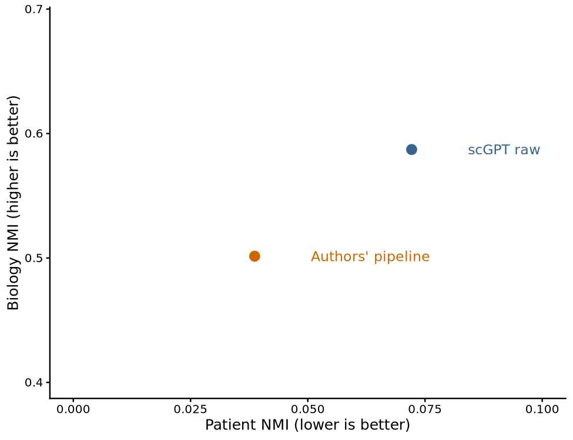

| hand annotation vs. SingleR | authors' pipeline | scGPT raw |
| --- | --- | --- |
| agreement, monocyte and DC apart | 95.3% | 95.8% |
| agreement, myeloid merged | 98.9% | 99.7% |
| T cells | 99.8% | 99.9% |
| NK cells | 87.9% | 93.5% |
| DC | 91.2% | 98.1% |
| monocytes | 65.6% | 63.8% |
| myeloid (merged) | 97.0% | 99.8% |
| B cells | *no cluster* | 96.7% |

Agreement is measured on the cells SingleR assigned, leaving out each arm's
Undetermined cluster (786 and 802 cells). Counting those as disagreements gives
94.2% and 94.7%.

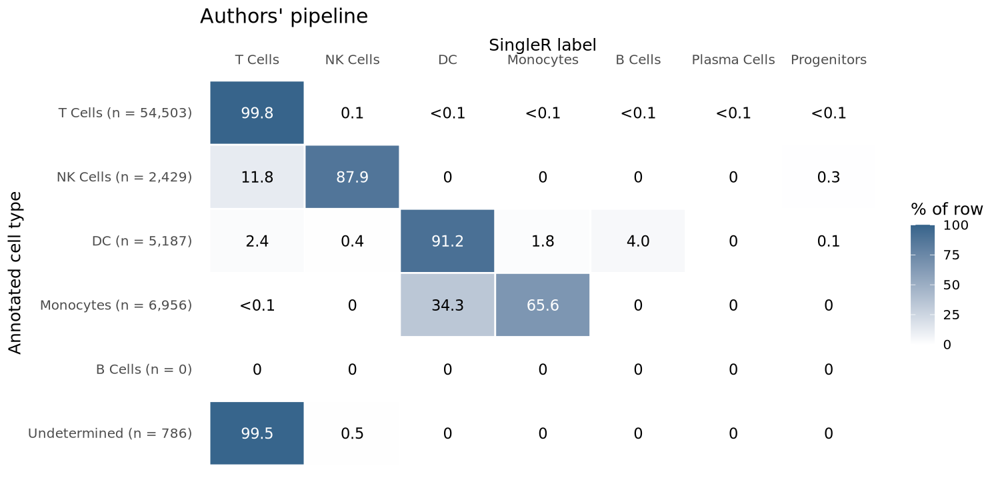

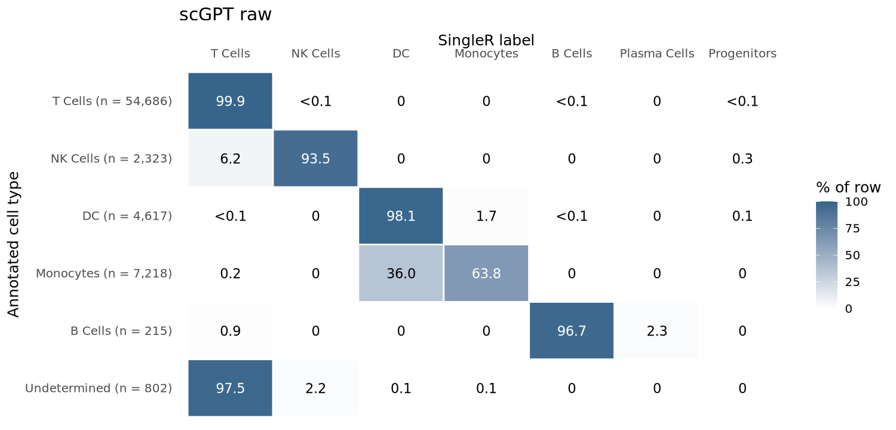

**Where the disagreement sits.** Each figure shows the arm's own UMAP three times:
coloured by SingleR, by the hand annotation, and with only the disagreeing cells
coloured, by kind (annotation → SingleR).

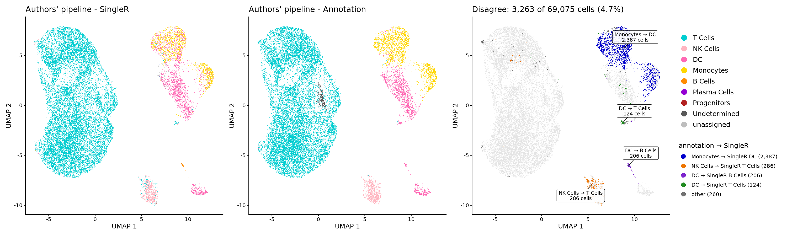

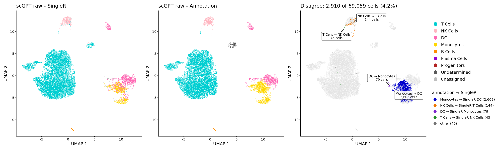

| kind of disagreement | authors' pipeline | scGPT raw |
| --- | --- | --- |
| Monocytes → SingleR DC | 2,387 | 2,602 |
| NK Cells → SingleR T Cells | 286 | 144 |
| DC → SingleR B Cells | 206 | 1 |
| DC → SingleR T Cells | 124 | 1 |
| DC → SingleR Monocytes | 95 | 79 |
| T Cells → SingleR NK Cells | 73 | 45 |
| everything else | 92 | 38 |
| **total** | **3,263 (4.7%)** | **2,910 (4.2%)** |

- **Most of it is one place in both arms: the monocyte clusters.** About 2,400–2,600
  cells there are called DC by SingleR.
  - In the macrophage-like cluster, that's 37% of the cells (authors' cluster 3) and
    40% (scGPT cluster 2).
  - In the classical monocyte cluster, it's 24% and 22%.
  - The disputed cells are spread through both clusters, not gathered in one corner
    of either. So no different cut would have avoided them; they are an
    intermediate population that both arms keep with the monocytes.
- **NK/T is the second boundary, twice as large in the authors' arm.** The disputed
  cells are 286 (12% of the authors' NK cluster) against 144 (6% of scGPT's). They
  sit at the edge of the NK island facing the T cells.
- **Two disagreements are specific to the authors' arm, and both are its DC
  clusters holding other cell types.**
  - 203 B cells in its plasmacytoid DC cluster: the tip of that island, where scGPT
    has a B-cell cluster of its own.
  - 123 T cells (the cycling cells of Section 4) in a small group at the bottom of
    its cDC2 cluster.
  - scGPT has essentially neither: 1 and 1 cell.

**Monocyte/DC disagreements**, percent of cells expressing each marker:

| group | cells (authors' / scGPT) | CD14 | FCER1A | CD1C | CLEC10A | SingleR confidence |
| --- | --- | --- | --- | --- | --- | --- |
| both call Monocytes | 4,565 / 4,605 | 97 | 7 | 5 | 39 | 0.060 |
| **annotation Monocytes, SingleR DC** | 2,387 / 2,602 | 96–97 | 46–49 | 22–26 | 66–68 | **0.040–0.042** |
| both call DC | 4,733 / 4,530 | 36–38 | 88 | 76 | 78 | 0.078 |

*SingleR confidence is the median gap between a cell's best and second-best main
label; smaller means less sure.*

**Conclusions.**
- **Biology dominates in both arms.** Biology NMI is 0.50–0.60, against patient NMI
  of 0.07 or less, even for scGPT with no correction at all.
- **scGPT follows cell type more closely.** Its biology NMI is higher at both
  resolutions (0.587 against 0.501; 0.597 against 0.507 with myeloid merged).
- **The authors' pipeline carries less patient identity, as designed.** Its patient
  NMI is about half of scGPT's (0.039 against 0.072). This is the anchor integration
  doing its job, not a weakness of scGPT's description. scGPT's remaining patient
  signal is visible in its cluster 7, where one patient supplies 47% of the cells.
- **The annotations agree with SingleR equally well overall** (95.3% against 95.8%).
  scGPT is ahead on NK cells (93.5% against 87.9%) and DCs (98.1% against 91.2%).
  - The authors' DC shortfall is mostly B cells. SingleR calls 206 cells in its DC
    group B cells (4.0%), the B cells that sit inside its plasmacytoid DC cluster.
    scGPT gives them their own cluster, which SingleR confirms (96.7%).
  - The authors' NK shortfall is T cells. SingleR calls 11.8% of its NK cluster T
    cells, against 6.2% for scGPT.
- **The one large disagreement is shared, and is the same population in both arms.**
  About 2,400–2,600 cells hand-annotated as monocytes are called DCs by SingleR.
  - They are CD14-positive like monocytes (96–97%), but express FCER1A and CD1C at
    about half the DC level.
  - SingleR is least confident about exactly these cells.
  - Neither label fits cleanly. The blood-derived reference has no CSF macrophage
    profile, which fits the macrophage-like cluster in Section 4. Monocyte
    subclustering is where this gets settled.
- **Undetermined cells are T cells by reference** (99.5% and 97.5%).

The earlier four-arm run of this stage, with the Harmony arms, is kept in
`Age_trajectory/results/17_biology_vs_donor_harmony_record/`.

**Code.** `02_CODE/16_singler_reference_labels.py`, `02_CODE/17_cluster_structure_vs_singler.py`
(drives `.R`).

---

## 6. Supplementary: how cleanly each space separates the reference cell types

**Question.** Without any clustering in between, how well does each space keep
SingleR's cell types apart?

**Answer.** The scGPT space keeps the reference cell types apart; the authors' PCA
space does not.
- **scGPT space.** SingleR's cell types score 0.243 (0.289 with myeloid merged),
  higher even than scGPT's own clusters (0.198). Under 5% of cells sit closer to
  another cell type than to their own.
- **Authors' PCA space.** The same cell types score −0.078, and 72% of cells sit
  closer to another cell type than to their own. Its own clusters score 0.203.

**What was done.** SingleR's broad labels were scored with silhouette width in the
authors' integrated PCA space (PCs 1–15) and in the uncorrected scGPT space (all 512
dimensions). The scoring also runs with DC and Monocytes merged. The method is
Section A's: 12,000 cells per draw, balanced so small groups count, five draws, on
the 69,861 cells SingleR assigned.

**How to read it.** The two SingleR scores cannot be compared with each other:
silhouette is built from distances, and distances in 15 variance-ordered components
and in 512 learned dimensions are different quantities. So each space also scores
both arms' own cluster partitions, on the same cells. Within one space every row is
comparable. The readings that mean something are how SingleR's cell types score
against that space's own clusters, and which arm's clusters score higher in each
space.

| labels scored | in authors' PCA (15) | in scGPT raw (512) |
| --- | --- | --- |
| SingleR cell types | −0.078 (72% below 0) | **0.243** (5% below 0) |
| SingleR, myeloid merged | −0.092 (79%) | **0.289** (2%) |
| authors' pipeline clusters | **0.203** (15%) | 0.071 (30%) |
| scGPT raw clusters | 0.126 (24%) | 0.198 (8%) |

*Mean silhouette over five draws; the share of cells scoring below 0 in brackets.
Compare down a column only.*

| SingleR cell type (cells) | in authors' PCA | in scGPT raw |
| --- | --- | --- |
| T Cells (55,575) | −0.112 | 0.275 |
| DC (7,133) | −0.117 | 0.046 |
| Monocytes (4,685) | 0.159 | 0.124 |
| NK Cells (2,234) | 0.363 | 0.305 |
| B Cells (212) | 0.410 | 0.455 |
| Myeloid, merged (11,818) | −0.059 | 0.217 |

**Conclusions.**
- **Each space favours its own clusters**, as Stage 07 found for the Harmony arms:
  the authors' clusters score best in PCA space, scGPT's in scGPT space.
- **Only the scGPT space also favours the reference cell types.** There, SingleR's
  labels score above scGPT's own clusters. In the authors' space they score below
  zero, far under both arms' clusters.
- **The difference is in the large compartments.** T cells (−0.11 against 0.27) and
  DCs (−0.12 against 0.05) are negative in the authors' space. The small, distinct
  types (NK, B, monocytes) separate about equally well in both.
- **What a negative T-cell score means.** In the authors' 15 PCs, the T-cell
  compartment is spread into well-separated subsets (its six T clusters, Section 4).
  The spread is wide enough that a typical T cell is nearer to some other cell type
  than to the average T cell. scGPT holds the T cells together as one compartment.
  So this is not evidence that the authors' space mixes cell types. It shows that
  the space devotes most of its 15 dimensions to differences *within* the T cells,
  which is what their reclustering step builds on.
- **The scores are less stable in the authors' space** (sd across draws 0.040,
  against 0.019 for scGPT), because a broad label spread over several separated
  subsets depends more on which cells are drawn.

**Code.** `02_CODE/18_singler_silhouette.R`. All 40 silhouettes (four labellings, two
spaces, five draws) run in parallel on every core; the draws are fixed first, so the
result is identical to a sequential run.

---

## 7. Subclustering the T cells and monocytes

**Question.** Recluster each arm's T cells and monocytes, as the authors did for
Figure 1D. Do the arms find the same subtypes?

**Answer.** Partly. This is the first place the authors' pipeline clearly does better.
- **Monocytes: the arms largely agree** (78% of shared cells get the same label), and
  the subclusters match on the same marker programmes.
- **T cells: the arms agree on 67% of shared cells.** Where they disagree, the raw
  counts side with the authors' arm almost every time. scGPT finds no regulatory T
  cells, and its CD8+ group is much less pure (CD8A in 58% of cells, against 88%).
- **scGPT's subclusters are far more patient-driven.** Patient NMI is 0.110 against
  0.012 for T cells, and 0.106 against 0.039 for monocytes. Within a lineage, where
  the cell types are closer together, the patient effect that anchor integration
  removes matters much more than it did at the broad level.

**What was done (Stage 20).** The authors' second pass (their lines 211–275), applied
to each arm's own Stage 15 T Cells and Monocytes:
- **Authors' pipeline: their recipe exactly.**
  - Subset the integrated object.
  - On the integrated assay, re-find variable features and re-run PCA.
  - Neighbours on PCs 1–15, Louvain at 0.3, UMAP with 30 neighbours.
  - No `ScaleData` step, because they made none.
- **scGPT raw: the same cells, reclustered on the 512-dimension embedding,** with the
  same neighbour, Louvain and UMAP settings. This is the one departure, and it is
  forced: an embedding has no assay to re-find variable features or re-run PCA on.
  It is how Stage 06 clustered the full set.
- **Evidence per subcluster.**
  - Size, patients, and top markers, from the same shared RNA matrix and Wilcoxon
    test as Stage 13.
  - The authors' reclustering panel (CD3D, CD4, CD8A, CD8B, FOXP3, CD14, FCGR3A,
    CD68): the share of cells with a raw count above zero, and mean expression.
    Mean expression is kept because the authors' monocyte labels are levels (CD68
    hi, mid, lo), not presence.
  - Within T cells, CD4 becomes usable. On the full dataset it can't serve as a
    T-cell marker, because 68–88% of myeloid cells express it here.
- **Labels by hand, then comparison.** Subclusters are labelled by hand into the
  authors' Figure 1D categories: CD4+, CD8+, CD4+/CD8+ and regulatory T cells, and
  CD14+/CD16− CD68lo, CD14+/CD16+ CD68mid and CD14+/CD16+ CD68hi monocytes. The arms
  are then compared three ways:
  - cross-tabulation of the subtype labels on the cells both arms put in the lineage
  - marker purity from raw counts, to say which arm is right where they disagree
  - patient NMI

**Why not SingleR here.** SingleR's T-cell subtype calls are near-ties.
- **Low confidence.** Its confidence gap between the best and runner-up label has a
  median of 0.006 for T cells, against 0.077 for every other cell type.
- **Implausible calls.** It calls 13.5% of T cells Vδ2 γδ T cells, which is
  implausibly many for CSF.
- **No matching category.** It has none for the authors' CD4+/CD8+ group.

So the subtypes are judged on the authors' markers and on the cross-tabulation.

**Labels (Stage 21).** Read from Stage 20's evidence and approved before scoring:

| subtype | authors' pipeline | scGPT raw |
| --- | --- | --- |
| CD4+ T Cells | 31,947 (subclusters 0, 1, 5) | 31,946 (1, 2, 4) |
| CD8+ T Cells | 11,173 (2) | 20,173 (0) |
| CD4+/CD8+ T Cells | 6,059 (3) | 2,590 (3, 5) |
| T Regulatory Cells | 5,374 (4) | **0** |
| CD14+/CD16−/CD68lo Monocytes | 2,092 (0) | 1,998 (1) |
| CD14+/CD16+/CD68mid Monocytes | 2,443 (2, 3) | 2,034 (2, 5) |
| CD14+/CD16+/CD68hi Monocytes | 2,589 (1, 4) | 3,164 (0, 3) |
| Undetermined | — | 163 (4) |

The judgement calls:
- **Authors' T 4 is Treg.** FOXP3 is only 17%, but every other subcluster is at 2%
  or less, and FOXP3 is captured poorly. Naive genes (LEF1, SELL, CCR7) beside TIGIT
  and ICOS suggest Tregs mixed with naive CD4 cells.
- **scGPT has no Treg subcluster.** None is above 5% FOXP3. This is left visible as
  a real difference, as the missing B cells were at the broad level.
- **"CD4+/CD8+" is the authors' category for mixed clusters.** For the authors' arm
  that is cluster 3: cytotoxic and HLA-DR+, CD8A 37%, CD4 16%. For scGPT it is
  cluster 3 (LTB, ribosomal genes) and the 101 cycling cells.
- **scGPT T 2 is CD4+, with a caveat.** It carries an immediate-early signature
  (CD69, JUN, NFKBIA) that may be dissociation stress.
- **scGPT T 4 is CD4+ (naive), with a caveat.** One patient supplies 42% of it.
- **Both arms' C1Q/APOE/TREM2 macrophage-like cluster is CD68hi.** That rests on its
  macrophage programme as much as its CD68 level.
- **scGPT monocyte 4 is Undetermined.** 85% of its cells express CD3D alongside
  T-cell and monocyte genes, and 53% come from one patient. These look like
  T-cell/monocyte doublets or complexes.

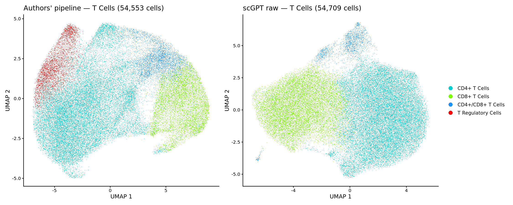

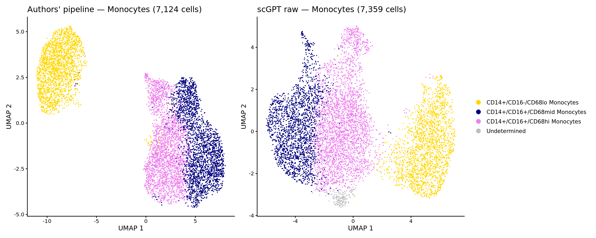

**Figure 1D.** The subtype labels written back onto the full dataset, beside the
broad labels for everything else, in the authors' colours:

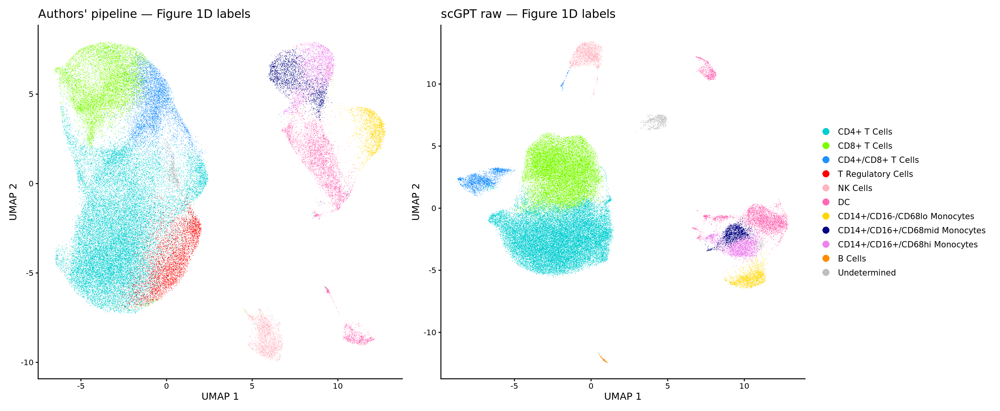

**Comparison.**

| | T cells | monocytes |
| --- | --- | --- |
| cells in the lineage in both arms | 54,267 | 6,847 |
| same subtype label | **67.0%** | **78.0%** |
| same label if Treg is merged into CD4+ | 76.7% | — |
| patient NMI, authors' subclusters | **0.012** | **0.039** |
| patient NMI, scGPT subclusters | 0.110 | 0.106 |

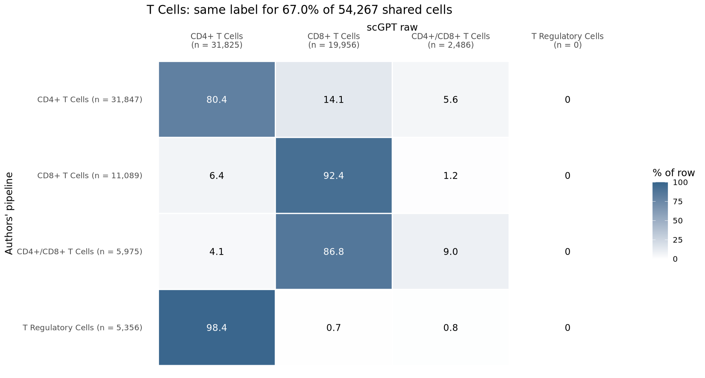

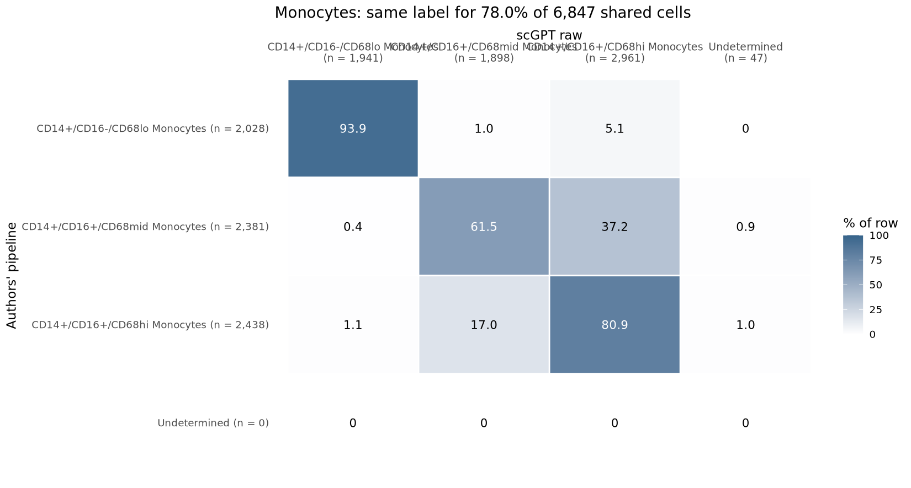

**Where the arms disagree on T cells**, percent of cells expressing each marker
(raw count above 0). The agreed CD8+ cells are the reference for CD8A, the agreed
CD4+ cells for FOXP3.

| authors' label → scGPT label | cells | CD4 | CD8A | CD8B | FOXP3 | the markers side with |
| --- | --- | --- | --- | --- | --- | --- |
| *CD8+ → CD8+ (agreed)* | *10,244* | *1* | *89* | *85* | *1* | |
| *CD4+ → CD4+ (agreed)* | *25,592* | *41* | *4* | *4* | *2* | |
| Treg → CD4+ | 5,272 | 39 | 3 | 4 | **17** | authors (FOXP3-enriched) |
| CD4+/CD8+ → CD8+ | 5,189 | 17 | 39 | 33 | 0 | authors (mixed, not CD8) |
| CD4+ → CD8+ | 4,484 | 33 | 13 | 9 | 1 | authors (CD4-like) |
| CD4+ → CD4+/CD8+ | 1,771 | 18 | 3 | 4 | 2 | authors (CD4-leaning) |
| CD8+ → CD4+ | 714 | 2 | 88 | 91 | 3 | authors (CD8) |

**Conclusions.**
- **The T-cell disagreements resolve in the authors' favour.**
  - scGPT's CD8+ group takes in 4,484 cells that are CD4-like on the raw counts,
    and 5,189 mixed cells that the authors kept apart.
  - That is why its CD8A purity is 58%, against 88% for the authors' CD8+ group.
  - Every large disagreement row matches the authors' label on the markers.
- **scGPT can't find the regulatory T cells.** The authors' Treg subcluster is
  genuinely FOXP3-enriched (17%, against 2% in the CD4+ cells both arms agree on),
  and scGPT folds 98% of it into CD4+.
- **The monocyte disagreements are mostly a boundary of degree.** 1,300 of the 1,506
  disagreeing cells sit on the CD68mid/CD68hi line, a level rather than a
  population.
  - The 886 cells the authors call mid and scGPT calls hi have a mean CD68 (1.78)
    between the agreed mid (1.68) and agreed hi (1.89) cells.
  - The 414 the authors call hi and scGPT calls mid have hi-level CD68 (1.89).
  - The classical CD68lo population agrees almost completely.
- **scGPT catches one thing the authors' arm misses.** The 47 shared cells it marks
  Undetermined express CD3D in 64–80% of cells. These are T-cell/monocyte doublets,
  which the authors' arm keeps inside its CD68 groups.
- **scGPT's subclusters carry much more patient identity.**
  - At the broad level its patient NMI was about twice the authors' (0.072 against
    0.039). Within the T cells it is nine times higher (0.110 against 0.012).
  - Without batch correction, patient differences are large next to the small
    differences between T-cell subtypes, so they shape scGPT's subclusters.
  - Its naive CD4 subcluster, 42% from one patient, is one example.
  - This is the cost of skipping correction, and it shows up exactly where the
    biology is finest.

**Code.** `02_CODE/20_subcluster_lineages.R` (one run per arm; the two run in
parallel), then `02_CODE/21_subtype_labels_and_comparison.R`.

---

# Where the Project Stands

**Done.**
- The authors' steps 2–7 are reproduced (Section 1).
- A frozen, out-of-the-box scGPT arm (Section 2).
- Markers for both arms on one shared RNA matrix (Section 3).
- Broad annotation of both partitions, approved (Section 4).
- Independent SingleR labels for every cell, and the two-arm comparison against
  them (Section 5).
- The cell-by-cell correspondence between the two partitions (Section 4).
- The supplementary silhouette of SingleR labels (Section 6).
- The authors' step 8, in both arms: T cells and monocytes reclustered, labelled,
  compared, and written back onto the full UMAP as Figure 1D (Section 7).

**Not yet done.** Link the Section 7 outputs from
[09_T_CELL_SUBCLUSTERS](../03_RESULTS/09_T_CELL_SUBCLUSTERS/) and
[10_MONOCYTE_SUBCLUSTERS](../03_RESULTS/10_MONOCYTE_SUBCLUSTERS/).

**Out of scope.**
- **Aging and cognitive impairment.** Age and diagnosis are constant within a patient,
  so the authors' anchor integration removes part of that signal along with the
  patient effect.
- **Re-running the authors' preprocessing.** The public matrix is already its output.
- **New model development**, such as fine-tuning scGPT.

---

# Appendix A. The earlier Harmony comparison

This was the project's first design, and it is no longer the main analysis. Its code
and outputs are kept for the record (Stages 06–11 and 15; `03_RESULTS/03_BATCH_CORRECTION`
to `07_CELL_TYPE_ANNOTATION`). Nothing in Sections 1–6 depends on it.

**What it asked.** Which representation organizes cells better once both are given
the same patient correction? Anchor integration can't be applied to scGPT, so neither
arm used it. Instead, PCA on per-patient SCT residuals (merged, no anchors) and the
scGPT embedding were each corrected with Harmony by patient, then clustered, scored
and annotated the same way.

**Why it was set aside.**
- **Its PCA arm was not the authors' pipeline.** It was a reconstruction without
  their integration step. So it couldn't answer the question that matters for
  someone choosing a method: does scGPT match what was actually published?
- **Equal correction proved hard to define.** Per-patient SCT residuals are centred
  within each patient, so the PCA arm carried a partial patient adjustment before
  Harmony ran, and scGPT had no such step. A "no Harmony" PCA arm was therefore never
  truly uncorrected.
- **Harmony is not out of the box.** Adding it to scGPT tests scGPT plus a
  batch-correction method, not the foundation model as shipped.

**What it found**, for the record:

| arm | clusters | smallest | donor mixing | patient NMI | biology NMI |
| --- | --- | --- | --- | --- | --- |
| PCA, normalized per patient, no Harmony | 10 | 206 | 0.883 | 0.049 | 0.566 |
| `pca_harmony` (15 PCs) | 12 | 217 | 0.969 | 0.038 | 0.540 |
| `scgpt_harmony` (512 dims) | 11 | 105 | 0.866 | 0.051 | 0.605 |

- **Silhouette (Stage 07).** Each partition scored best in its own space (PCA 0.176
  in PCA space; scGPT 0.220 in scGPT space). The pattern held with PCA extended to 512
  dimensions (Stages 10–11), which also cut PCA to 8 clusters.
- **WCSS sweep (Stage 08).** A supporting elbow analysis across resolutions.
- **Annotation (Stage 15).** Both Harmony arms gave the same broad cell types, within
  119 cells for every type. The annotation agreed with SingleR for 96% of cells, and
  for 99%+ with DC and monocytes merged. Almost all disagreement was about 2,500
  CD14-positive cells that also express FCER1A and CD1C at about half the DC level.

The superseded SCT-`data`-layer outputs from before that arm was rebuilt are in
`Age_trajectory/results_superseded_2026-11-22/`.

## References

- Piehl N, et al. *Cerebrospinal fluid immune dysregulation during healthy brain aging and cognitive impairment.* Cell. 2022. DOI: 10.1016/j.cell.2022.11.019.
- Dataset: GEO accession **GSE200164**.
- Author code: `gatelabNW/csf_aging` (copies in [`05_REFERENCES/`](../05_REFERENCES/)).
- Full technical and audit record: [`ARCHIVE/FULL_ANALYSIS_LOG.md`](../ARCHIVE/FULL_ANALYSIS_LOG.md).
