# Project in 60 Seconds

**Dataset.** GSE200164 (Piehl et al. 2022, *Cell*): 70,391 CSF immune cells from 59
individuals.

**Comparison.** Two ways to represent a cell: PCA on SCTransformed expression, and a
frozen, zero-shot scGPT embedding.

**Main question.** Which representation organizes cells into cleaner,
donor-independent cell populations, and do those populations correspond to real
immune cell types?

**Analysis sequence.**

```text
Published workflow reproduction        (Stages 01–03)
  → PCA vs scGPT representations       (Stage 04–05)
  → Harmony donor correction           (Stage 06, 09)
  → silhouette comparison              (Stage 07)
  → PCA-512 dimensionality control     (Stages 10–11)
  → WCSS/elbow supporting analysis     (Stage 08)
  → RNA marker validation              (Stages 12–14)
  → broad cell-type annotation         (Stage 15)
  → NEXT: T-cell and monocyte subclustering
```

**Main result so far.** scGPT gives much better geometric cluster separation, and the
advantage survives a 512-vs-512 dimensionality control. After Harmony both arms carry
the same donor NMI, but PCA mixes donors better locally. Both arms recover nearly
identical broad immune populations.

**What remains unknown.** Whether scGPT's cleaner geometry means better biology at
finer resolution: T-cell and monocyte subtypes.

**Immediate next step.** Recluster the T cells, then the monocytes, in both arms, and
compare the subtype annotations.

Code lives in [`02_CODE/`](../02_CODE/). Results are organized by question in
[`03_RESULTS/`](../03_RESULTS/README.md). The full technical and audit record this
document was condensed from is [`ARCHIVE/FULL_ANALYSIS_LOG.md`](../ARCHIVE/FULL_ANALYSIS_LOG.md).

---

# The Analysis

## 1. Dataset and published workflow reproduction

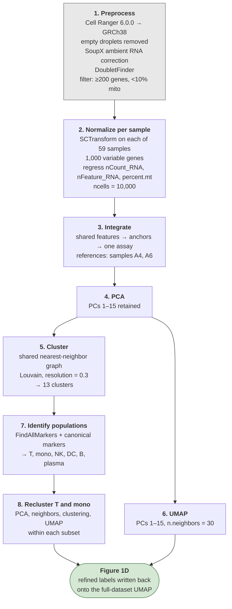

*Above: the authors' workflow. Step 1 was already applied to the public GEO matrix, so
this project starts at step 2.*

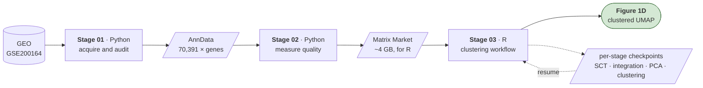

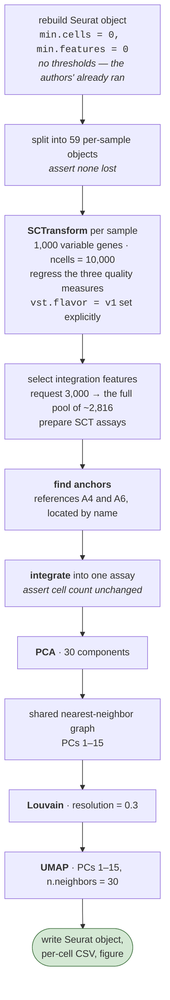

### What I did

- **Download and audit (Stage 01).** Downloaded the GEO matrix and verified that the
  sparse conversion preserved every value exactly. The values are SoupX-corrected and
  fractional, and they are never rounded.
- **Quality measures, no filtering (Stage 02).** Computed the three quality measures
  but removed no cells. The matrix is already the authors' QC-filtered output.
- **Clustering (Stage 03).** Reran the authors' steps 2–6 with their parameters:
  SCTransform v1 per sample, anchor integration, PCs 1–15, Louvain at 0.3.

One deliberate departure: I requested the *full* ~2,816-gene pool of integration
features rather than 2,000. Only ~2,816 genes are shared by all 59 samples here, and
cutting to 2,000 discarded the rare-population markers and lost the small clusters.

**Code.** `02_CODE/01_download_audit_build_anndata.py`, `02_CODE/02_prepare_figure1d.py`,
`02_CODE/03_reproduce_figure1d.py` (drives `03_reproduce_figure1d.R`).

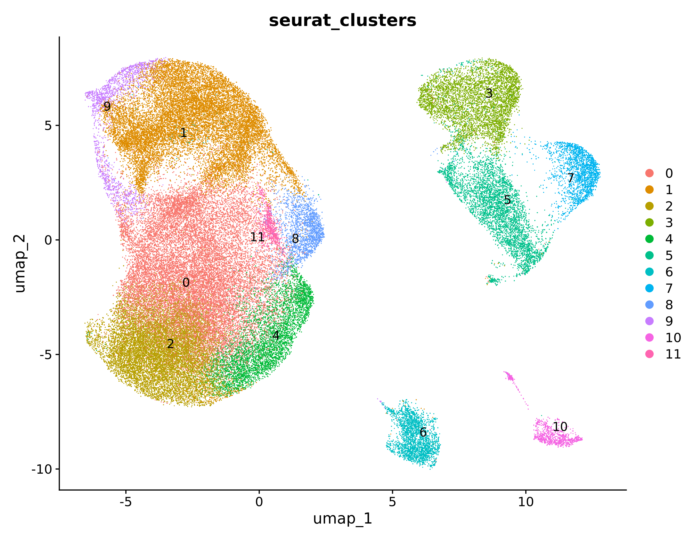

Result: 12 clusters over all 70,391 cells, ranging from 18,533 cells down to 787. The
paper reports 13.

### Conclusion

The published clustering workflow reproduces from the public data, with the rare
populations retained. The one-cluster difference is not chased by tuning resolution,
because cluster count is a diagnostic here, not a target.

The authors' marker panel, used later in section 7:

```text
CD3D, CD4, CD8A, CD8B, FOXP3    T cells and regulatory T cells
NKG7, GNLY                      NK cells
FCER1A                          dendritic cells
CD68, CD14, FCGR3A              monocytes
CD19, JCHAIN                    B cells and plasma cells
```

Figure 1D's final labels (CD4+, CD8+, CD4+/CD8+ and Treg T cells; classical,
intermediate and non-classical monocytes) come from step 8, the reclustering, which
has not been done yet.

---

## 2. scGPT representation

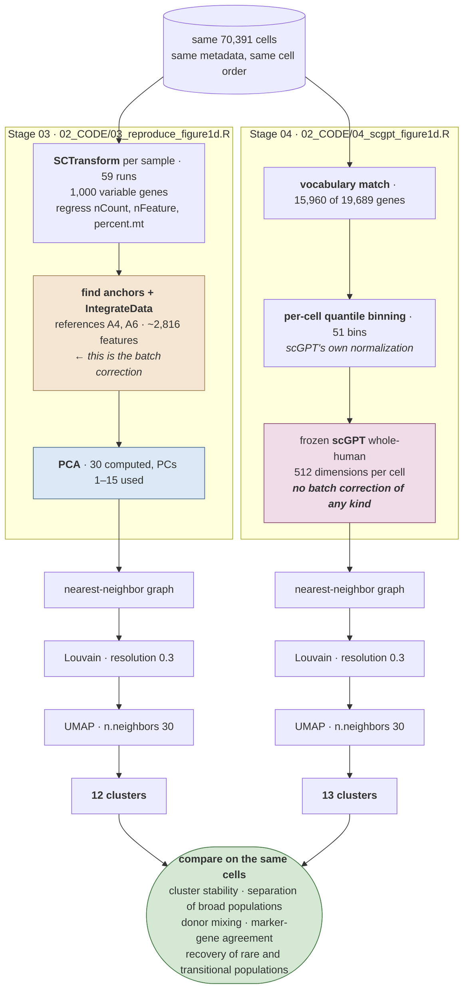

### What I did

- **Embedding.** Each cell was embedded with the frozen whole-human scGPT model: 512
  dimensions, no fine-tuning, no batch correction.
- **Downstream.** The same Seurat code and settings as the PCA arm then ran on the
  embedding. Only the representation differs. All 512 dimensions are used, because an
  embedding has no variance ordering to truncate by.
- **Gene coverage (Stage 05).** I checked what scGPT's gene vocabulary drops.

**Code.** `02_CODE/04_scgpt_figure1d.py` (drives `.R`), `02_CODE/05_audit_scgpt_gene_coverage.py`.

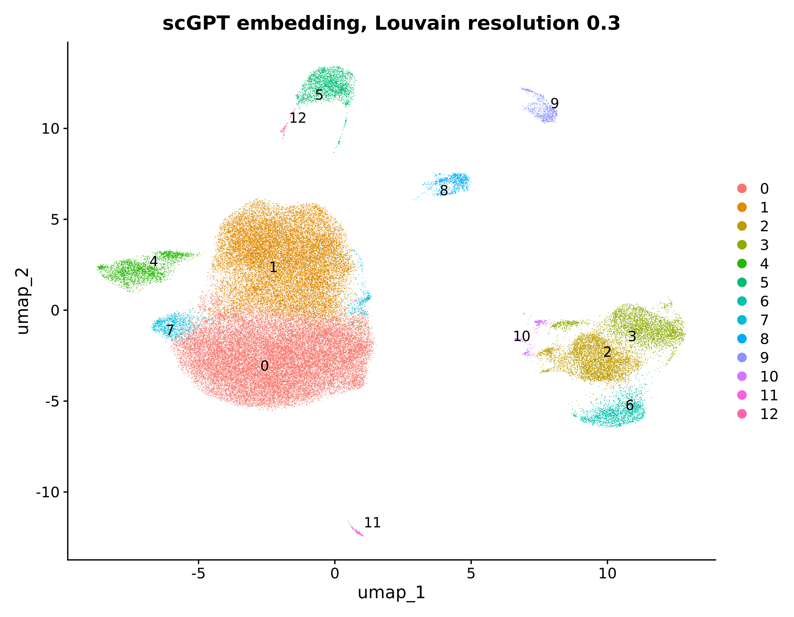

Result: 13 clusters, splitting finer at the small end. Five clusters are under 1,000
cells (the smallest is 103), against two in the PCA arm.

| | genes | share of total expression |
| --- | --- | --- |
| kept | 15,960 (81.1%) | **98.862%** |
| dropped | 3,729 (18.9%) | **1.138%** |

### Conclusion

The vocabulary gap does not matter for this comparison. It is 1.1% of expression, and
none of 65 canonical immune markers is lost. The dropped genes are mostly clone-based
loci, lncRNAs and renamed symbols.

One caveat to remember: the loss is concentrated in histones and tRNA synthetases, so
any cell-cycle-defined cluster is seen more weakly by scGPT. Also, the scGPT arm is
uncorrected while the PCA arm is anchor-corrected, so the two aren't yet comparable.

---

## 3. Making PCA and scGPT comparable: Harmony

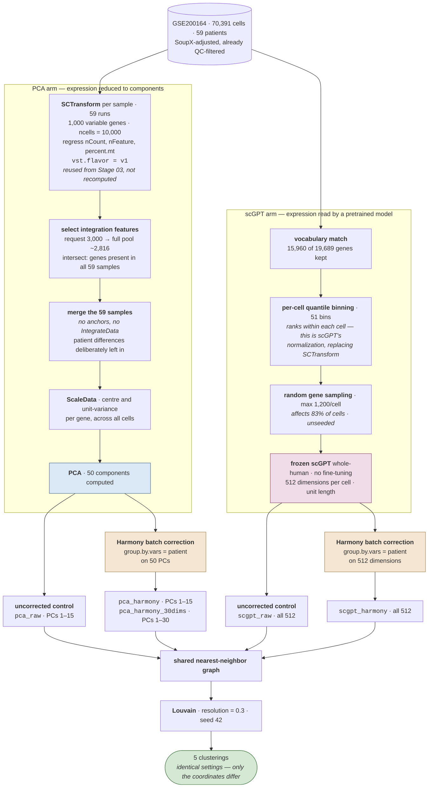

### What I did

- **Why this was needed.** Stage 03 was corrected with anchors and Stage 04 not at
  all, so a difference between them could be donor structure rather than
  representation.
- **Rebuilding the PCA arm.** I rebuilt PCA without anchors (the same SCT
  normalizations, merged; this is *not* Stage 03's PCA). Reusing Stage 03's PCA would
  have corrected it twice.
- **Correcting both arms.** I applied Harmony by patient to both representations
  equally. Five arms were then clustered identically: each representation raw and
  corrected, plus PCA at 30 dims.
- **What was measured.** Donor NMI: how much of a clustering patient identity
  explains. Donor mixing: the fraction of a cell's 30 neighbours from other patients,
  against a ceiling of 0.9726.

The two arms carried forward are `pca_harmony_30dims` (13 clusters) and
`scgpt_harmony` (11).

**Code.** `02_CODE/06_benchmark_representations.py` (drives `.R`); the donor-coloured
layout is from `02_CODE/09_pca_raw_umap.R`.

| arm | dims | clusters | smallest | donor mixing | donor NMI |
| --- | --- | --- | --- | --- | --- |
| `pca_raw` | 15 | 11 | 490 | 0.801 | **0.167** |
| `pca_harmony` | 15 | 12 | 109 | **0.959** | 0.051 |
| `pca_harmony_30dims` | 30 | 13 | 139 | 0.950 | 0.051 |
| `scgpt_raw` | 512 | 12 | 103 | 0.806 | **0.072** |
| `scgpt_harmony` | 512 | 11 | 110 | 0.867 | 0.051 |

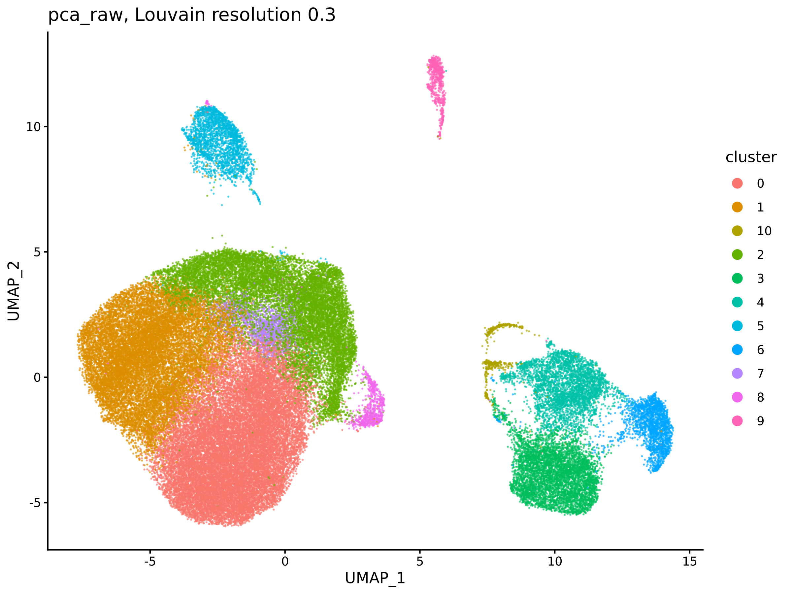

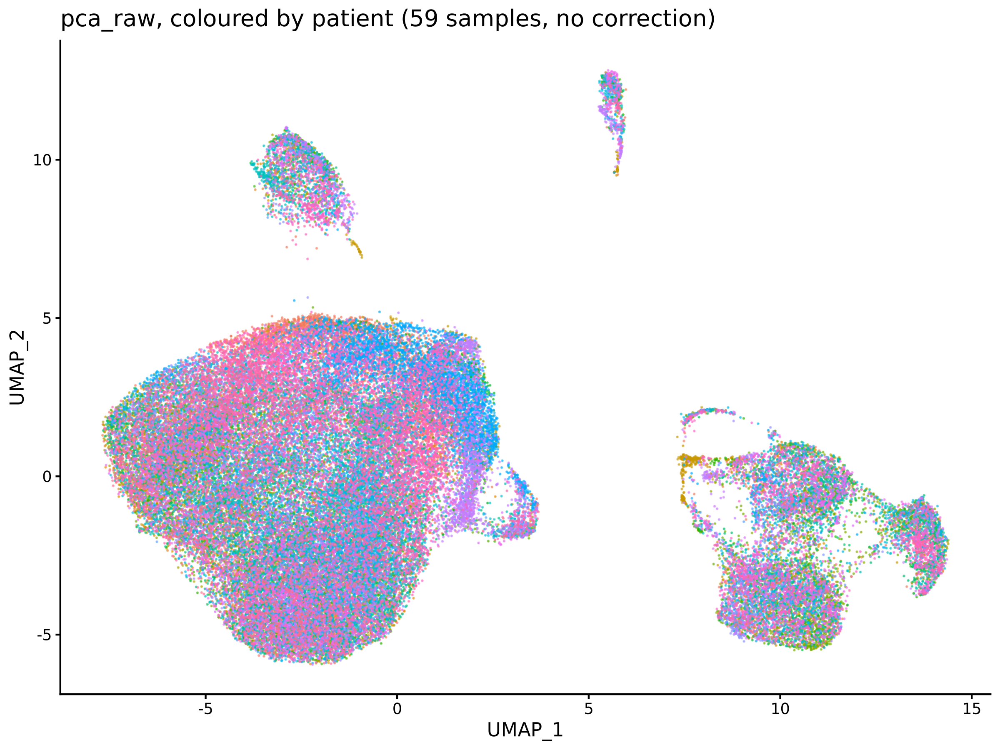

*Uncorrected PCA coloured by patient. This is what donor NMI 0.167 looks like: streaks
and patches of single patients inside what should be one cell type.*

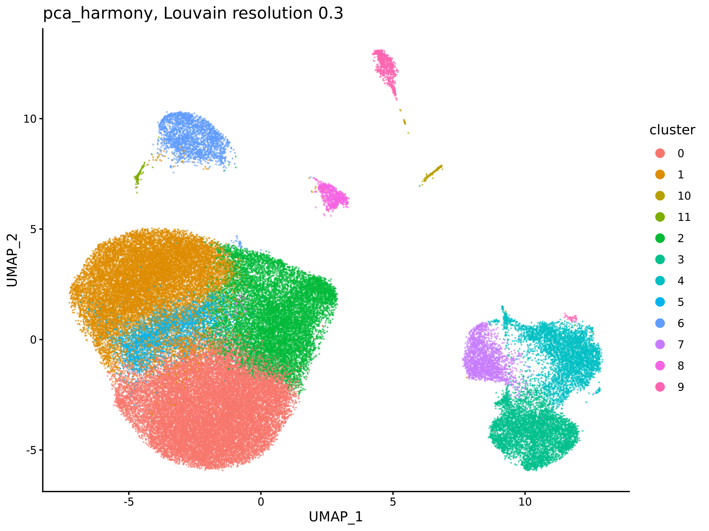

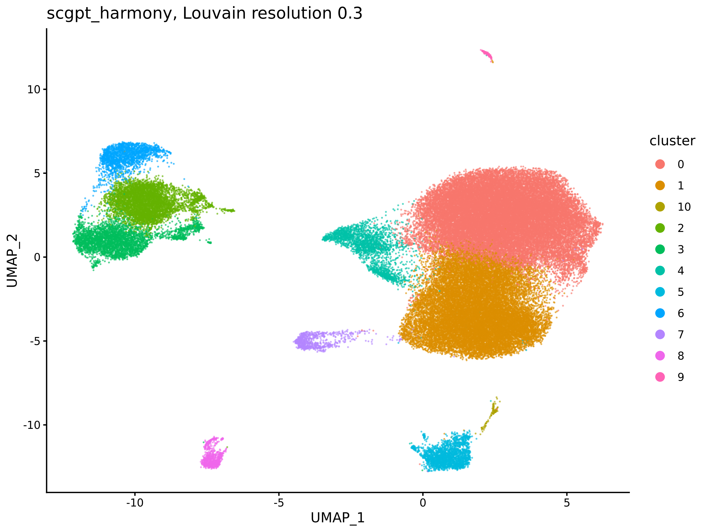

*Each UMAP is its own coordinate system, so compare groupings, not positions or colours.*

### Conclusion

- **Before correction,** scGPT was the more batch-robust representation (donor NMI
  0.072 against PCA's 0.167).
- **After Harmony,** donor NMI is equal (0.051 for both).
- **Local donor mixing is better for PCA** (0.959 against 0.867). Harmony moved PCA
  much more than the embedding, so scGPT is **not** universally better at batch
  correction.
- **Correction recovered PCA's rare populations,** with its smallest cluster going
  from 490 to 109 cells.
- **The two corrected arms agree only moderately** (ARI 0.584, NMI 0.694).

**Caveat.** Age, sex and diagnosis are constant within a patient, so Harmony also
removes all aging and cognitive-impairment signal. These coordinates are for grouping
cells by type only.

---

## 4. Cluster separation: silhouette

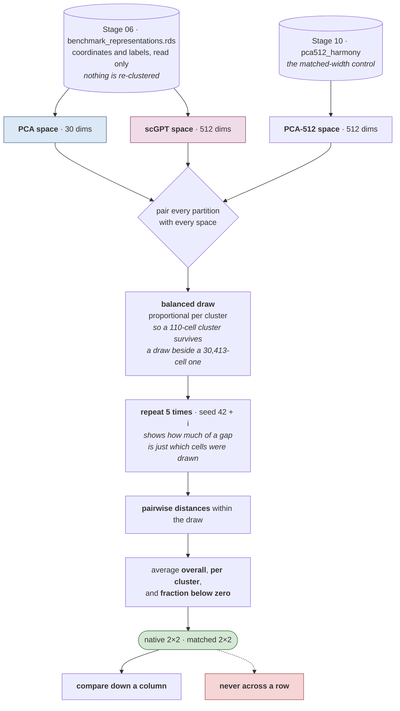

### What I did

I scored both corrected partitions (PCA-30, 13 clusters; scGPT, 11 clusters) in
*both* spaces, using balanced subsamples (12,000 cells, 5 repeats) so small clusters
count. Comparisons are only valid within one space, because distances in 30 and 512
dimensions are different quantities.

**Code.** `02_CODE/07_silhouette_comparison.py` (drives `.R`).

| partition | space | | clusters | mean silhouette | sd across draws | negative fraction |
| --- | --- | --- | --- | --- | --- | --- |
| `pca_labels` | pca | *native* | 13 | 0.006 | 0.0017 | 55.5% |
| `scgpt_labels` | pca | cross | 11 | 0.008 | 0.0013 | 45.5% |
| `pca_labels` | scgpt | cross | 13 | 0.103 | 0.0011 | 19.3% |
| `scgpt_labels` | scgpt | *native* | 11 | **0.207** | 0.0007 | **5.5%** |

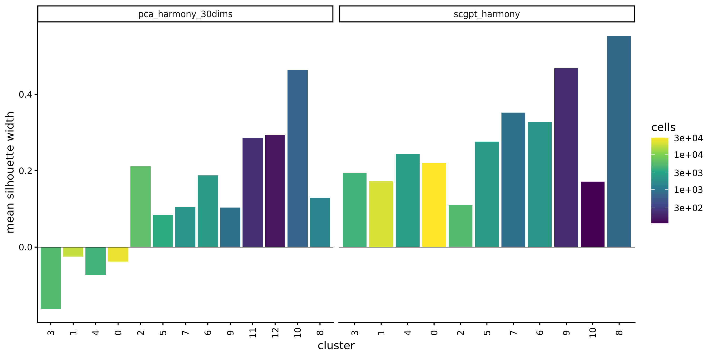

### Conclusion

- **In PCA space** the two partitions are indistinguishable (0.006 against 0.008),
  and 55.5% of cells sit closer to another cluster.
- **In scGPT space** everything separates better, even PCA's own partition (0.103),
  and scGPT's partition scores 0.207.
- **Small clusters are the best-separated structures** (up to 0.575). The large T-cell
  and monocyte masses score poorly, and those are the populations the authors
  resolved by reclustering.

Because the two spaces differ in width, this pass alone cannot rule out a
dimensionality effect. Section 5 tests that.

---

## 5. PCA-512 dimensionality control

### What I did

To test whether scGPT wins only because it has 512 dimensions, I extended PCA to 512
components using exact SVD, applied Harmony, and clustered it fresh at identical
settings. Both 512-dimension partitions were then scored with silhouette, 25,000
cells per draw, with PCA-30 carried along as a control.

**Code.** `02_CODE/10_pca512_arm.py`, then `02_CODE/11_silhouette_dimension_matched.py` (each drives its `.R`).

| arm | dims | clusters | smallest |
| --- | --- | --- | --- |
| `pca_harmony` | 15 | 12 | 109 |
| `pca_harmony_30dims` | 30 | 13 | 139 |
| `scgpt_harmony` | 512 | 11 | 110 |
| **`pca512_harmony`** | **512** | **9** | **378** |

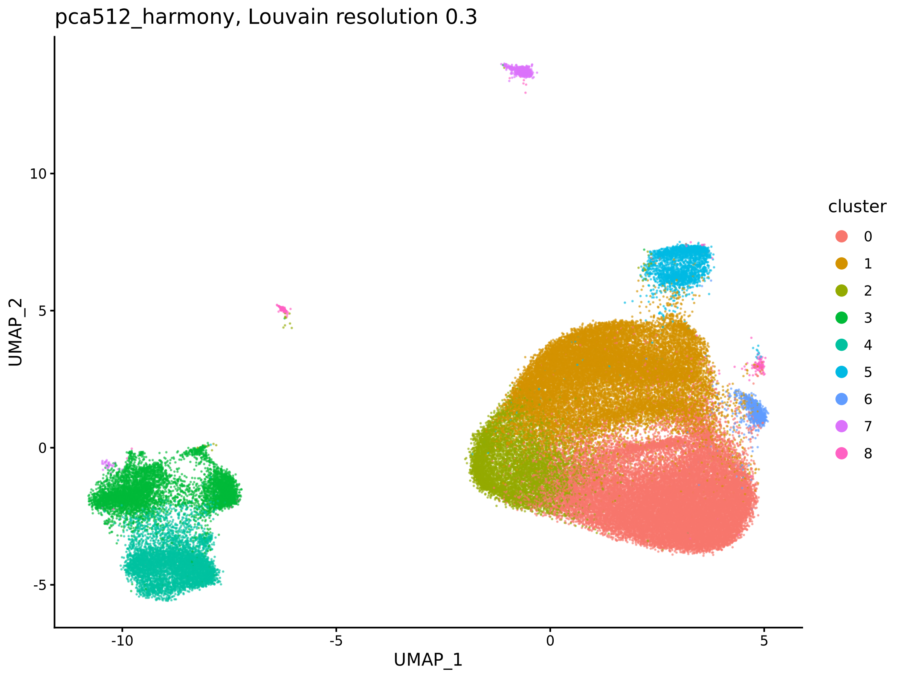

| partition | scored in PCA-512 | scored in scGPT-512 |
| --- | --- | --- |
| **PCA-512 labels** (9 clusters) | **−0.033** *(native)* | 0.160 |
| **scGPT labels** (11 clusters) | −0.048 | **0.219** *(native)* |
| *PCA-30 labels* (13, carried) | *−0.042* | *0.107* |

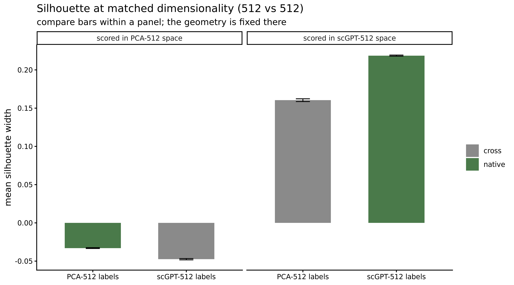

| | PCA-512 labels | scGPT labels |
| --- | --- | --- |
| clusters scoring above zero | **4 of 9** | **11 of 11** |
| largest cluster | 25,820 cells at −0.100 | 30,413 cells at 0.237 |
| smallest cluster | 378 cells at −0.097 | 110 cells at 0.145 |
| best cluster | 783 cells at 0.205 | 757 cells at **0.521** |

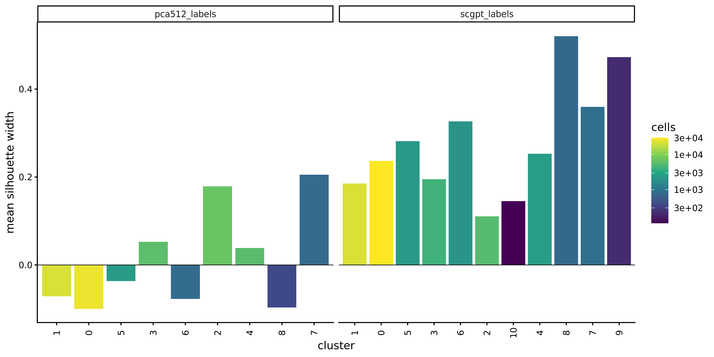

### Conclusion

**scGPT's separation advantage persists at matched dimensionality, and it is not an
artifact of width.**
- **Adding dimensions made PCA worse.** Its own-space score fell from 0.006 to
  −0.033, 73–79% of cells sit closer to another cluster, and the rare populations were
  lost (9 clusters, smallest 378).
- **Why.** PCs 31–512 hold 59.73% of the variance, spread across near-noise axes, and
  that dilutes the signal separating rare populations.
- **The cluster-count bias favours PCA and it still loses.** PCA-512 has the coarser
  partition (9 clusters against 11), which silhouette rewards, and it still scores
  lower in scGPT space (0.160 against 0.219).

**Silhouette measures geometric separation, not biological correctness.** That is the
job of sections 7–8.

---

## 6. WCSS / elbow (supporting analysis only)

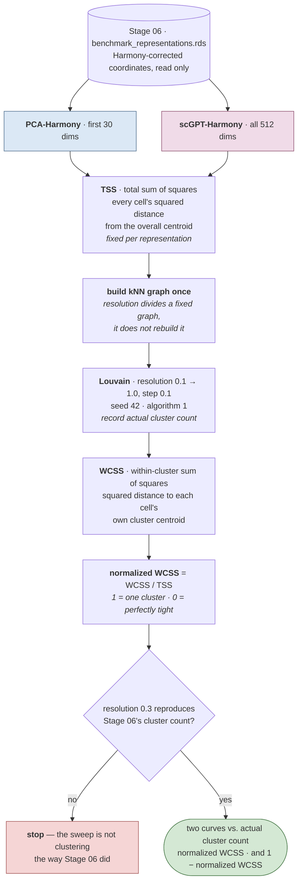

### What I did

Resolution 0.3 was inherited from the authors, not tuned. To see where it sits for
each representation, I swept Louvain resolution from 0.1 to 1.0 on a fixed kNN graph
and plotted normalized WCSS (WCSS/TSS) against the cluster count each setting
produced.

**Code.** `02_CODE/08_wcss_resolution_sweep.py` (drives `.R`).

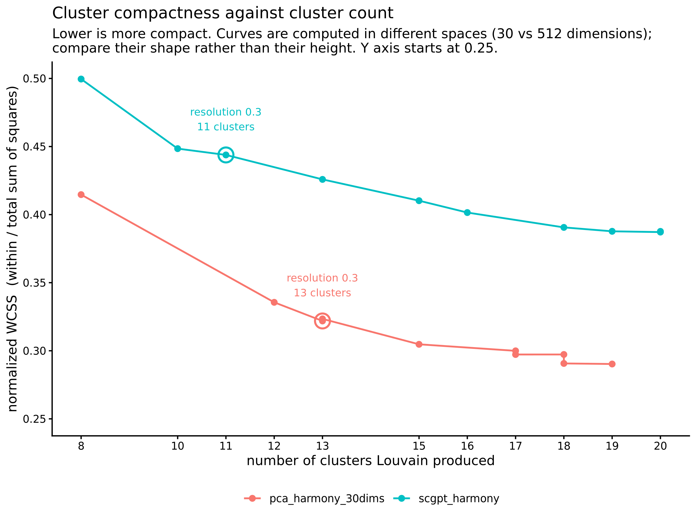

| | PCA-Harmony | scGPT-Harmony |
| --- | --- | --- |
| WCSS at 8 clusters | 0.4147 | 0.4996 |
| WCSS at ~19–20 clusters | 0.2903 | 0.3872 |
| total drop across the sweep | **0.124** | **0.112** |
| drop by 13 clusters | **0.093 (75% of total)** | 0.074 (66% of total) |
| bend | **12–13 clusters** | **~16–18 clusters** |

<details>
<summary>Full sweeps</summary>

**PCA-Harmony, 30 dimensions** (total sum of squares 24,683,610)

| resolution | clusters | normalized WCSS | dispersion explained |
| --- | --- | --- | --- |
| 0.1 | 8 | 0.4147 | 0.5853 |
| 0.2 | 12 | 0.3356 | 0.6644 |
| **0.3** | **13** | **0.3219** | **0.6781** |
| 0.4 | 13 | 0.3234 | 0.6766 |
| 0.5 | 15 | 0.3047 | 0.6953 |
| 0.6 | 17 | 0.2999 | 0.7001 |
| 0.7 | 18 | 0.2973 | 0.7027 |
| 0.8 | 17 | 0.2973 | 0.7027 |
| 0.9 | 19 | 0.2903 | 0.7097 |
| 1.0 | 18 | 0.2907 | 0.7093 |

**scGPT-Harmony, 512 dimensions**

| resolution | clusters | normalized WCSS | dispersion explained |
| --- | --- | --- | --- |
| 0.1 | 8 | 0.4996 | 0.5004 |
| 0.2 | 10 | 0.4485 | 0.5515 |
| **0.3** | **11** | **0.4438** | **0.5562** |
| 0.4 | 13 | 0.4259 | 0.5741 |
| 0.5 | 15 | 0.4102 | 0.5898 |
| 0.6 | 16 | 0.4015 | 0.5985 |
| 0.7 | 18 | 0.3906 | 0.6094 |
| 0.8 | 20 | 0.3872 | 0.6128 |
| 0.9 | 19 | 0.3877 | 0.6123 |
| 1.0 | 20 | 0.3877 | 0.6123 |

</details>

### Conclusion

**This is supporting analysis only.**
- **Absolute WCSS cannot be compared across the two spaces.** The PCA curve sitting
  lower is not evidence that PCA clusters better.
- **The shapes are comparable, and they differ.** The PCA curve bends at about 12–13
  clusters, where resolution 0.3 lands. The scGPT curve keeps improving until about
  16–18 clusters, so 0.3 under-divides the embedding.
- **What the shapes suggest.** scGPT may carry finer structure, which is what
  sections 7–8 and the planned subclustering have to test biologically.

---

## 7. RNA marker validation

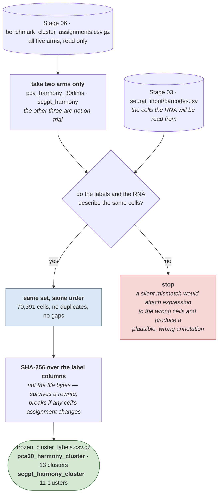

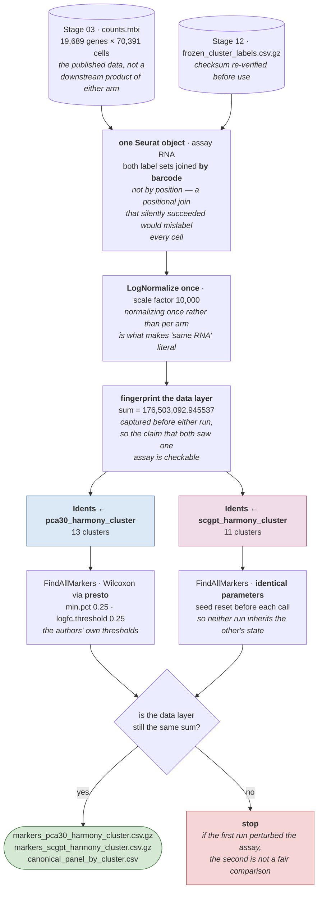

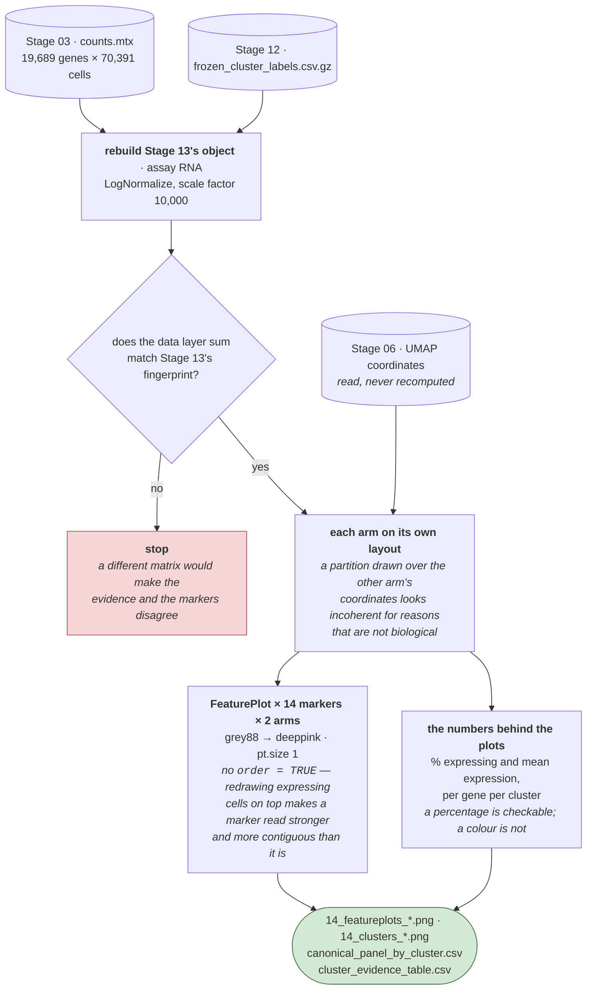

### What I did

Geometry can't say whether a cluster is a cell type, so I let the RNA judge.
- **Freeze (Stage 12).** The two partitions were frozen and checksummed, so they
  can't move from here on.
- **Markers (Stage 13).** Marker discovery ran identically for both partitions on the
  same LogNormalized RNA matrix, so the only thing that differs is which cells carry
  which label. It used RNA rather than SCT because the per-sample SCT assays share
  only 9,013 of 19,689 genes, and the missing ones include rare-population markers.
- **Evidence (Stage 14).** The authors' canonical panel was drawn over each arm's own
  UMAP, along with a per-cluster evidence table: size, donors, top markers, and panel
  genes expressed.

**Code.** `02_CODE/12_freeze_cluster_labels.py`, `02_CODE/13_marker_discovery.py`,
`02_CODE/14_marker_evidence.py` (the last two drive `.R`).

Where the frozen partitions disagree: scGPT cluster 0 (30,413 cells) draws from five
PCA clusters.

| PCA cluster | cells → scGPT 0 | of that cluster | reading |
| --- | --- | --- | --- |
| 0 | 23,548 | 93% | lands in scGPT 0 |
| 8 | 1,322 | 97% | lands in scGPT 0 |
| 2 | 3,197 | 52% | splits, rest to scGPT 4 |
| 1 | 1,141 | 6% | mostly elsewhere |
| 5 | 1,114 | 32% | splits, more goes to scGPT 1 |

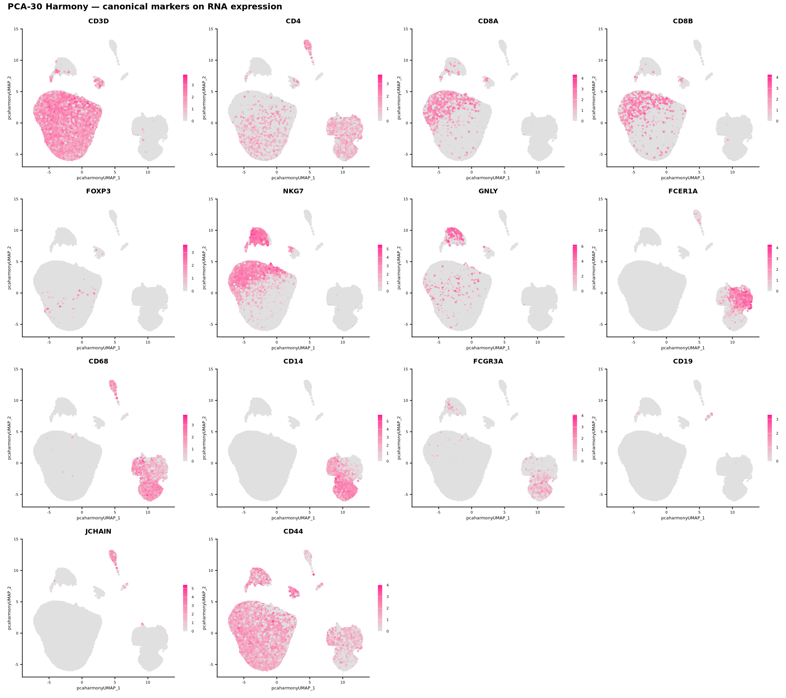

*PCA-30 Harmony. CD3D covers the large left mass, with CD8A/CD8B in its upper half and
CD4 in the lower. NKG7 and GNLY mark the small upper cluster, CD68, CD14 and FCER1A
the right-hand pair, and CD19 and JCHAIN two small clusters.*


*scGPT Harmony: the same panel and the same cells, in the other layout.*

### Conclusion

Every canonical lineage lands on its own territory in both arms. The arms disagree
about where boundaries fall, not about whether the populations are visible. Only PCA
clusters 0 and 8 are truly absorbed into scGPT cluster 0; clusters 2 and 5 are split
differently.

---

## 8. Broad cell-type annotation

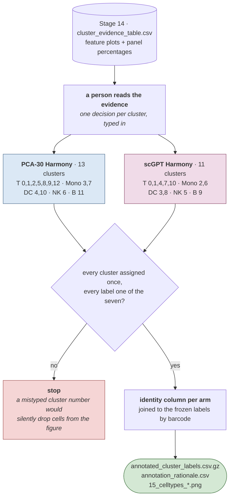

### What I did

Following the authors, I assigned each cluster by hand, from its evidence row and
feature plots, to one of their seven broad categories. This is only the authors' first
pass. Their finer labels come from reclustering, which hasn't been done yet. Cluster
numbers mean nothing across arms, so each arm was read from its own plots.

**Code.** `02_CODE/15_annotate_clusters.R`.


| identity | PCA-30 Harmony | scGPT Harmony | difference |
| --- | --- | --- | --- |
| T Cells | 55,485 | 55,554 | 69 |
| Monocytes | 7,392 | 7,471 | 79 |
| DC | 4,931 | 4,848 | 83 |
| NK Cells | 2,362 | 2,311 | 51 |
| B Cells | 221 | 207 | 14 |

### Conclusion

Both representations recover nearly identical broad immune populations, within 83
cells for every type. `Undetermined` and `Plasma Cells` went unused in both arms.
PCA's two extra clusters are subdivisions *within* T cells (Treg cluster 8 and cycling
cluster 12), not a lineage scGPT missed. At this resolution the arms are
biologically equivalent.

---

# Where the Project Stands

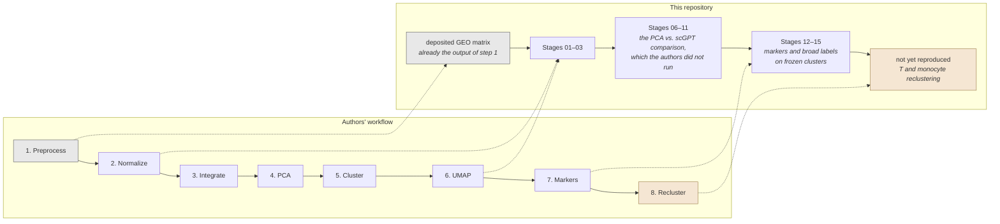

## Completed

- **Clustering reproduced.** Figure 1D's unsupervised clustering reproduced from
  the public data (authors' steps 2–7).
- **scGPT arm and batch correction.** A frozen scGPT arm, with both arms
  Harmony-corrected.
- **Separation tested.** Silhouette at native width, the PCA-512 dimensionality
  control, and the WCSS sweep.
- **Biology checked.** Frozen partitions, RNA marker validation, and broad cell-type
  annotation for both arms.

## Main conclusion so far

scGPT produces substantially better geometric cluster separation than PCA, and the
advantage holds at matched 512 dimensions. Batch correction is mixed: donor NMI is
equal after Harmony, but PCA mixes donors better locally. Both arms recover the same
broad immune populations, so there is not yet any evidence that scGPT's cleaner
geometry means better biology.

## Next step

Recluster and annotate the T cells (CD4, CD8, CD4/CD8, Treg), then the monocytes
(classical, intermediate, non-classical), in both arms. This compares PCA and scGPT at
finer biological resolution and completes Figure 1D.

## What not to do

- **Aging and cognitive-impairment analysis** is out of scope for this paper. Harmony
  coordinates can't support it anyway.
- **Unrelated model development** (fine-tuning scGPT, new representations) is also
  out of scope.

## References

- Piehl N, et al. *Cerebrospinal fluid immune dysregulation during healthy brain aging and cognitive impairment.* Cell. 2022. DOI: 10.1016/j.cell.2022.11.019.
- Dataset: GEO accession **GSE200164**.
- Author code: `gatelabNW/csf_aging` (copies in [`05_REFERENCES/`](../05_REFERENCES/)).
