# Figure Overview

The figures and tables for each step, with one line on what each shows. The reasoning,
methods and caveats are in [ANALYSIS_WALKTHROUGH.md](ANALYSIS_WALKTHROUGH.md), and the
section numbers match.

**Question.** Can a frozen foundation model (scGPT), used out of the box, match the
authors' published pipeline? The authors' pipeline includes batch correction and
scGPT raw doesn't; that is intended.

---

## 1. Authors' pipeline (Stages 01–03)

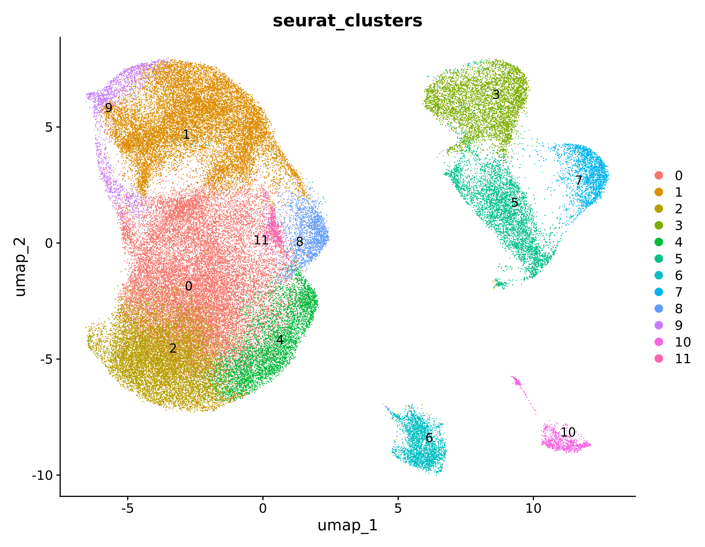

12 clusters, from 18,533 cells down to 787 (paper: 13).

## 2. scGPT, out of the box (Stages 04–06)

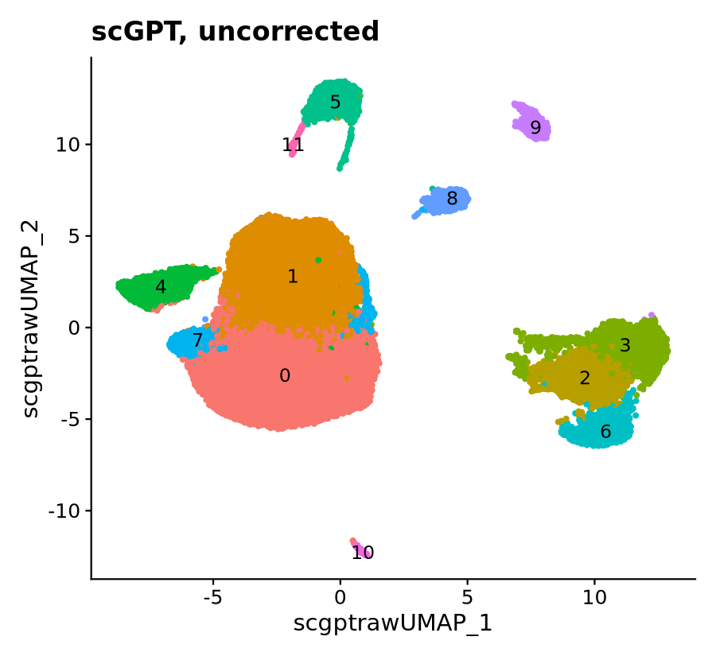

12 clusters, from 28,722 cells down to 103.

| scGPT vocabulary | genes | share of expression |
| --- | --- | --- |
| kept | 15,960 (81.1%) | 98.862% |
| dropped | 3,729 (18.9%) | 1.138% |

## 3. RNA markers (Stages 12–14)

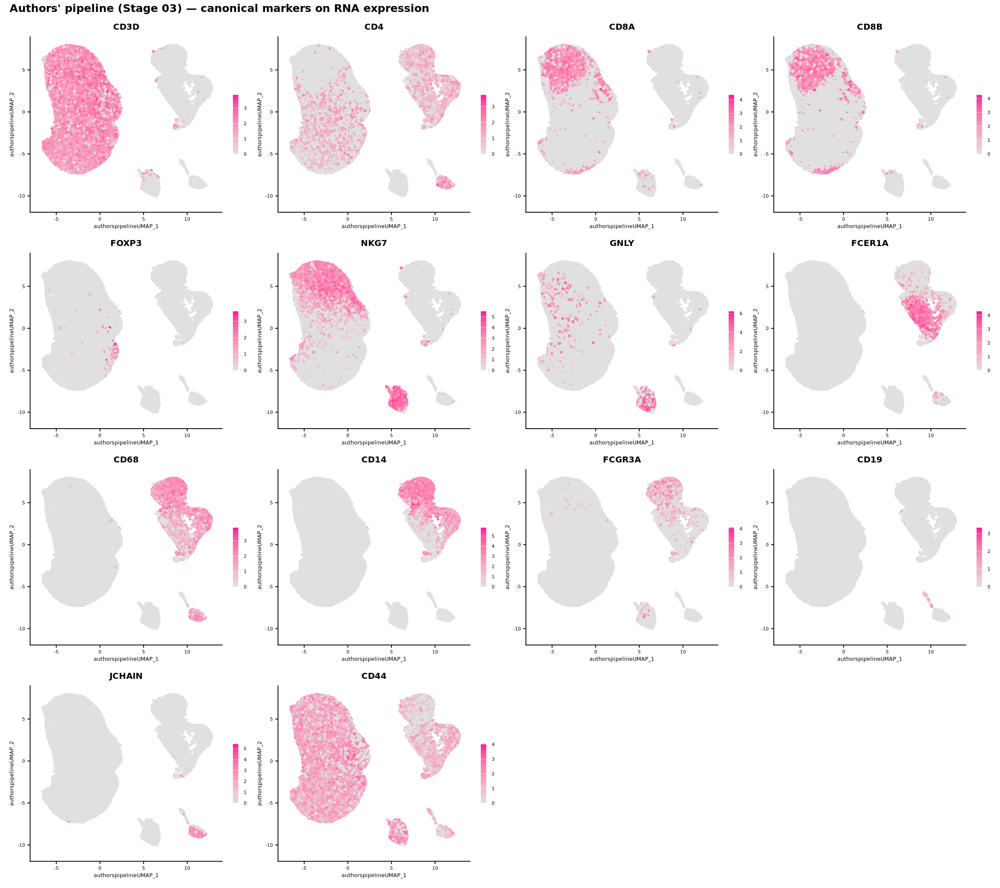

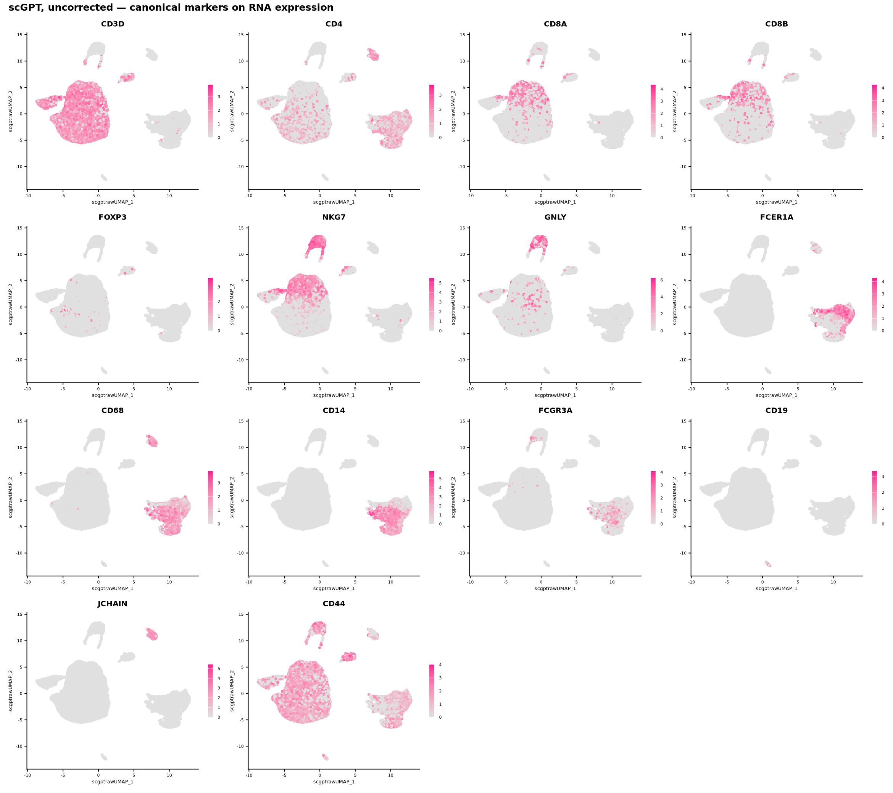

Tables: `Age_trajectory/results/14_marker_evidence/` (`cluster_evidence_table.csv`,
`top_markers_*.csv`, `canonical_pct_expressing_*.csv`).

## 4. Broad cell types and arm agreement (Stages 15, 19)

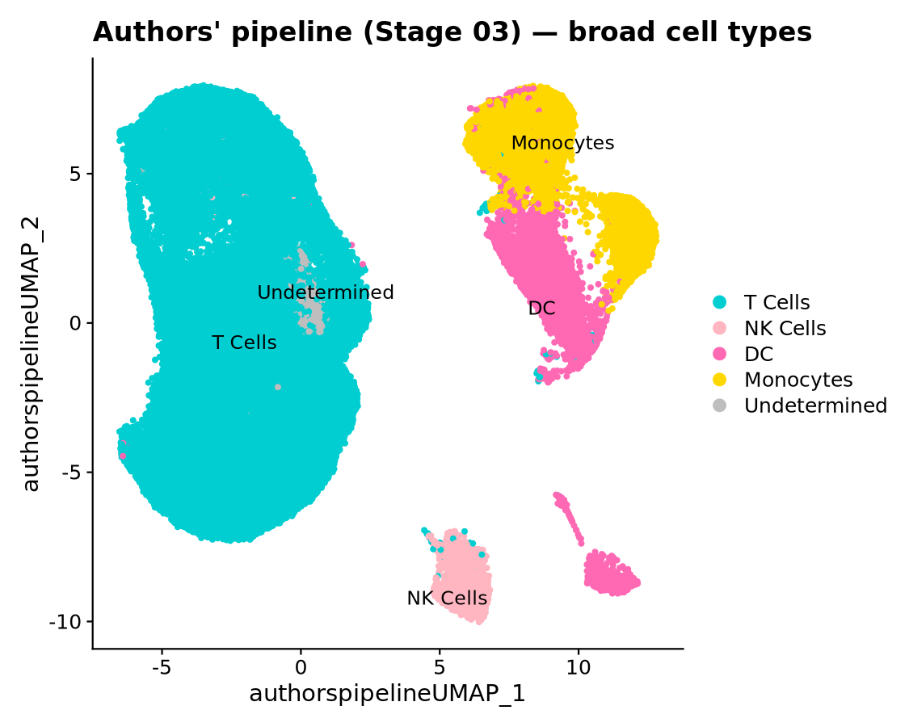

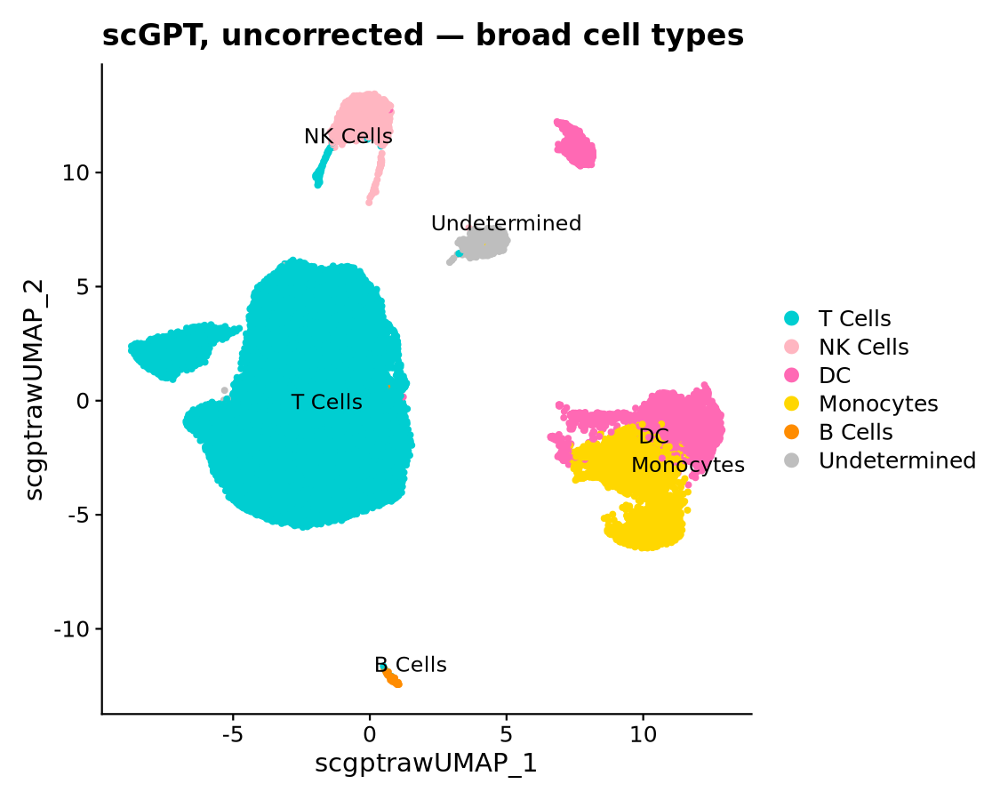

| identity | authors' pipeline | scGPT raw |
| --- | --- | --- |
| T Cells | 54,553 | 54,709 |
| Monocytes | 7,124 | 7,359 |
| DC | 5,478 | 4,969 |
| NK Cells | 2,449 | 2,336 |
| B Cells | 0 | 215 |
| Undetermined | 787 | 803 |

**Do the arms group the same cells? (Stage 19)**

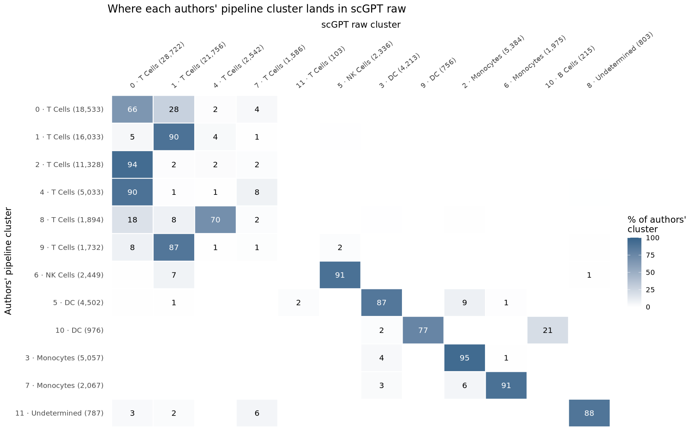

Near one-to-one outside the T cells; the arms divide the T cells differently. Tables:
`Age_trajectory/results/19_arm_agreement/` (`crosstab_*.csv`, `cluster_correspondence.csv`).

## 5. Biology vs. patient (Stages 16–17)

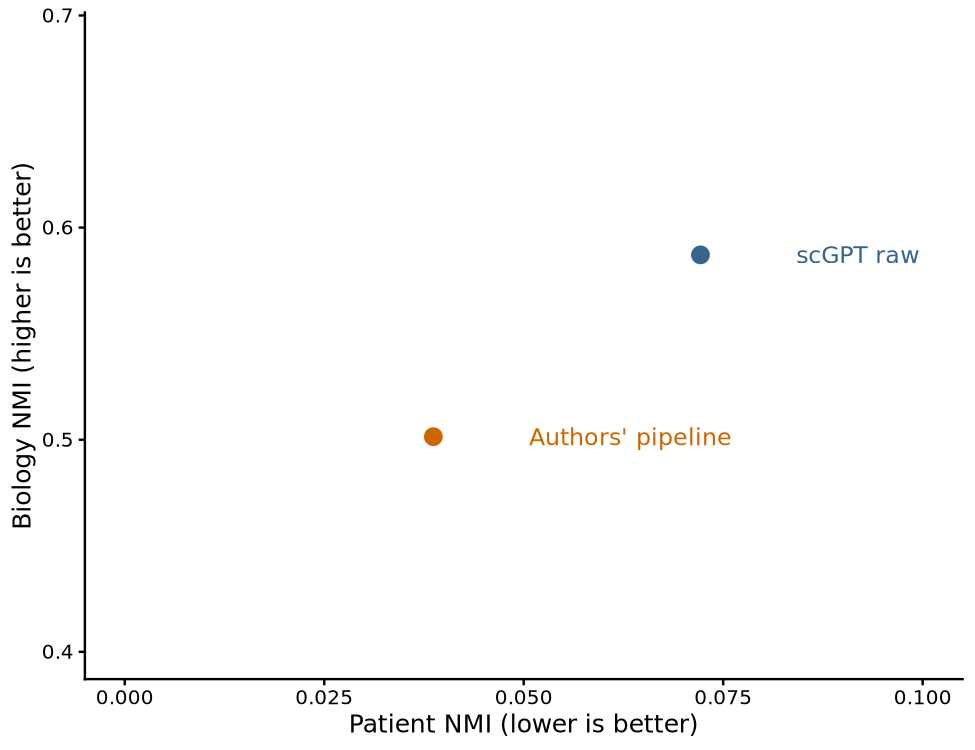

| arm | patient NMI | biology NMI | biology NMI, myeloid merged |
| --- | --- | --- | --- |
| Authors' pipeline | **0.039** | 0.501 | 0.507 |
| scGPT raw | 0.072 | **0.587** | **0.597** |

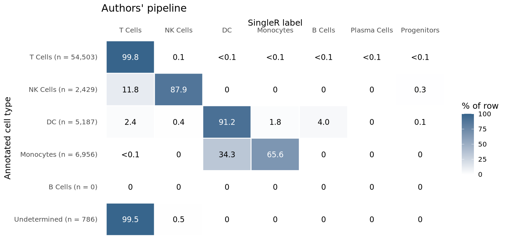

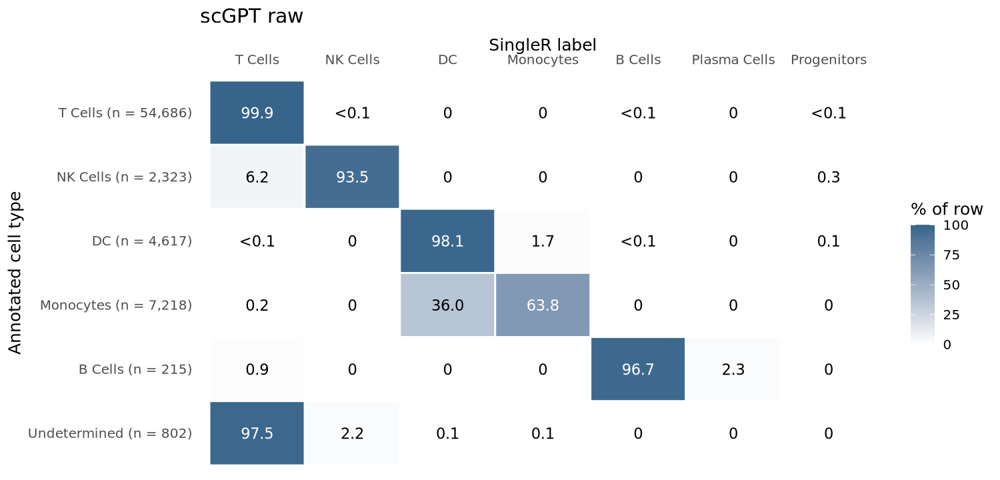

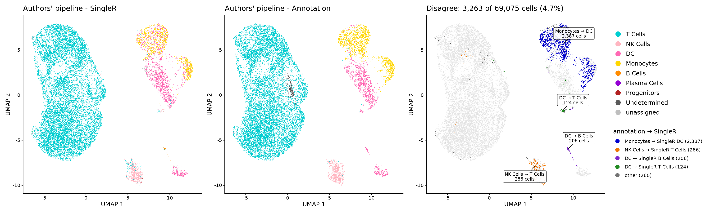

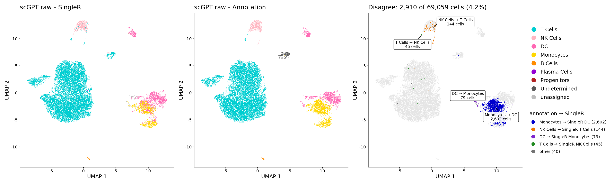

| kind of disagreement | authors' pipeline | scGPT raw |
| --- | --- | --- |
| Monocytes → SingleR DC | 2,387 | 2,602 |
| NK Cells → SingleR T Cells | 286 | 144 |
| DC → SingleR B Cells | 206 | 1 |
| DC → SingleR T Cells | 124 | 1 |
| all other kinds | 260 | 162 |
| **total** | **3,263 (4.7%)** | **2,910 (4.2%)** |

| agreement with SingleR | authors' pipeline | scGPT raw |
| --- | --- | --- |
| overall | 95.3% | 95.8% |
| myeloid merged | 98.9% | 99.7% |
| T / NK / DC / Monocytes | 99.8 / 87.9 / 91.2 / 65.6% | 99.9 / 93.5 / 98.1 / 63.8% |
| B cells | no cluster | 96.7% |

| Monocyte/DC disputed cells (% expressing) | CD14 | FCER1A | CD1C |
| --- | --- | --- | --- |
| both call Monocytes | 97 | 7 | 5 |
| annotation Monocytes, SingleR DC (~2,500) | 96–97 | 46–49 | 22–26 |
| both call DC | 36–38 | 88 | 76 |

## 6. Supplementary: silhouette of SingleR labels (Stage 18)

| labels scored | in authors' PCA (15) | in scGPT raw (512) |
| --- | --- | --- |
| SingleR cell types | −0.078 | **0.243** |
| SingleR, myeloid merged | −0.092 | **0.289** |
| authors' pipeline clusters | **0.203** | 0.071 |
| scGPT raw clusters | 0.126 | 0.198 |

Compare down a column only. Tables: `Age_trajectory/results/18_singler_silhouette/`
(`singler_silhouette_summary.csv`, `singler_silhouette_per_label.csv`).

## 7. T-cell and monocyte subclusters (Stages 20–21)

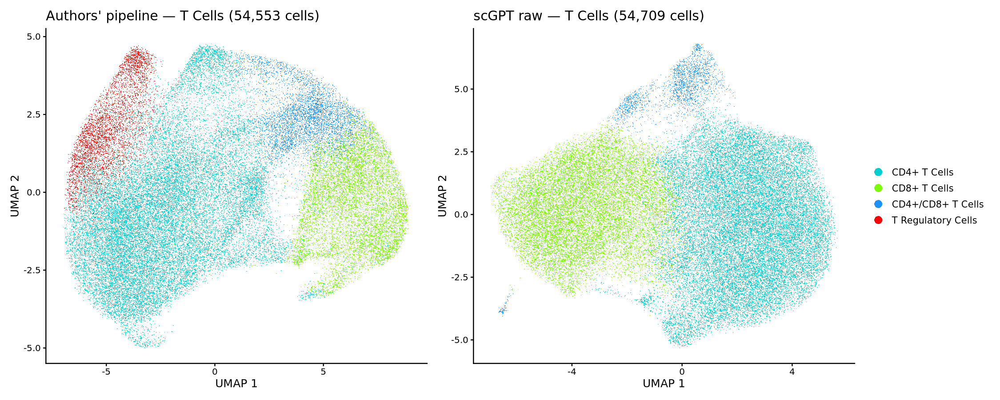

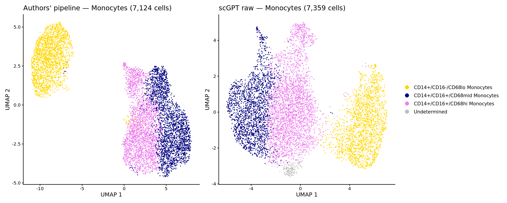

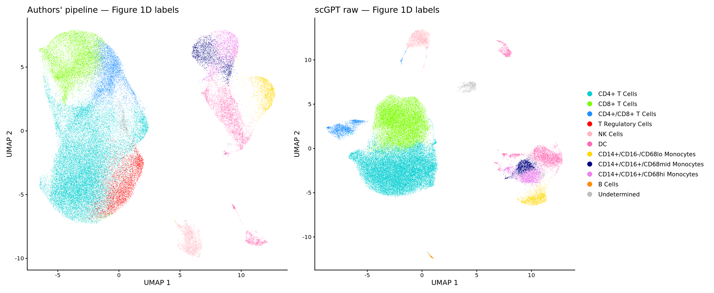

| subtype | authors' pipeline | scGPT raw |
| --- | --- | --- |
| CD4+ T Cells | 31,947 | 31,946 |
| CD8+ T Cells | 11,173 | 20,173 |
| CD4+/CD8+ T Cells | 6,059 | 2,590 |
| T Regulatory Cells | 5,374 | 0 |
| CD68lo / mid / hi Monocytes | 2,092 / 2,443 / 2,589 | 1,998 / 2,034 / 3,164 |

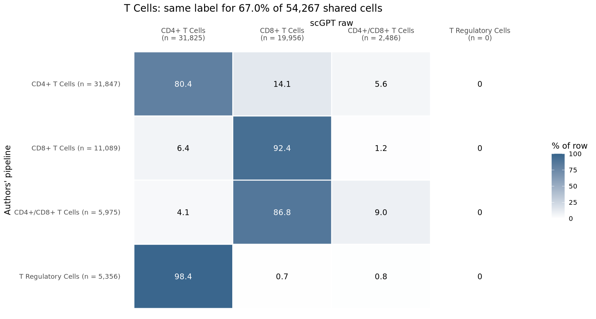

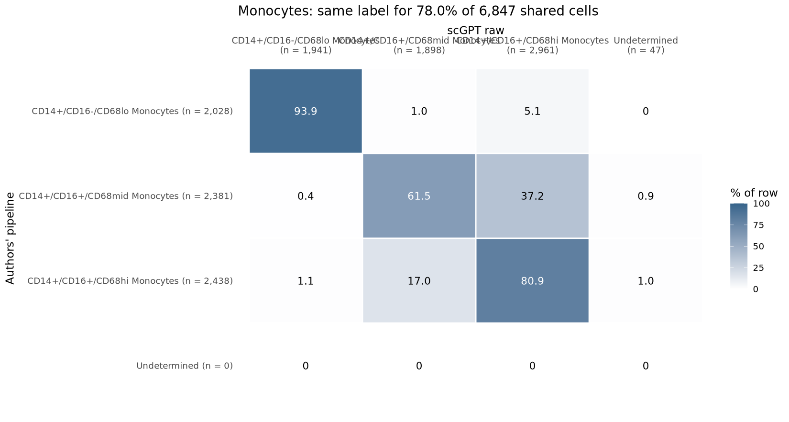

| | T cells | monocytes |
| --- | --- | --- |
| same subtype label (shared cells) | 67.0% | 78.0% |
| patient NMI, authors' / scGPT subclusters | 0.012 / 0.110 | 0.039 / 0.106 |
| CD8A in the CD8+ label, authors' / scGPT | 88% / 58% | — |

Tables: `Age_trajectory/results/20_subclusters/` (evidence, markers) and
`Age_trajectory/results/21_subtypes/` (`crosstab_*.csv`, `marker_purity_*.csv`,
`subcluster_patient_nmi.csv`, `figure1d_labels.csv.gz`).

---

## Appendix A. Earlier Harmony comparison (record only)

| arm | clusters | patient NMI | biology NMI |
| --- | --- | --- | --- |
| `pca_harmony` | 12 | 0.038 | 0.540 |
| `scgpt_harmony` | 11 | 0.051 | 0.605 |

Figures and tables: `03_RESULTS/03_BATCH_CORRECTION` to `07_CELL_TYPE_ANNOTATION`, and
`Age_trajectory/results/17_biology_vs_donor_harmony_record/`.
