# Paper outline

*Working outline. Numbers come from `01_PROJECT_OVERVIEW/ANALYSIS_WALKTHROUGH.md`.
Items marked **PENDING** depend on the T-cell and monocyte subclustering, which has
not been run.*

## Title (candidates)

- Geometric separation is not biological resolution: PCA versus a frozen scGPT
  embedding for cerebrospinal fluid immune cells
- Does a single-cell foundation model improve cell-state structure? A controlled
  comparison with PCA in human CSF
- Frozen scGPT embeddings versus PCA for CSF immune cell clustering

## Central claim

scGPT clusters CSF immune cells with clearly better geometric separation than PCA,
and this is not a dimensionality artifact. At broad cell-type resolution, both
representations recover the same biology. **PENDING:** whether the advantage holds
at subtype resolution.

## 1. Introduction

1. **Context.** Cell representation (PCA on normalized expression) sits at the
   start of nearly every scRNA-seq analysis. Foundation models (scGPT, Geneformer,
   and others) offer pretrained embeddings as an alternative.
2. **Gap.** Benchmarks often confound the representation with batch correction,
   dimensionality, or clustering settings, and they score geometric quality
   (silhouette, ARI against labels) rather than testing whether clusters are
   biologically correct.
3. **Test case.** CSF immune cells: clinically relevant, dominated by continuous
   T-cell and myeloid states, with a published, annotated reference analysis
   (Piehl et al. 2022, Figure 1D).
4. **This study.** Hold everything fixed except the representation; control
   separately for donor correction and dimensionality; then judge both partitions
   against the same RNA.
5. **Summary of findings** (one paragraph, mirroring the abstract).

## 2. Data

- GSE200164: 70,391 CSF immune cells, 59 individuals, 10x Genomics.
- The deposited matrix is the authors' processed output: SoupX-corrected
  (fractional values, kept as-is), QC-filtered (≥200 genes, <10% mitochondrial
  reads), doublets removed. No further filtering was applied.
- Donor metadata (age, sex, diagnosis) attached per cell, and used only as batch
  identity here.

## 3. Methods

### 3.1 Reproducing the published workflow
- SCTransform v1 per sample (1,000 variable genes; regressing nCount, nFeature,
  percent.mt), anchor integration (references A4 and A6), PCs 1–15, Louvain at
  resolution 0.3, UMAP.
- One deliberate departure: the full ~2,816-gene integration feature pool was used
  instead of 2,000, because the smaller set discarded rare-population markers.

### 3.2 scGPT representation
- Frozen whole-human scGPT, zero-shot. 512 dimensions per cell, all used.
- Vocabulary coverage: 15,960 of 19,689 genes, holding 98.86% of expression; no
  canonical immune marker lost.

### 3.3 Donor correction
- The PCA arm was rebuilt without anchors (merged SCT → PCA), so that each arm is
  corrected exactly once.
- Harmony by patient on both arms, with uncorrected controls.
- Identical neighbor graph, Louvain (resolution 0.3, seed 42) and UMAP settings.
- Metrics: donor NMI, and local donor mixing (fraction of the 30 nearest neighbours
  from other donors, against the 0.9726 ceiling).

### 3.4 Cluster separation
- Silhouette of both partitions scored in both spaces, using balanced subsamples
  (12,000 cells × 5 draws). Comparisons only within a space.

### 3.5 Dimensionality control
- PCA extended to 512 components by exact SVD, Harmony-corrected, and clustered
  fresh. Silhouette recomputed in a 512-vs-512 design (25,000 cells per draw).

### 3.6 Resolution sweep (supplementary)
- Louvain resolution 0.1–1.0; normalized WCSS against cluster count.

### 3.7 Biological validation
- Partitions frozen and checksummed before any biological assessment.
- One LogNormalized RNA matrix shared by both arms. RNA rather than SCT because
  per-sample SCT shares only 9,013 genes.
- FindAllMarkers (Wilcoxon; min.pct 0.25, logFC 0.25), with identical calls per arm.
- The authors' 14-gene canonical panel; manual annotation into the authors'
  seven categories.

### 3.8 Subclustering — PENDING
- T cells and monocytes subset and reclustered within each arm, following the
  authors' step 8, then annotated: CD4, CD8, CD4/CD8, Treg; classical,
  intermediate, non-classical monocytes.
- Comparison metrics to decide before running: subtype recovery, marker
  specificity, and agreement with the published Figure 1D proportions.

## 4. Results

### 4.1 The published clustering reproduces from public data
- 12 clusters against the paper's 13, with rare populations retained (smallest 787
  cells).

**Fig. 1A.** Reproduction of the published clustering, 12 clusters

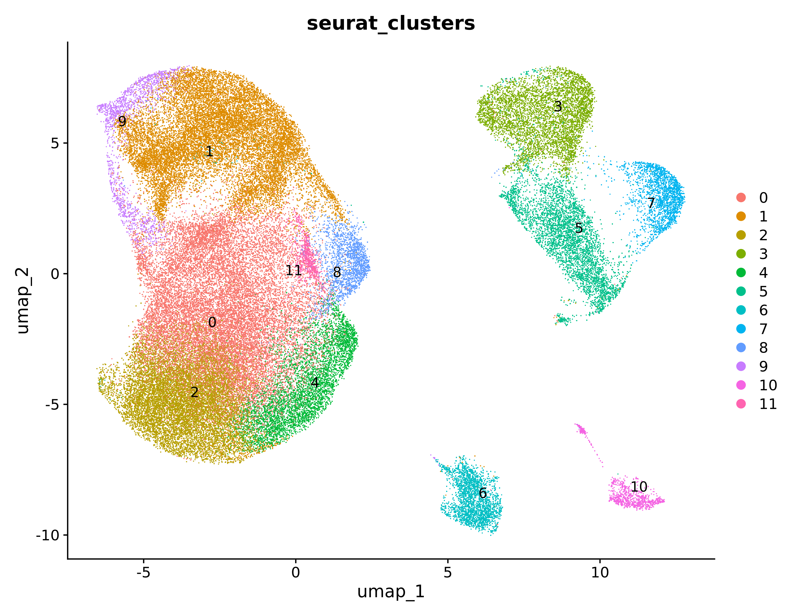

### 4.2 scGPT is more donor-robust before correction; PCA mixes donors better after
- Uncorrected: donor NMI 0.167 for PCA against 0.072 for scGPT.
- Harmony: NMI 0.051 for both. Local mixing 0.959 (PCA) against 0.867 (scGPT).
- Correction recovered PCA's rare populations (smallest cluster 490 → 109 cells).
- Cross-arm agreement is moderate: ARI 0.584, NMI 0.694.
- **Table 1.**

**Fig. 1B.** Uncorrected PCA coloured by donor (donor NMI 0.167)

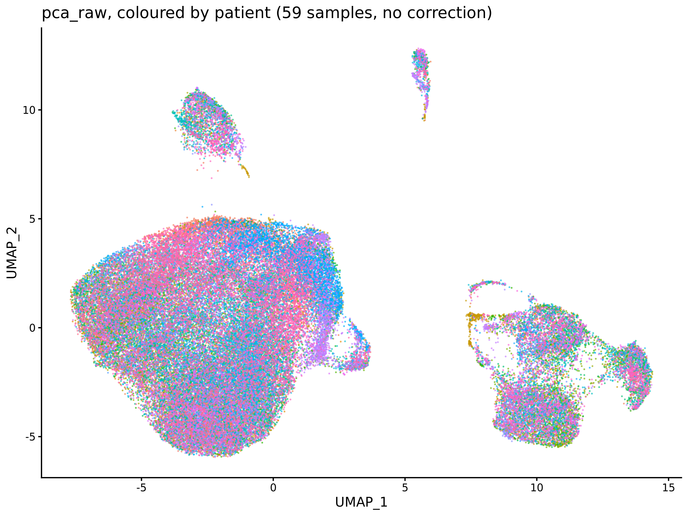

**Fig. 1C.** PCA after Harmony, 12 clusters

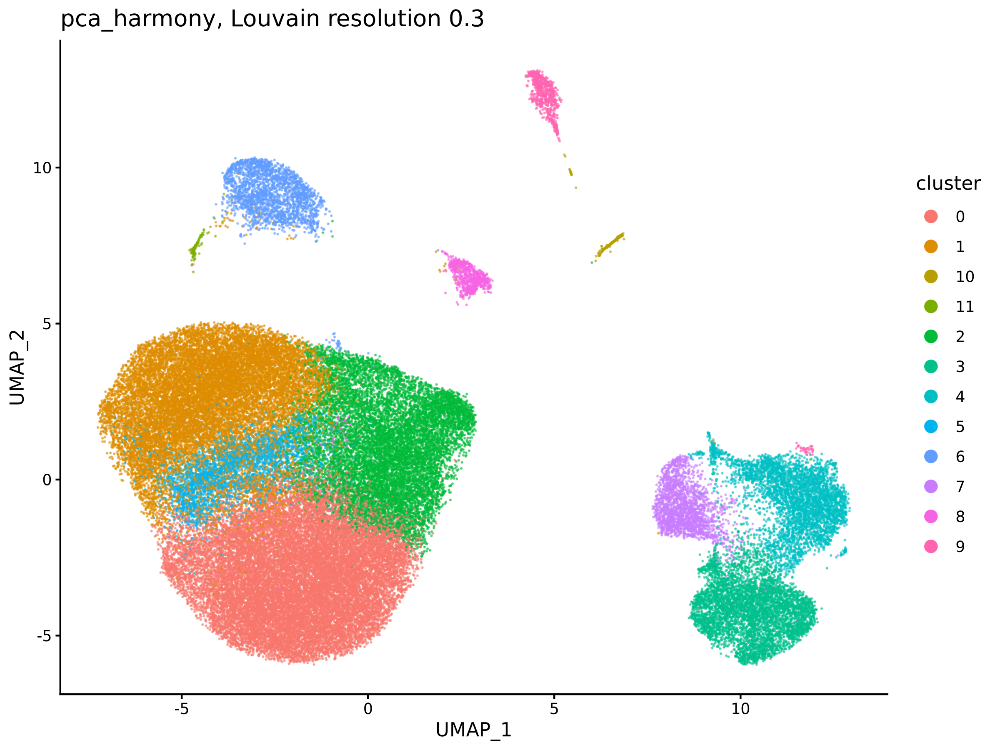

**Fig. 1D.** scGPT after Harmony, 11 clusters

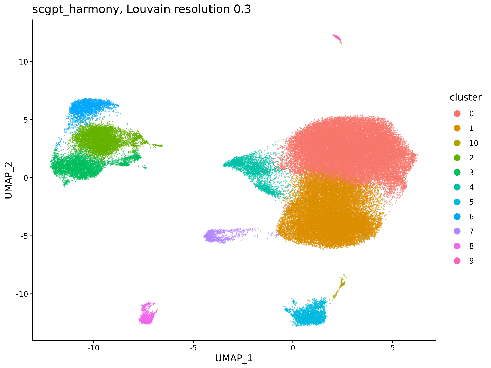

### 4.3 scGPT separates clusters better
- In scGPT space: 0.207 for the scGPT partition against 0.103 for the PCA partition.
- In PCA space both partitions are near zero (0.006 and 0.008), with 55.5% of cells
  negative.
- The best-separated structures are the small clusters; the T-cell and monocyte
  masses score lowest.

**Fig. 2A.** Per-cluster silhouette, both partitions in both spaces

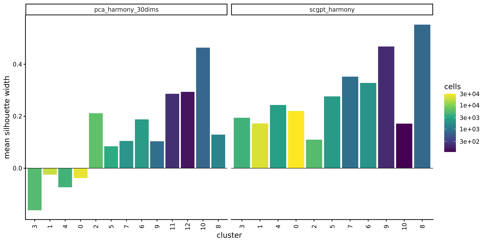

### 4.4 The advantage is not dimensionality
- PCA-512: 9 clusters, smallest 378; −0.033 in its own space, with 73–79% of cells
  negative.
- Matched 2×2: 0.219 against 0.160 in scGPT space. The cluster-count bias favours
  PCA and PCA still loses.
- Per cluster: 11 of 11 scGPT clusters positive, against 4 of 9 for PCA-512.

**Fig. 2B.** PCA-512 after Harmony, 9 clusters

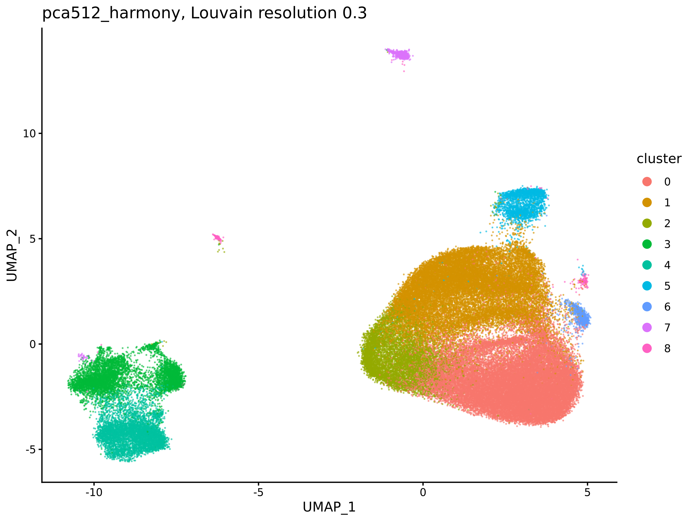

**Fig. 2C.** Matched 512-vs-512 silhouette

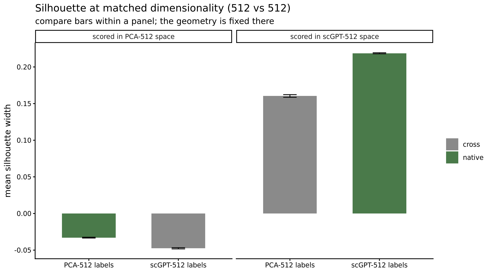

**Fig. 2D.** Matched per-cluster silhouette

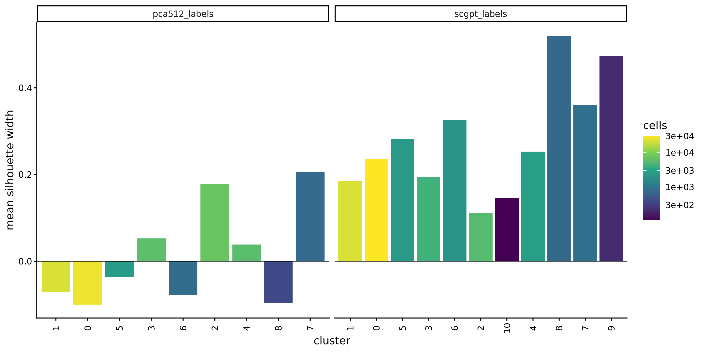

### 4.5 Both representations recover the same broad cell types
- Frozen partitions and shared RNA; the canonical panel over each arm's own layout.
- Five populations, with counts within 83 cells. PCA's two extra clusters are
  within T cells (Treg and cycling).
- scGPT's largest cluster (30,413 cells) absorbs PCA clusters 0 and 8 and splits
  2 and 5.
- **Table 2.**

**Fig. 3A.** Canonical markers over the PCA-Harmony UMAP

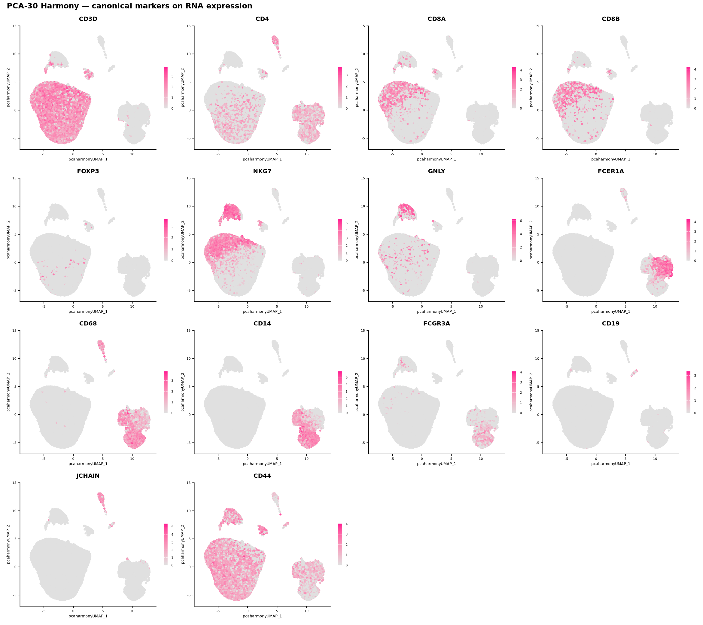

**Fig. 3B.** Canonical markers over the scGPT-Harmony UMAP

**Fig. 3C.** Broad cell types, PCA-Harmony

**Fig. 3D.** Broad cell types, scGPT-Harmony

### 4.6 Subtype resolution — PENDING
- T-cell and monocyte subclusters per arm; comparison with Figure 1D.
- **Fig. 4:** not yet generated.

## 5. Discussion

1. **Main message.** Better geometry ≠ better biology at broad resolution.
   Silhouette rewards separation, which is not the same as correctness.
2. **Why PCA degrades at 512 dimensions.** 59.73% of variance lies in PCs 31–512,
   spread across near-noise axes. The embedding concentrates structure differently.
3. **Batch correction is mixed, not a clean win.** scGPT starts more donor-robust,
   but Harmony corrects PCA more effectively. This has practical implications for
   pipelines that correct after embedding.
4. **Where the difference would matter.** Continuous T-cell and myeloid states are
   the populations both methods find hardest, and exactly where subclustering will
   decide the question (**PENDING**).
5. **Limitations.**
   - A single dataset and tissue.
   - Zero-shot scGPT only, with no fine-tuning.
   - Resolution 0.3 inherited from the authors rather than tuned per representation.
   - Manual annotation.
   - A 1.1% vocabulary gap concentrated in histone and cell-cycle genes.
   - Harmony removes donor-level biology (age, diagnosis), so these coordinates
     cannot address the paper's aging questions.
6. **Conclusion.** Two to three sentences.

## Figures

Links point to the canonical files in `Age_trajectory/results/figures/` (they open on this VM; the PNGs are not in git).

| Panel | Shows | File |
| --- | --- | --- |
| **1A** | Reproduction of the published clustering (12 clusters) | [03_seurat_umap_clusters.png](../Age_trajectory/results/figures/03_seurat_umap_clusters.png) |
| **1B** | Uncorrected PCA coloured by donor (NMI 0.167) | [06_pca_raw_umap_by_donor.png](../Age_trajectory/results/figures/06_pca_raw_umap_by_donor.png) |
| **1C** | PCA after Harmony (12 clusters) | [06_pca_harmony_umap.png](../Age_trajectory/results/figures/06_pca_harmony_umap.png) |
| **1D** | scGPT after Harmony (11 clusters) | [06_scgpt_harmony_umap.png](../Age_trajectory/results/figures/06_scgpt_harmony_umap.png) |
| **2A** | Per-cluster silhouette, both partitions in both spaces | [07_silhouette_per_cluster.png](../Age_trajectory/results/figures/07_silhouette_per_cluster.png) |
| **2B** | PCA-512 UMAP (9 clusters, rare populations lost) | [10_pca512_harmony_umap.png](../Age_trajectory/results/figures/10_pca512_harmony_umap.png) |
| **2C** | Matched 512-vs-512 silhouette 2×2 | [11_silhouette_matched.png](../Age_trajectory/results/figures/11_silhouette_matched.png) |
| **2D** | Matched per-cluster silhouette | [11_silhouette_matched_per_cluster.png](../Age_trajectory/results/figures/11_silhouette_matched_per_cluster.png) |
| **3A** | Canonical marker panel over PCA-Harmony UMAP | [14_featureplots_pca30_harmony_cluster.png](../Age_trajectory/results/figures/14_featureplots_pca30_harmony_cluster.png) |
| **3B** | Canonical marker panel over scGPT-Harmony UMAP | [14_featureplots_scgpt_harmony_cluster.png](../Age_trajectory/results/figures/14_featureplots_scgpt_harmony_cluster.png) |
| **3C** | Broad cell types, PCA-Harmony | [15_celltypes_pca30_harmony_cluster.png](../Age_trajectory/results/figures/15_celltypes_pca30_harmony_cluster.png) |
| **3D** | Broad cell types, scGPT-Harmony | [15_celltypes_scgpt_harmony_cluster.png](../Age_trajectory/results/figures/15_celltypes_scgpt_harmony_cluster.png) |
| **S1** | scGPT uncorrected UMAP (13 clusters) | [04_scgpt_raw_umap_clusters.png](../Age_trajectory/results/figures/04_scgpt_raw_umap_clusters.png) |
| **S2A** | Uncorrected PCA UMAP (11 clusters) | [06_pca_raw_umap.png](../Age_trajectory/results/figures/06_pca_raw_umap.png) |
| **S3A** | WCSS against cluster count | [08_wcss_compactness.png](../Age_trajectory/results/figures/08_wcss_compactness.png) |
| **S3B** | Dispersion explained against cluster count | [08_wcss_dispersion_explained.png](../Age_trajectory/results/figures/08_wcss_dispersion_explained.png) |
| **S4** | Cluster maps used alongside the marker panels | [14_clusters_scgpt_harmony_cluster.png](../Age_trajectory/results/figures/14_clusters_scgpt_harmony_cluster.png) · [14_clusters_pca30_harmony_cluster.png](../Age_trajectory/results/figures/14_clusters_pca30_harmony_cluster.png) |
| **4A–B** | T-cell subclusters per arm | PENDING |
| **4C–D** | Monocyte subclusters per arm | PENDING |

Main-text figures: **Fig. 1** reproduction and donor correction · **Fig. 2** cluster
separation and dimensionality control · **Fig. 3** biological validation · **Fig. 4**
subtypes (pending). Supplementary: S1 scGPT uncorrected · S2 uncorrected PCA ·
S3 WCSS sweep · S4 cluster maps.

### Supplementary figures

**Supp. Fig. S1.** scGPT uncorrected, 13 clusters

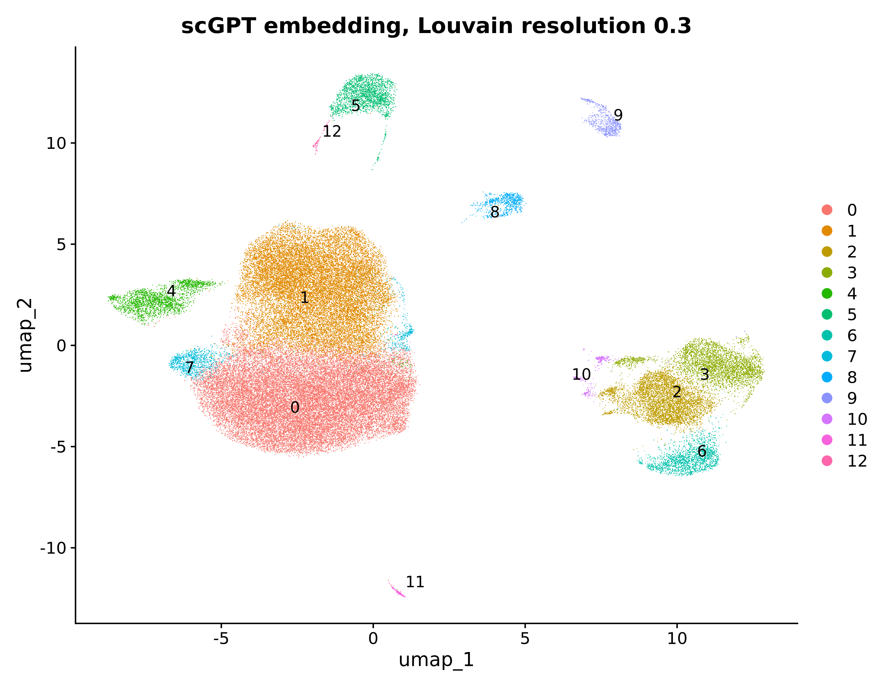

**Supp. Fig. S2.** Uncorrected PCA, 11 clusters

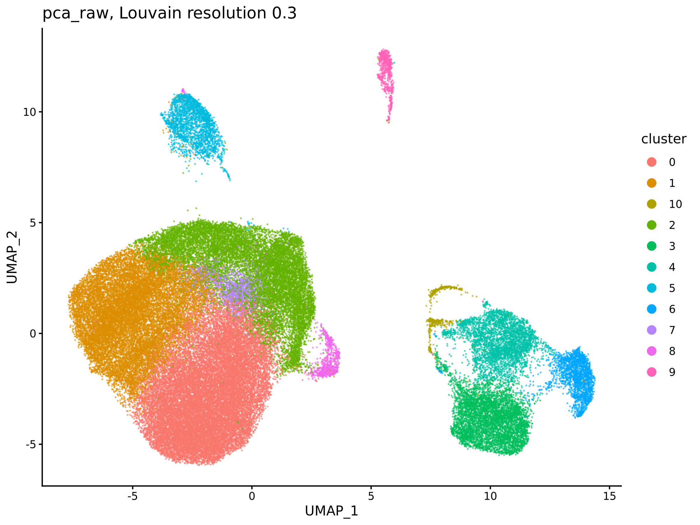

**Supp. Fig. S3A.** Normalized WCSS against cluster count

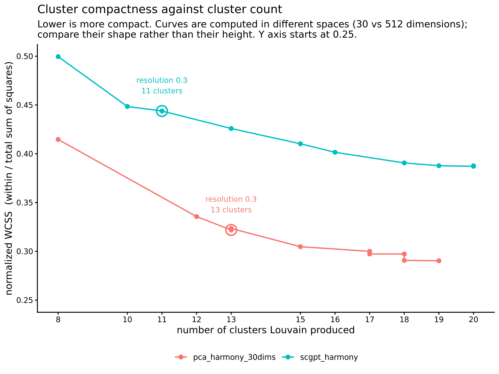

**Supp. Fig. S3B.** Dispersion explained against cluster count

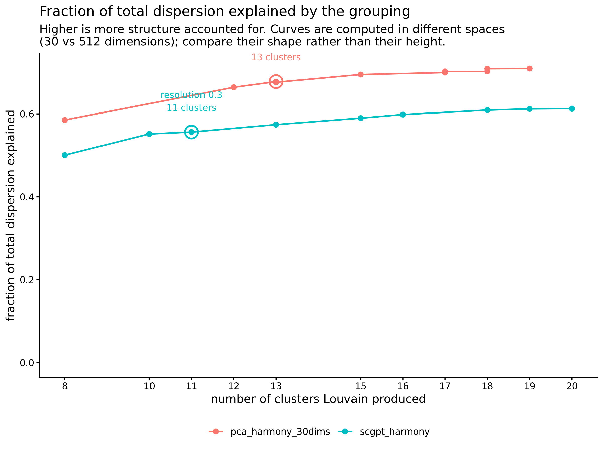

**Supp. Fig. S4A.** PCA-Harmony cluster map

**Supp. Fig. S4B.** scGPT-Harmony cluster map

| Table | Content |
| --- | --- |
| **Table 1** | Five arms: dims, clusters, smallest, donor mixing, donor NMI |
| **Table 2** | Broad cell-type counts per arm |
| **Supp. Table S1** | scGPT vocabulary coverage |
| **Supp. Table S2** | Cross-tabulation of scGPT cluster 0 against PCA clusters |

## References (to collect)

- Piehl N, et al. Cell 2022 (dataset and reference workflow).
- scGPT: Cui H, et al. Nat Methods 2024.
- Seurat v5 / SCTransform (Hafemeister & Satija 2019; Choudhary & Satija 2022).
- Harmony: Korsunsky I, et al. Nat Methods 2019.
- Louvain / SNN clustering; silhouette (Rousseeuw 1987).
- Foundation-model benchmarks (e.g., Kedzierska et al. zero-shot evaluation) for the
  Introduction and Discussion.
