# PCA vs. scGPT on GSE200164 CSF immune cells

This repository compares two cell representations — PCA on SCTransformed expression, and a frozen scGPT embedding — on the public GSE200164 single-cell RNA-seq dataset: **70,391 CSF immune cells from 59 individuals**. The two are benchmarked first on cell-state structure, then on patient-level aging and cognitive-impairment biology. [The two benchmarks](#the-two-benchmarks) states both questions.

The baseline for that comparison is a reproduction of the clustering workflow behind Figure 1D of Piehl et al., which generates an integrated UMAP of unsupervised clusters. The published figure is a later, annotated result, in which the authors used marker genes and separate reclustering of T cells and monocytes to assign final cell-type labels.

The image below is the corrected pipeline's own result: 12 unsupervised clusters over all 70,391 cells, after the integration-feature correction described in [Result and the cluster-count difference](#result-and-the-cluster-count-difference).

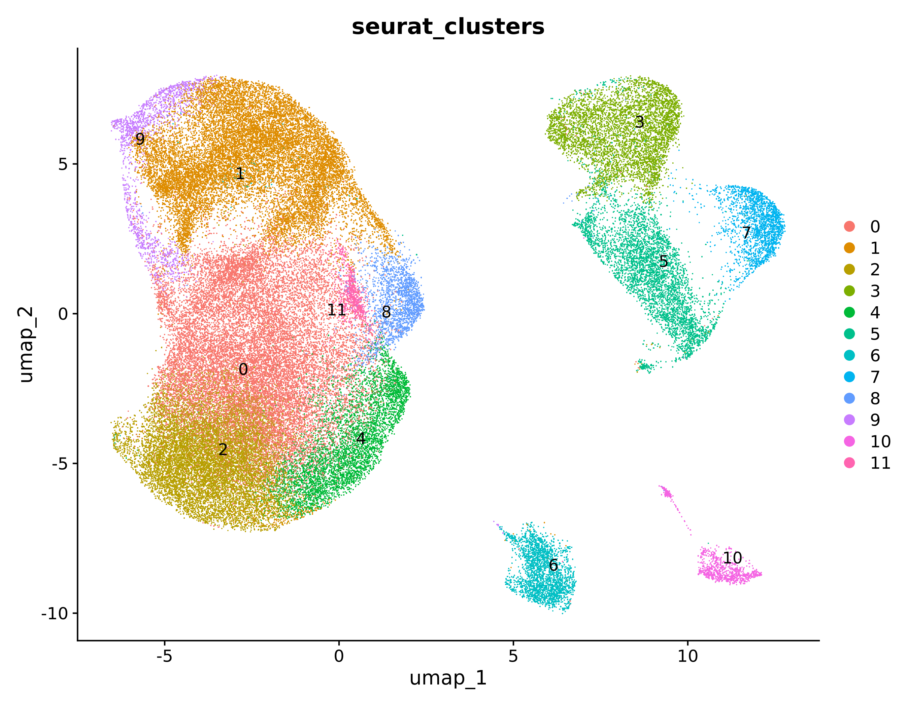

**Stage 03, the Seurat arm.** SCTransform per sample, integration over the full 2,816-gene candidate pool, PCs 1–15, Louvain at resolution 0.3. Clusters are numbered, not identified — the authors' cell-type names come from the marker and reclustering steps this reproduction stops short of. Cluster sizes run from 18,533 cells down to 787, the two smallest being the 976-cell cluster 10 and the 787-cell cluster 11; the earlier 2,000-feature run bottomed out at 671 with nothing below it.

## The two benchmarks

Reproducing Figure 1D is the starting point, not the goal. The goal is to compare two ways of representing a cell — PCA on SCTransformed expression, and a frozen scGPT embedding — on two different scientific questions. They are separate benchmarks with separate correction requirements, and they can produce different winners.

**Benchmark 1 — cell-state structure.** *Which representation organizes cells into cleaner, donor-independent cell populations?* Batch-corrected PCA against batch-corrected scGPT. Batch correction belongs here: a CD8 T cell from patient A should sit with a CD8 T cell from patient B, not in a "patient A" cluster. This is Stages 06–08, and it breaks into several tests:

| test | what it asks | stage |
| --- | --- | --- |
| donor mixing / donor NMI | are clusters driven by patient identity instead of shared biology? | 06 |
| silhouette | are clusters compact and separated? | 07 |
| WCSS sweep | how does compactness change as Louvain makes more communities? *(supporting)* | 08 |
| PCA-512 control | is scGPT's advantage just having more dimensions? | 10–11 |
| marker analysis | do clusters correspond to real immune cell types? | not yet written |

**Benchmark 2 — patient biology.** *Which representation better preserves variation associated with healthy aging and cognitive impairment?* Patient-preserving PCA against patient-preserving scGPT. Not yet run.

The correction requirement inverts here. Age, sex, and diagnosis are constant within a patient, so Harmony's removal of between-patient variation deletes the entire signal this benchmark is looking for — see [the age caveat](#the-age-caveat). Benchmark 2 therefore uses Benchmark 1 only for its cell-type labels, then returns to a representation that keeps patient variation, and pools cells to **patient × cell type**, making the patient rather than the cell the independent unit:

```
patient A's CD8 cells  →  one CD8 state vector for patient A
patient B's CD8 cells  →  one CD8 state vector for patient B
```

Two questions follow. First, healthy aging: fit a cell-type-specific trajectory over cognitively healthy patients only, `H_pc = f_c(age_p, sex_p)`, and ask whether patient-level cell state changes predictably with age. Second, cognitive impairment: a 74-year-old CI patient is compared not against all healthy patients but against the expected state of a healthy 74-year-old, `D_pc = H_pc − f_c(age_p, sex_p)`, and the test is whether CI patients deviate systematically.

## Where the results are

Every figure and table is inventoried in **[`Age_trajectory/results/README.md`](Age_trajectory/results/README.md)**. Figures are collected in [`Age_trajectory/results/figures/`](Age_trajectory/results/figures/); each stage's data stays in its own numbered directory.

| stage | what it produced | figure |
| --- | --- | --- |
| **03** Seurat reproduction | 12 clusters, anchor-integrated | [UMAP](#result-and-the-cluster-count-difference) |
| **04** scGPT embedding | 13 clusters, frozen, uncorrected | [UMAP](#stage-04--the-scgpt-comparison) |
| **06** Harmony benchmark | 5 arms, donor leakage removed | [three layouts](#the-three-layouts) |
| **07** silhouette | native and matched widths, both spaces | [matched 2×2](#matched-widths--512-against-512) |
| **08** WCSS sweep | the elbow, resolution 0.1 → 1.0 | [compactness](#stage-08--elbow-style-compactness-comparison) |
| **10** PCA-512 control | 9 clusters, rare populations lost | [UMAP](#stage-10--pca-at-the-embeddings-width) |
| **14** marker evidence | canonical panel over both layouts | [feature plots](#stage-14--the-authors-marker-evidence-drawn-for-both-arms) |
| **15** annotation | five cell types, both arms, by hand | [cell types](#the-two-arms-agree-at-this-resolution) |

## What the authors did

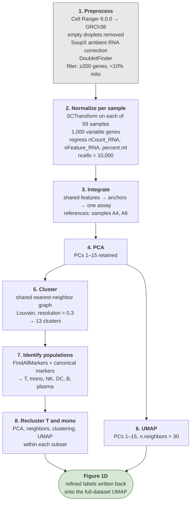

The public expression matrix used here is already the output of step 1.

**PCA feeds clustering and UMAP separately.** UMAP visualizes the cells; the clusters come from the neighbor graph, not from the two-dimensional UMAP coordinates.

Markers used in step 7:

```text
CD3D, CD4, CD8A, CD8B, FOXP3    T cells and regulatory T cells
NKG7, GNLY                      NK cells
FCER1A                          dendritic cells
CD68, CD14, FCGR3A              monocytes
CD19, JCHAIN                    B cells and plasma cells
```

Step 8 produced the finer labels: CD4+, CD8+, CD4+/CD8+, and regulatory T cells; classical, intermediate, and non-classical monocytes.

## What this repository currently does

Our reproduction starts from the processed GEO matrix rather than the raw FASTQ files, so it picks up at the authors' step 2 and carries through their step 6.

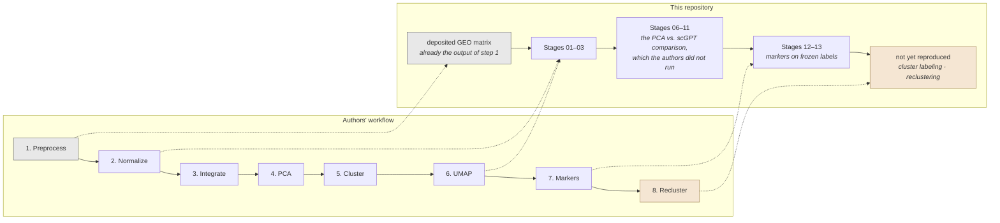

The work is split across three scripts, run in order. Each writes its result to disk and the next reads that file, so a stage can be re-run without repeating the ones before it.


### Stage 01 — acquire the data and prove it is intact

`scripts/01_download_audit_build_anndata.py`

1. downloads the GEO expression matrix and series metadata, verifying each archive's gzip integrity and recording a SHA-256 digest, so a later run can prove it started from identical source data;
2. converts the very large dense CSV into a sparse matrix, storing only nonzero measurements, in both row and column orientations;
3. re-reads the original download and verifies the conversion changed no value — everything downstream depends on this holding;
4. binds measurements, gene names, and cell barcodes into a single AnnData object;
5. parses the patient table from the series matrix and copies each person's age, sex, and diagnosis onto every one of their cells.

The SoupX-adjusted values are fractional, not integer counts. They are preserved exactly at every step; rounding them would silently undo the authors' ambient-RNA correction.

### Stage 02 — measure cell quality and prepare the hand-off

`scripts/02_prepare_figure1d.py`

1. opens Stage 01's result and confirms its dimensions are unchanged;
2. computes the three quality measures the authors regressed out — `nCount_RNA`, `nFeature_RNA`, `percent.mt`;
3. reconciles GEO's accession-based sample names against the authors' `A1`–`H8` labels, and writes a 59-row summary of the study;
4. saves its own checkpoint so a re-run need not repeat the above;
5. exports the matrix in Matrix Market form for R — skipped when Stage 03 already has a checkpoint to resume from, since the export is roughly 4 GB;
6. confirms R and its packages are present now, rather than discovering they are not once Stage 03 is hours into the analysis.

**No cells are removed.** Thresholds are recomputed and reported, but nothing is filtered: `percent.mt` maxes at 9.9979 and `nFeature_RNA` bottoms at 202 — the fingerprints of the authors' filters having already run. Filtering again would diverge from the published dataset.

### Stage 03 — the clustering workflow

`scripts/03_reproduce_figure1d.R`, started automatically by `scripts/03_reproduce_figure1d.py`

The direct counterpart of the authors' steps 2 through 6:


The expensive steps are checkpointed, so `--restart-from` controls how far back a re-run goes:

| `--restart-from` | redoes | keeps | cost |
| --- | --- | --- | --- |
| `none` *(default)* | nothing | the most advanced checkpoint | — |
| `clustering` | neighbors, Louvain, UMAP | the PCA checkpoint | minutes |
| `pca` | PCA onward | the integrated object | ~30 min |
| `integration` | anchors, `IntegrateData` | the 59 SCT checkpoints | hours |
| `all` | everything, including per-sample SCTransform | nothing | many hours |

Each level discards its own checkpoint and every later one, so asking for a cheap re-run never triggers an expensive step.

### Result and the cluster-count difference

The result contains all 70,391 cells in 12 clusters. The authors reported 13.

The resolution is not tuned to force 13, and `vst.flavor = "v1"` stays set. Cluster count is a diagnostic, not a target: a run with no small clusters means rare cell types were lost during feature selection, and that is where to look.

## Stage 04 — the scGPT comparison

This arm replaces the PCA-based cell representation with a frozen scGPT embedding and keeps everything downstream identical. It has been run: `scripts/04_scgpt_figure1d.py` starts `04_scgpt_figure1d.R`, and the results are in `Age_trajectory/results/04_scgpt_embedding/`.

The diagram below shows **both arms side by side**, not Stage 04 alone. Stage 04 is only the right-hand branch; the left-hand branch is Stage 03, a separate script. Neither arm is batch-corrected against the other's method here — that asymmetry is what Stage 06 later exists to remove.

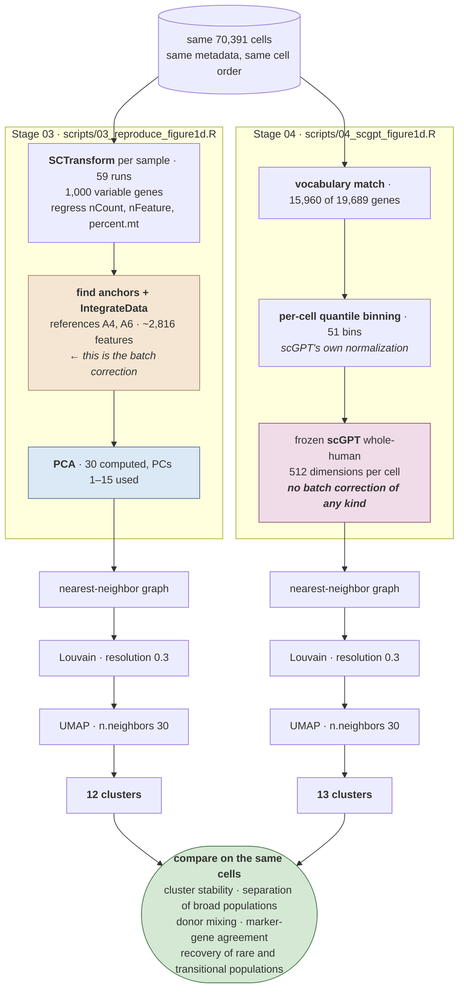

Only the representation differs. Both arms run the same Seurat 5.5.1 code at the same settings with the same seed, so a difference in the result points at the representation rather than at the tooling.

**One departure is unavoidable.** Stage 03 takes PCs 1–15 because PCA orders its output by variance captured. An scGPT embedding has no such ordering — its 512 dimensions are learned jointly and none is privileged — so all 512 are used, as these embeddings are normally consumed. The vectors are unit length, so no dimension dominates through scale alone.

**scGPT never performs explicit batch correction.** It is trusted to place a CD8 T cell in a similar region regardless of which of the 59 samples it came from, because it was pretrained across tens of millions of cells. Testing that assumption is what Stage 06 exists for.


**Stage 04, the scGPT arm — the same 70,391 cells from a frozen embedding instead of from PCA.** Drawn at the same size, palette, and settings as the Seurat figure above so the two can be compared directly. This arm returns 13 clusters to Stage 03's 12 and splits them further at the small end: five clusters under 1,000 cells against Stage 03's two, down to 103 cells. Whether that finer division reflects real populations or uncorrected batch structure is what Stage 06's donor-mixing check answers.

### The genes scGPT never saw

scGPT reads genes as tokens from a vocabulary frozen at pretraining, so genes it does not know are dropped before the model sees a cell. Of this dataset's 19,689 gene symbols, **15,960 (81.1%) matched and 3,729 did not**. Because the embedding is frozen and zero-shot, nothing downstream compensates.

The raw gene count overstates the loss by a factor of sixteen:

| | genes | share of total expression |
| --- | --- | --- |
| kept | 15,960 (81.1%) | **98.862%** |
| dropped | 3,729 (18.9%) | **1.138%** |

**scGPT retained 98.86% of the transcriptomic signal.** The dropped set is overwhelmingly clone-based loci (3,420 of them, e.g. `AC016831.7`), lncRNAs, pseudogenes, and 198 conventional symbols that are nomenclature drift rather than missing biology — the dataset's GRCh38 reference predates HGNC renames the vocabulary already reflects (`HIST1H2BK` → `H2BC12`, `AARS` → `AARS1`, `TMEM173` → `STING1`). scGPT knows those genes under their current names.

**What this settles.** The concern was that a rare-population marker had fallen into the gap, which would give any B-cell or plasma-cell difference between the arms two candidate explanations. Not one of 65 canonical CSF and immune markers was dropped, and 1.1% of signal cannot account for a population-level difference. That concern is closed.

**What it does not settle.** The loss is concentrated in histones and tRNA synthetases — proliferation and translational-capacity signal. If a cluster turns out to be defined by cell-cycle state, the scGPT arm saw a weakened version of that axis.

`scripts/05_audit_scgpt_gene_coverage.py` produces the full report in `scgpt_gene_coverage_audit.json`. It refuses to run if the vendored vocabulary at `archive/vendor/scGPT-main/scgpt/tokenizer/default_census_vocab.json` does not reproduce the run's recorded matched-gene count, so a mismatched vocabulary fails loudly rather than producing a plausible wrong answer.

## Stage 06 — making the two arms comparable

Stages 03 and 04 cannot be compared directly. Stage 03 corrects for patient with integration anchors *before* reducing dimensions; Stage 04 does not correct at all, because scGPT expects count-scale input. One arm is batch-corrected and the other is not, so a clustering difference could be donor structure rather than the representation.

Stage 06 removes that confound by correcting *after* the representation exists, with Harmony, on both arms equally.

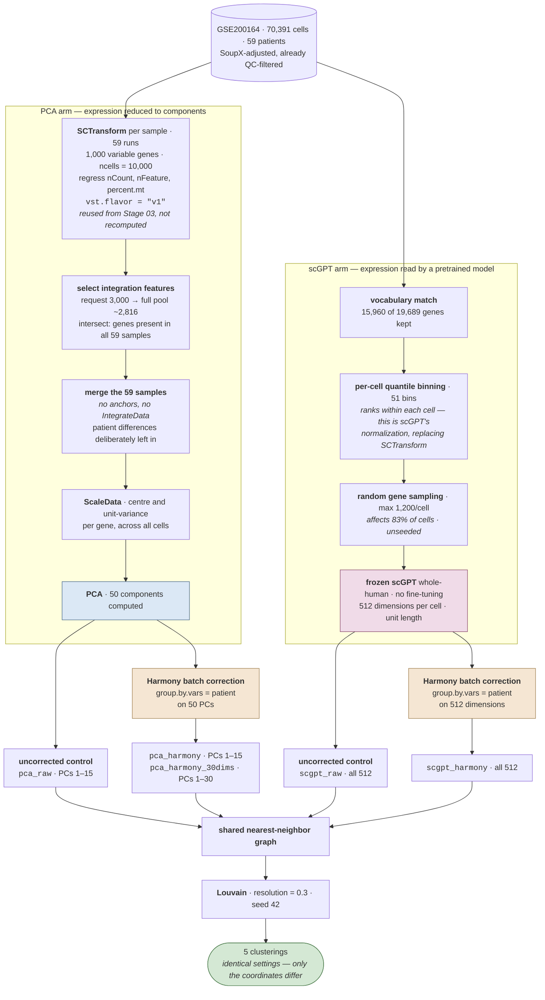

**Where each arm handles the problems SCTransform solves.** The PCA arm normalizes sequencing depth and stabilizes variance explicitly in SCTransform, then corrects patient separately in Harmony. The scGPT arm does neither of those first two as a step: its per-cell quantile binning is a *ranking within each cell*, so dividing a cell by its library size or taking a logarithm leaves every bin unchanged. Depth normalization is absorbed rather than skipped.

Two things binning does **not** absorb, and they remain as asymmetries: SCTransform also regressed out mitochondrial fraction, which ranking preserves, so that technical gradient survives only in the scGPT arm; and the two arms read different gene sets (15,960 vocabulary-matched against ~2,816 variable).

The PCA arm is rebuilt without anchors rather than reusing Stage 03's components. Reusing them would leave that arm corrected twice — once by anchors, once by Harmony — while scGPT is corrected once, and the comparison would confound representation with correction method.

**Stage 03 is not modified.** It remains the paper reproduction; Stage 06's PCA arm is a separate analysis that happens to share its per-sample normalizations, and its cluster count should not be read against the paper's.

### What the correction did

| arm | dims | clusters | smallest | donor mixing | donor NMI |
| --- | --- | --- | --- | --- | --- |
| `pca_raw` | 15 | 11 | 490 | 0.801 | **0.167** |
| `pca_harmony` | 15 | 12 | 109 | **0.959** | 0.051 |
| `pca_harmony_30dims` | 30 | 13 | 139 | 0.950 | 0.051 |
| `scgpt_raw` | 512 | 12 | 103 | 0.806 | **0.072** |
| `scgpt_harmony` | 512 | 11 | 110 | 0.867 | 0.051 |

Donor NMI is how much of a clustering is explained by which patient a cell came from; donor mixing is the fraction of a cell's 30 neighbours from other patients, against the 0.9726 ceiling the sample sizes allow.

**The confound was real, and asymmetric in scGPT's favour.** Uncorrected PCA leaked patient identity at NMI 0.167 against scGPT's 0.072 — the zero-shot embedding was already the more batch-robust of the two, the opposite of what motivated the check. Harmony brought both to 0.051, which is what makes the arms comparable.

**Harmony corrected PCA more effectively than the embedding** (mixing 0.801 → 0.959 against 0.806 → 0.867), consistent with centroid-based correction working less well in 512 concentrated dimensions. The scGPT clustering also moved less: ARI 0.853 between its raw and corrected forms, against 0.519 for the PCA pair.

**Correction recovered rare populations.** `pca_raw` had nothing smaller than 490 cells; after Harmony the smallest is 109. Per the diagnostic this repository uses throughout, that is the signature of rare cell types surviving rather than being absorbed. `pca_harmony` at 12 clusters with a 109-cell smallest also closely tracks Stage 03's anchor-corrected 12 and 120 — two unrelated correction methods converging on the same structure.

**Cross-arm agreement is moderate:** ARI 0.584 between `pca_harmony` and `scgpt_harmony`, NMI 0.694. Related but distinguishable structure.

### The three layouts

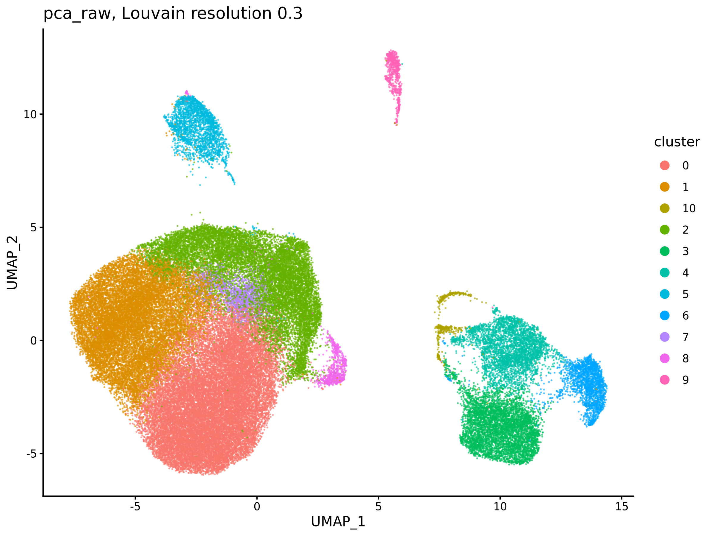

**`pca_raw` — the uncorrected control, 11 clusters.** This is the confound the rest of the stage exists to remove. Nothing is re-clustered — the labels are Stage 06's own and only the layout is new (`scripts/09_pca_raw_umap.R`).

The same layout coloured by patient is the panel that makes the number concrete:

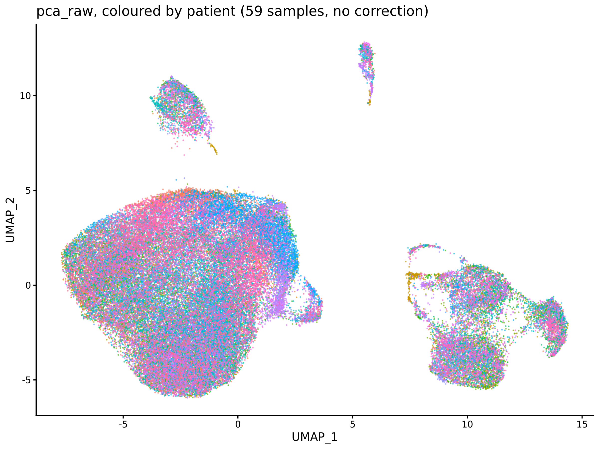

**Donor NMI 0.167 is what this looks like.** The patient colours are visibly textured rather than evenly mixed — streaks and patches of single colours inside what should be one cell type. Compare the smallest cluster: 490 cells here, against 109 after correction. Rare populations are not missing because they are absent, they are absorbed into larger groups that patient structure is holding apart.

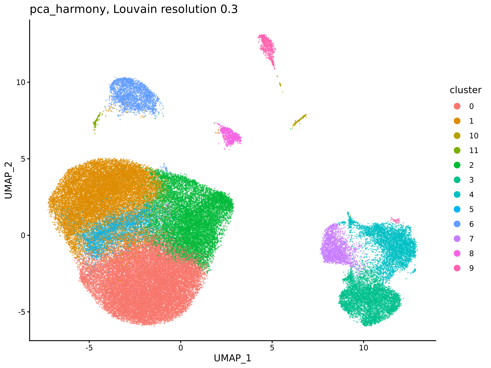

**`pca_harmony` — 12 clusters, donor mixing 0.959 against the 0.9726 ceiling.** It tracks Stage 03's anchor-corrected result closely (12 clusters, 109-cell smallest, against Stage 03's 12 and 120) — two unrelated correction methods converging on the same structure.

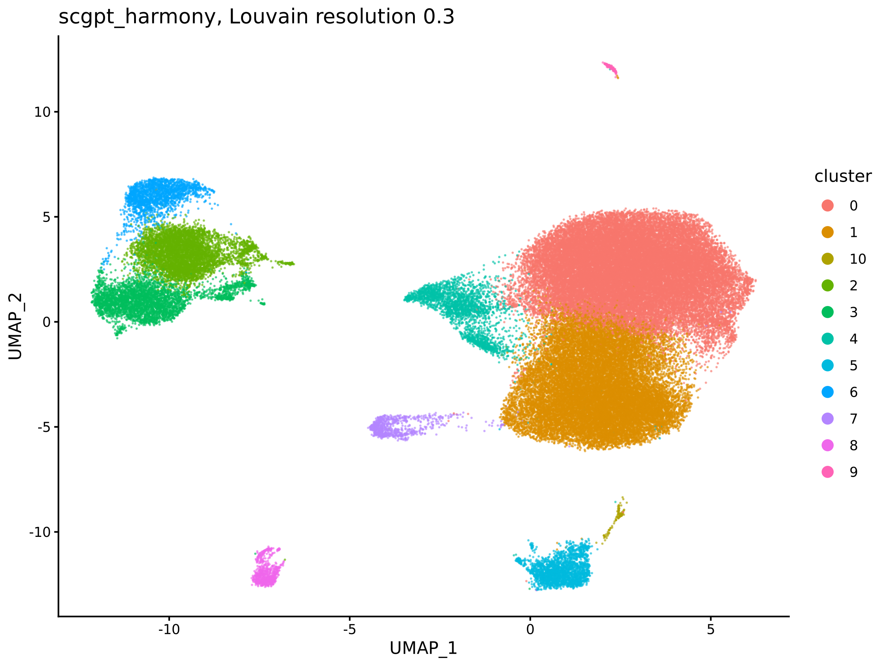

**`scgpt_harmony` — 11 clusters from the corrected embedding.** Harmony moved this arm far less than it moved PCA, so it remains the less thoroughly corrected of the two even after the same treatment.

**The three layouts are not in a shared coordinate system.** Each is a separate UMAP of separate coordinates, so a cluster's position in one panel has no relationship to its position in another. Only the grouping structure is comparable — not location, orientation, or which colour a cluster happens to receive.

### The age caveat

Each of the 59 samples is one patient, and age, diagnosis, sex and cognitive group are all constant within a patient. Patient identity therefore determines age exactly, so removing between-patient variation removes **all** age and diagnosis signal — by construction, not as a tunable side effect.

That is correct for Benchmark 1, which only groups cells by type. It makes the Harmony coordinates unusable for Benchmark 2, which must take the cell-type labels from here but return to a patient-preserving representation to measure aging and CI effects. The driver prints this warning on every run.

## Stage 07 — silhouette comparison

Silhouette scores each cell on how far it sits from its own cluster against the nearest cluster it does not belong to. It runs twice here: once at the arms' native widths (30 dimensions against 512), and again at matched width once [Stage 10](#stage-10--pca-at-the-embeddings-width) has built a 512-dimension PCA arm. The second pass exists because the first cannot separate representation from dimensionality.

Every partition is scored in **both** spaces, and comparisons run **down a column**, where the geometry is fixed. Never across a row: 30 dimensions and 512 dimensions produce distances of different sizes.

Scores come from repeated balanced draws, not all 70,391 cells — the calculation is quadratic in cell count. Drawing proportionally from every cluster, with a floor of two cells, keeps a 25,000-cell cluster from crowding out a 110-cell one. The native pass draws 12,000 cells five times; the matched pass draws 25,000.

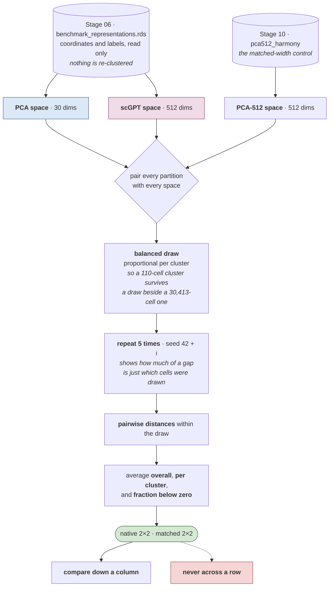

### Native widths — 30 dimensions against 512

| partition | space | | clusters | mean silhouette | sd across draws | negative fraction |
| --- | --- | --- | --- | --- | --- | --- |
| `pca_labels` | pca | *native* | 13 | 0.006 | 0.0017 | 55.5% |
| `scgpt_labels` | pca | cross | 11 | 0.008 | 0.0013 | 45.5% |
| `pca_labels` | scgpt | cross | 13 | 0.103 | 0.0011 | 19.3% |
| `scgpt_labels` | scgpt | *native* | 11 | **0.207** | 0.0007 | **5.5%** |

In PCA space the two partitions are indistinguishable — 0.006 against 0.008, a gap the size of the spread across draws. In scGPT space they separate: 0.207 against 0.103.

The space dominates the partition. Every partition scores higher in scGPT coordinates, including the PCA partition itself, which improves seventeenfold — 0.006 to 0.103 — simply by being measured elsewhere. And neither partition is well separated in PCA space, where 55.5% of cells sit closer to a cluster they were not assigned to. CSF immune populations form gradients, and 30 principal components render them as one largely continuous mass.

That leaves two readings this pass cannot separate: the embedding organizes these cells better, or silhouette behaves differently in 512 dimensions than in 30. Distances concentrate in high dimensions, and silhouette is built from distances, so width moves the score on its own.

### Matched widths — 512 against 512

Both spaces 512 dimensions, both partitions Harmony-corrected and clustered at resolution 0.3 with the same seed. PCA-30 is carried along as a control showing what changes when only the scoring space widens.

| partition | scored in PCA-512 | scored in scGPT-512 |
| --- | --- | --- |
| **PCA-512 labels** (9 clusters) | **−0.033** *(native)* | 0.160 |
| **scGPT labels** (11 clusters) | −0.048 | **0.219** *(native)* |
| *PCA-30 labels* (13, carried) | *−0.042* | *0.107* |

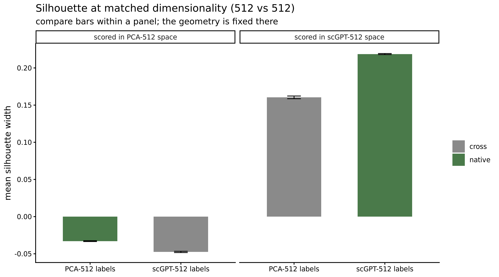

The dimensionality explanation is refuted. Give PCA the embedding's exact width and it degrades rather than improves: PCA-30 scored 0.006 in its own space above, PCA-512 scores **−0.033** in its own space here.

PCA-512 space is not a usable geometry at all. Every partition scores negative there, with **73–79% of cells closer to a cluster they were not assigned to** — including PCA-512's own labels in PCA-512's own space, at 73%.

The cluster-count caveat does not rescue it. Silhouette rewards coarser partitions, and PCA-512 is the coarser one here — 9 clusters against 11. That bias runs in PCA's favour and PCA still loses in scGPT space, 0.160 to 0.219. The remaining asymmetry works against the conclusion, which is what makes it safe to draw.

### Per-cluster, in each partition's own space

| | PCA-512 labels | scGPT labels |
| --- | --- | --- |
| clusters scoring above zero | **4 of 9** | **11 of 11** |
| largest cluster | 25,820 cells at −0.100 | 30,413 cells at 0.237 |
| smallest cluster | 378 cells at −0.097 | 110 cells at 0.145 |
| best cluster | 783 cells at 0.205 | 757 cells at **0.521** |

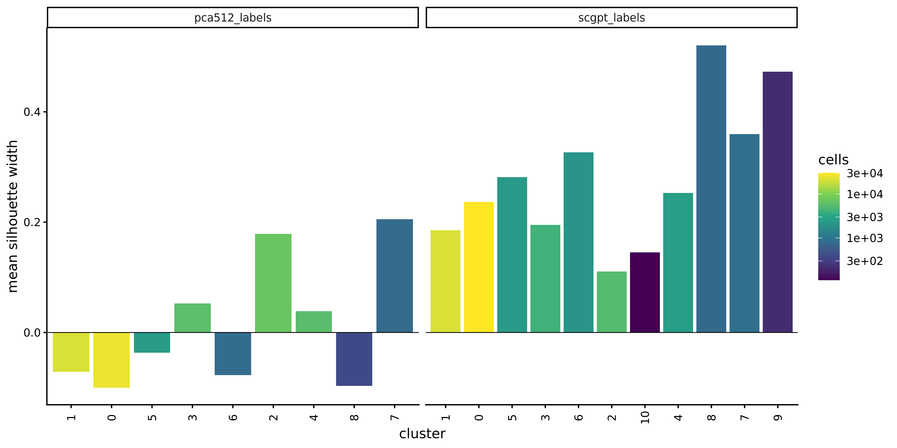

Five of PCA-512's nine clusters score negative, including its two largest — 47,241 cells together, two thirds of the dataset — and its smallest. The scGPT partition scores positive on all eleven, and its small clusters are its strongest: 0.521 at 757 cells, 0.473 at 207. PCA-512 did not merely merge rare populations into nine groups; the nine it produced do not hold together.

The same pattern holds at native widths, where the means above are dominated by the largest clusters sitting in the continuum:

| | best small cluster | largest cluster |
| --- | --- | --- |
| scGPT labels in scGPT space | 757 cells at 0.553 | 30,413 cells at 0.220 |
| PCA labels in scGPT space | 718 cells at **0.575** | — |

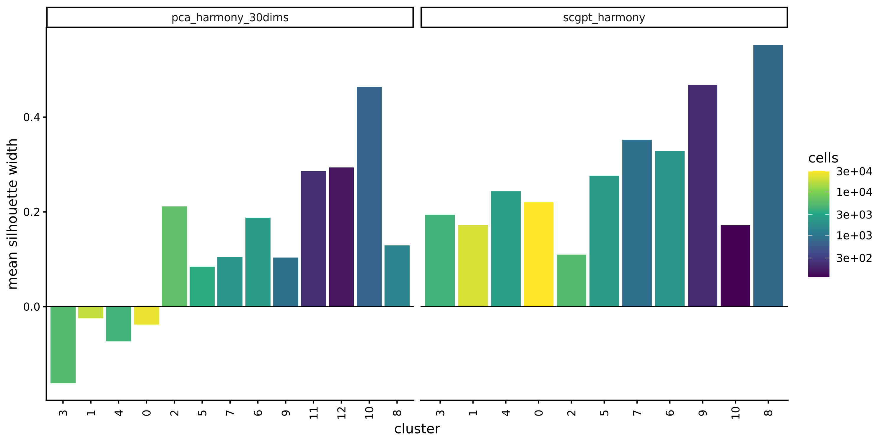

The small clusters both arms recover after correction are the most cleanly separated structures in the data, not marginal groups that barely cleared a threshold. The large T-cell and monocyte masses are what silhouette struggles with — precisely the populations the authors resolved by reclustering rather than on the first pass.

### What this settles, and what it does not

**Settled.** scGPT's advantage is not an artifact of dimensionality. The matched comparison removes that confound, and the remaining cluster-count asymmetry favours PCA, so the result survives its own most likely objection.

**Not settled.** Silhouette measures geometric separation, not biological correctness. A tight group is not necessarily one cell type, and two distinct types with similar expression will always score poorly. That needs marker annotation, which is what Stage 13 begins.

**Dimensions are not rescaled.** Rescaling to equal variance would promote PCA's trailing noise components to the weight of the leading ones carrying the biology — PC1 spans about ten times the spread of PC30. The coordinates are used exactly as the clustering used them.

```bash
python scripts/07_silhouette_comparison.py
python scripts/11_silhouette_dimension_matched.py
```

Outputs land in `Age_trajectory/results/07_silhouette/` and `Age_trajectory/results/11_silhouette_matched/`.


## Stage 08 — elbow-style compactness comparison

**This is a supporting analysis, not part of the PCA-versus-scGPT verdict.** It answers a narrower question — whether resolution 0.3, a parameter inherited from the authors rather than tuned here, sits in a sensible place for each representation. The verdict itself rests on donor mixing (Stage 06) and on silhouette at matched dimensionality ([Stage 07](#matched-widths--512-against-512)); the reason this sweep cannot carry it is the same reason the matched pass had to exist, and is spelled out under [Reading the two curves](#reading-the-two-curves) below.

The elbow method plots how much of a dataset's spread a grouping accounts for against the number of groups, and looks for where adding groups stops helping. It normally runs with k-means, which takes the group count as an argument. **Louvain does not** — it takes a resolution, and the cluster count is an outcome.

So Stage 08 sweeps resolution 0.1 → 1.0 in steps of 0.1, records whatever cluster count each setting produced, and plots against that. No k-means, no re-clustering, no change to Stage 06.

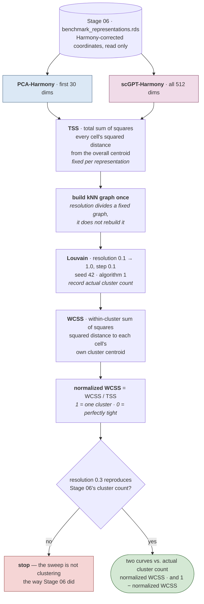

The sweep passes through resolution 0.3, the setting every other stage reports, so the script hard-fails if it does not reproduce Stage 06's 13 and 11 clusters there. Without that check a silently different clustering procedure would still draw a plausible curve.

### PCA-Harmony, 30 dimensions

Total sum of squares: 24,683,610.

| resolution | clusters | normalized WCSS | dispersion explained |
| --- | --- | --- | --- |
| 0.1 | 8 | 0.4147 | 0.5853 |
| 0.2 | 12 | 0.3356 | 0.6644 |
| **0.3** | **13** | **0.3219** | **0.6781** |
| 0.4 | 13 | 0.3234 | 0.6766 |
| 0.5 | 15 | 0.3047 | 0.6953 |
| 0.6 | 17 | 0.2999 | 0.7001 |
| 0.7 | 18 | 0.2973 | 0.7027 |
| 0.8 | 17 | 0.2973 | 0.7027 |
| 0.9 | 19 | 0.2903 | 0.7097 |
| 1.0 | 18 | 0.2907 | 0.7093 |

**The bend sits at 12–13 clusters, and resolution 0.3 lands on it.** Going 8 → 13 clusters buys 0.093 of normalized WCSS; going 13 → 19 buys only 0.032 while adding nearly half again as many clusters — about three times the return per cluster before the bend as after.

That is an independent check on a parameter this project inherited rather than tuned: resolution 0.3 came from the authors, and the compactness curve agrees with it.

### scGPT-Harmony, 512 dimensions

| resolution | clusters | normalized WCSS | dispersion explained |
| --- | --- | --- | --- |
| 0.1 | 8 | 0.4996 | 0.5004 |
| 0.2 | 10 | 0.4485 | 0.5515 |
| **0.3** | **11** | **0.4438** | **0.5562** |
| 0.4 | 13 | 0.4259 | 0.5741 |
| 0.5 | 15 | 0.4102 | 0.5898 |
| 0.6 | 16 | 0.4015 | 0.5985 |
| 0.7 | 18 | 0.3906 | 0.6094 |
| 0.8 | 20 | 0.3872 | 0.6128 |
| 0.9 | 19 | 0.3877 | 0.6123 |
| 1.0 | 20 | 0.3877 | 0.6123 |

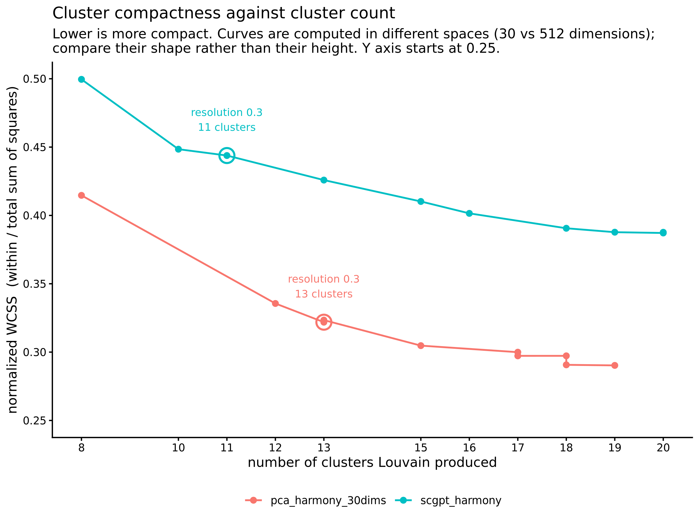

### Reading the two curves

**Heights are not comparable.** The curves live in different spaces — 30 principal components against 512 learned dimensions — and squared distance is not the same quantity in each. Dividing by total spread puts both on 0–1 but does not fix that: dispersion distributes differently in high dimensions, so the vertical gap reflects dimensionality as much as compactness. **The PCA curve sitting below the scGPT curve is not evidence that PCA clusters better.** This is the same confound [Stage 07's matched pass](#matched-widths--512-against-512) removed by rebuilding PCA at 512 dimensions — where it scores *worse*, not better.

**Shape is comparable**, and the two shapes differ:

| | PCA-Harmony | scGPT-Harmony |
| --- | --- | --- |
| WCSS at 8 clusters | 0.4147 | 0.4996 |
| WCSS at ~19–20 clusters | 0.2903 | 0.3872 |
| total drop across the sweep | **0.124** | **0.112** |
| drop by 13 clusters | **0.093 (75% of total)** | 0.074 (66% of total) |
| bend | **12–13 clusters** | **~16–18 clusters** |

**PCA bends earlier and harder.** It banks three quarters of its total improvement by 13 clusters and is flat thereafter — 13 → 19 buys only 0.032. scGPT keeps improving further out: it is still gaining measurably at 16 and 18 clusters, and only flattens near 20.

That is a real difference in how structure is organized. PCA-Harmony concentrates its separable structure into around a dozen groups; scGPT-Harmony's structure keeps subdividing usefully past that point, which is consistent with the embedding carrying finer distinctions that 30 principal components compress away.

**Resolution 0.3 sits differently on each curve.** For PCA it lands on the bend — an independent check on a parameter this project inherited from the authors rather than tuned. For scGPT it lands *before* the bend, at 11 clusters, on a part of the curve still descending. Applying the authors' resolution to the embedding therefore under-divides it relative to where its own compactness curve flattens.

**Neither curve reaches a low absolute value.** Both plateau around 0.29–0.39 normalized WCSS, meaning roughly a third of each representation's total dispersion remains within clusters at any resolution tried. Immune populations in CSF form gradients rather than isolated islands, so no partition into a dozen or two groups will be tight — the elbow locates where subdivision stops paying, not a point where the clusters become compact.

**Resolution is not monotonic in cluster count** in either arm (PCA: 0.7 → 18, 0.8 → 17; scGPT: 0.8 → 20, 0.9 → 19). Louvain is a heuristic, so the plotted lines double back slightly. Read the trend, not individual points.

```bash
python scripts/08_wcss_resolution_sweep.py
```

Outputs land in `Age_trajectory/results/08_wcss_sweep/`, and the two figures in `Age_trajectory/results/figures/`.

## Stage 10 — PCA at the embedding's width

Stage 07's native pass left two readings it could not separate — the embedding organizes these cells better, or silhouette behaves differently at 512 dimensions than at 30. Separating them needs a PCA arm at the embedding's width.

Stage 10 builds that control: PCA carried to 512 components, Harmony-corrected, and clustered fresh at Stage 06's settings — same resolution, same seed, same neighbour graph. **The clustering is new, not the 30-dimension labels re-scored**, because the comparison needs a PCA-512 partition rather than the PCA-30 partition viewed from further away.

### The decomposition has to be exact

Seurat's `RunPCA` defaults to `approx = TRUE`, which uses irlba — a *truncated* method built to pull a few components from a large matrix. Asked for 512 of a possible 2,815 it returns:

```text
did not converge--results might be invalid!; try increasing work or maxit
```

A non-converged decomposition still returns a full matrix of numbers. Dimension checks pass, `anyNA` passes, Harmony corrects it, Louvain clusters it, and the UMAP looks entirely ordinary. The warning is the only evidence anywhere in the pipeline that the components are untrustworthy — the exact failure mode this repository exists to guard against. Stage 10 therefore passes `approx = FALSE` for exact SVD, and promotes any convergence warning to a hard error rather than a message that scrolls past.

### What PCA-512 produced

| arm | dims | clusters | smallest |
| --- | --- | --- | --- |
| `pca_harmony` | 15 | 12 | 109 |
| `pca_harmony_30dims` | 30 | 13 | 139 |
| `scgpt_harmony` | 512 | 11 | 110 |
| **`pca512_harmony`** | **512** | **9** | **378** |

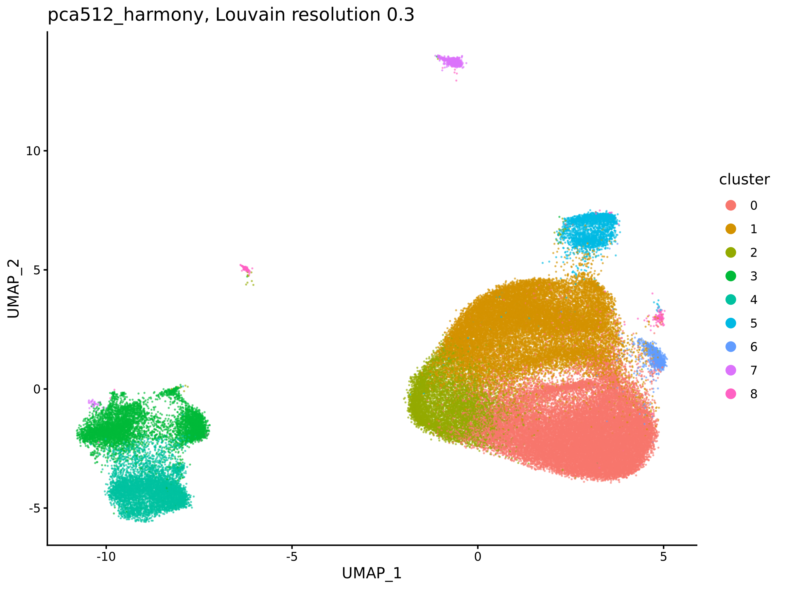

**PCA-512 lost the rare populations.** It returns the fewest clusters of any corrected arm and nothing below 378 cells, where every other arm resolves something near 110. By the diagnostic this repository uses throughout — a run with no small clusters means rare cell types were absorbed rather than resolved — adding dimensions to PCA made it worse.

The variance accounting explains why. Exact SVD puts **40.27% of variance in PCs 1–30 and 59.73% in PCs 31–512**: the added components are many low-variance directions rather than a few informative ones. Euclidean distance sums across all 512, so signal that separates a rare population sharply in 30 components is diluted across roughly 482 near-noise axes, and Louvain merges what it can no longer distinguish.

That is a real property of PCA at this width, not a defect in the setup. It is also the first substantive answer to the question the matched pass was built for — scored rather than inferred in [Stage 07](#matched-widths--512-against-512).

```bash
python scripts/10_pca512_arm.py
```

The PCA-512 arm's outputs land beside Stage 06's in `Age_trajectory/results/06_harmony_benchmark/`.

## Stage 12 — freezing the two partitions

Stages 06 through 11 compared the two representations in their own terms — silhouette, WCSS, donor mixing. None of that says whether either partition's communities are *cell types*. A partition can be geometrically clean and still cut across biology; a loose one can still land on real populations.

The biological test is a **same RNA, different cluster assignments** experiment. PCA and scGPT decide which cells are grouped together; the original RNA expression says what those groups are. Because the marker evidence comes from the RNA assay and not from either representation, neither arm can grade its own work.

That independence only holds if the partitions stop moving. From here the labels are an **input, never an output** — no resolution retuning, no re-clustering, no dropping cells. Stage 12 copies the two arms out of Stage 06 into their own file and records a checksum, so every later stage can prove it read the same partition.

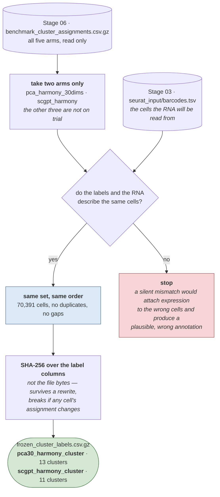

The cluster numbers carry no meaning across arms. Louvain numbers by descending size, so PCA cluster 3 and scGPT cluster 3 are unrelated — and neither has anything to do with the paper's cluster 3. What is frozen is the grouping, not the names.

### Where the two partitions disagree

Cross-tabulating the frozen labels shows the disagreement concentrated in one place. Most clusters map close to one-to-one, but scGPT cluster 0 — 30,413 cells, the largest in either arm — draws from five different PCA clusters:

| PCA cluster | cells → scGPT 0 | of that cluster | reading |
| --- | --- | --- | --- |
| 0 | 23,548 | 93% | lands in scGPT 0 |
| 8 | 1,322 | 97% | lands in scGPT 0 |
| 2 | 3,197 | 52% | splits, rest to scGPT 4 |
| 1 | 1,141 | 6% | mostly elsewhere |
| 5 | 1,114 | 32% | splits, more goes to scGPT 1 |

Only clusters 0 and 8 are genuinely absorbed. Clusters 2 and 5 divide between scGPT clusters, which is a different phenomenon — a boundary drawn in a different place, not a population swallowed.

Either way the question is the same: is PCA resolving real subpopulations that scGPT blurs together, or splitting one population several ways? Geometry cannot settle it — only the RNA can, which is what Stages 13 and 14 do.

```bash
python scripts/12_freeze_cluster_labels.py
```

Outputs land in `Age_trajectory/results/12_frozen_labels/`. Re-running is idempotent: the stage refuses to overwrite the file with different labels, so the freeze cannot drift out from under the stages that read it.

## Stage 13 — marker discovery on one shared expression object

The design that makes this a comparison rather than two separate analyses: **one expression object, two sets of labels**. Not a PCA object with its own RNA and an scGPT object with its own RNA — one matrix, normalized once, with both frozen label columns attached as metadata. `FindAllMarkers` then runs twice over that single object with identical assay, slot, and thresholds.

The only thing that differs between the two runs is which cells are called cluster 0.

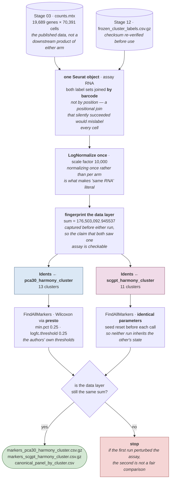

### Why RNA and not SCT

The authors set `DefaultAssay(s) <- "SCT"` before their marker call, and following that literally would be wrong here. Their SCTransform ran on **one merged object**, so it covered one gene set. In this pipeline SCTransform ran **per sample**, and the 59 checkpoints do not agree on which genes they contain:

| gene set | count |
| --- | --- |
| SCT, per sample | 10,112 – 14,923 |
| **SCT, shared by all 59 samples** | **9,013** |
| SCT, union across samples | 17,303 |
| **RNA, every gene for every cell** | **19,689** |

Taking the SCT intersection would discard 54% of the transcriptome, and the genes that drop are exactly the ones measured in some samples but not all — which is what a rare population's markers look like. That is the same failure the 2,000-feature integration cut caused in an earlier Stage 03, described above.

RNA carries every gene for every cell, is identical for both arms, and is what the authors themselves used for their final marker heatmap. It is the assay this stage uses.

### Why presto is required, not optional

presto supplies a compiled Wilcoxon implementation. The stage **refuses to run without it** rather than falling back to Seurat's own — if one arm ran under presto and the other did not, a difference between their marker lists could be the implementation rather than the biology. A hard failure makes that impossible to hit by accident, and the audit records which implementation ran.

```bash
python scripts/13_marker_discovery.py
```

Outputs land in `Age_trajectory/results/13_marker_discovery/`.

## Stage 14 — the authors' marker evidence, drawn for both arms

Stage 13 produced two marker tables. This stage turns them into what a person actually reads before annotating: each canonical marker painted over that arm's own UMAP, plus the numbers behind the colours. Nothing is clustered, and no identity is assigned.

The procedure is the authors' — their 14-gene panel, their `FeaturePlot`, their colours and point size — run twice over the one shared expression object. The only divergences are the two this project studies, plus the RNA-instead-of-SCT choice forced by per-sample SCTransform.

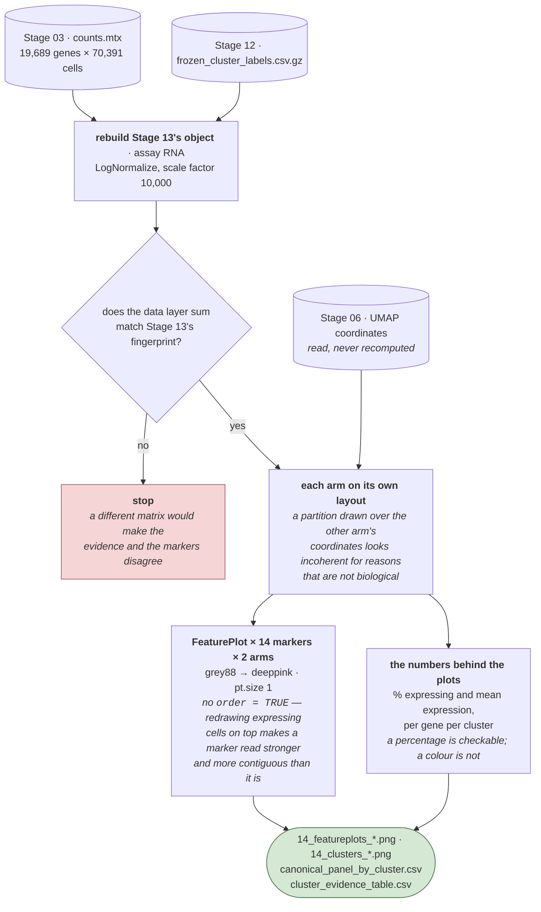

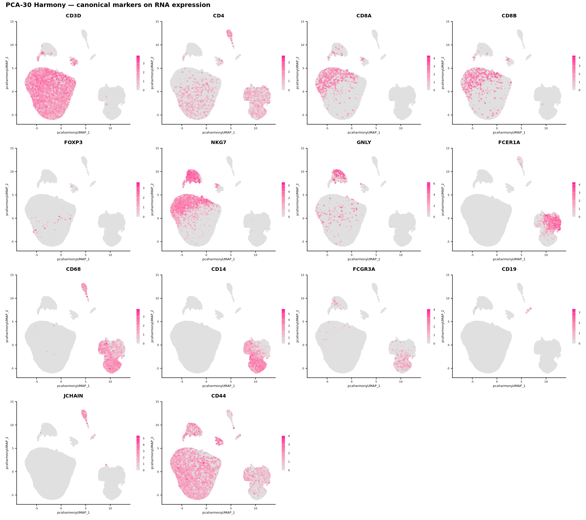

**PCA-30 Harmony.** CD3D covers the large left mass; CD8A/CD8B pick out its upper half and CD4 the lower; NKG7 and GNLY concentrate in the small upper cluster; CD68, CD14 and FCER1A fall on the right-hand pair; CD19 and JCHAIN mark two small clusters and nothing else.


**scGPT Harmony.** The same panel over the same cells in the other layout. The lineages land on separate territories here too, so the annotation below rests on the same kind of evidence in both arms — the disagreement between them is about where boundaries fall, not whether the populations are visible.

Each cluster also gets one evidence row: size, how many of the 59 donors contribute, the largest donor's share, its top 20 markers, and which panel genes are present in at least 25% of its cells. That row is what Stage 15 is read off, and what makes a hand-made decision auditable afterwards.

```bash
python scripts/14_marker_evidence.py
```

Outputs land in `Age_trajectory/results/14_marker_evidence/`, with per-marker plots in `figures/14_feature_plots/`.

## Stage 15 — annotation, by hand, in the authors' seven categories

The authors did not compute their annotation. They read their feature plots and typed cluster numbers into a block of assignments. This stage is that block, written twice.

It is deliberately not a rule engine — an earlier version inferred identities from marker thresholds and invented finer categories than a 14-gene panel can support. CD4 against CD8 against Treg, and the monocyte subtypes, come from reclustering each lineage, which has not happened. The categories here are the authors' seven, `Undetermined` included, and every cluster must receive exactly one of them before the stage will write anything.

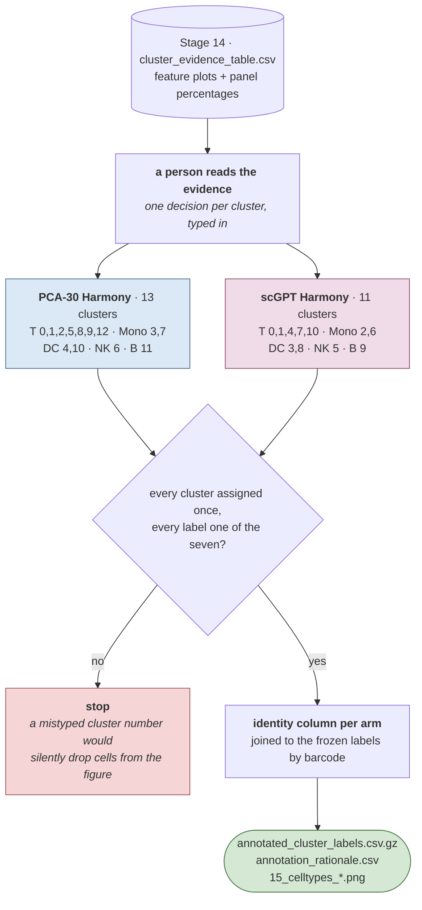

The cluster numbers transfer nowhere. Louvain numbers by descending size, so the authors' "cluster 7 = NK Cells" says nothing about cluster 7 here, and PCA cluster 3 has nothing to do with scGPT cluster 3. Each block above was read off its own partition's plots.


Colours are the authors' Figure 1D palette, so the broad plot and an eventual reclustered Figure 1D read as one family.

### The two arms agree at this resolution

Thirteen clusters and eleven clusters resolve to the same five populations in nearly the same proportions:

| identity | PCA-30 Harmony | scGPT Harmony | difference |
| --- | --- | --- | --- |
| T Cells | 55,485 | 55,554 | 69 |
| Monocytes | 7,392 | 7,471 | 79 |
| DC | 4,931 | 4,848 | 83 |
| NK Cells | 2,362 | 2,311 | 51 |
| B Cells | 221 | 207 | 14 |

Neither arm produced a cluster the panel could not resolve, so `Undetermined` and `Plasma Cells` go unused in both. The extra two PCA clusters are subdivisions *within* T cells — the Treg cluster 8 and the cycling cluster 12 — not a lineage scGPT missed. That is the answer to the Stage 12 question at this resolution: PCA cuts the T compartment finer, and both arms see the same cell types.

```bash
Rscript scripts/15_annotate_clusters.R \
  Age_trajectory/results/12_frozen_labels \
  Age_trajectory/results/14_marker_evidence \
  Age_trajectory/results/06_harmony_benchmark \
  Age_trajectory/results/15_annotation \
  Age_trajectory/results/figures
```

Outputs land in `Age_trajectory/results/15_annotation/`.

## References

- Piehl N, et al. *Cerebrospinal fluid immune dysregulation during healthy brain aging and cognitive impairment.* Cell. 2022. DOI: 10.1016/j.cell.2022.11.019.
- Dataset: GEO accession **GSE200164**.
- Author code: `gatelabNW/csf_aging`.
