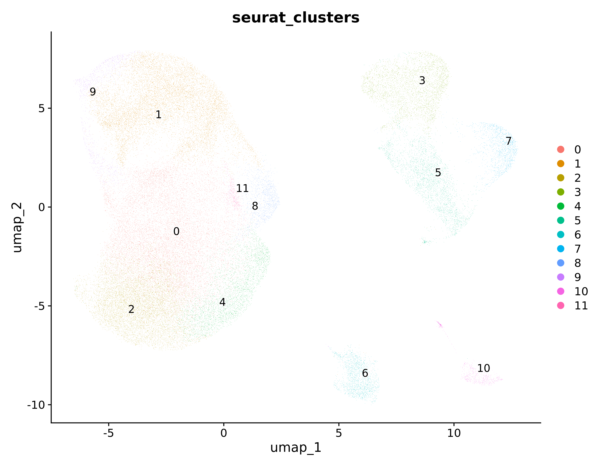
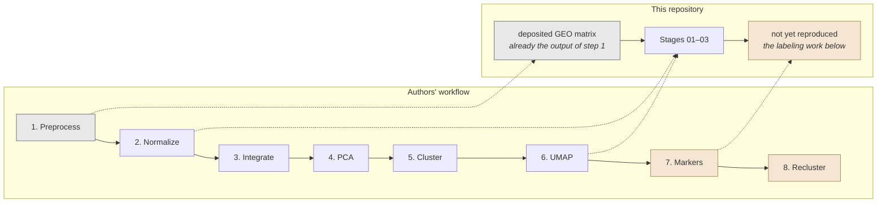
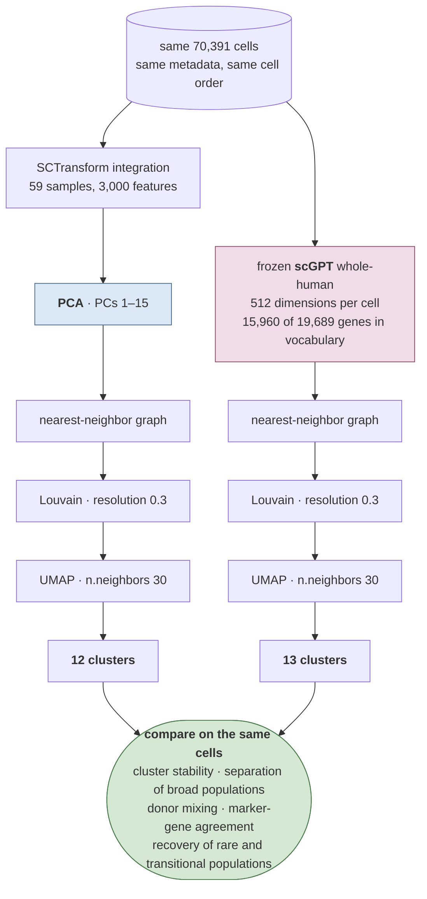

# GSE200164 Figure 1D Reproduction

This repository reproduces the clustering workflow used for Figure 1D of Piehl et al. from the public GSE200164 single-cell RNA-seq dataset: **70,391 CSF immune cells from 59 individuals**.

The reproduction generates an integrated UMAP of unsupervised clusters. The published figure is a later, annotated result, in which the authors used marker genes and separate reclustering of T cells and monocytes to assign final cell-type labels.

The image below is from the earlier 11-cluster run, before the integration-feature correction described in [Result and the cluster-count difference](#result-and-the-cluster-count-difference); it will be replaced when the corrected pipeline is re-run.



## What the authors did


The public expression matrix used here is already the output of step 1.

**PCA feeds clustering and UMAP separately.** UMAP visualizes the cells; the clusters come from the neighbor graph, not from the two-dimensional UMAP coordinates.

Markers used in step 7:

```text
CD3D, CD4, CD8A, CD8B, FOXP3    T cells and regulatory T cells
NKG7, GNLY                      NK cells
FCER1A                          dendritic cells
CD68, CD14, FCGR3A              monocytes
CD19, JCHAIN                    B cells and plasma cells
```

Step 8 produced the finer labels: CD4+, CD8+, CD4+/CD8+, and regulatory T cells; classical, intermediate, and non-classical monocytes.

## What this repository currently does

Our reproduction starts from the processed GEO matrix rather than the raw FASTQ files, so it picks up at the authors' step 2 and carries through their step 6.



The work is split across three scripts, run in order. Each writes its result to disk and the next reads that file, so a stage can be re-run without repeating the ones before it.


### Stage 01 — acquire the data and prove it is intact

`scripts/01_download_audit_build_anndata.py`

1. downloads the GEO expression matrix and series metadata, verifying each archive's gzip integrity and recording a SHA-256 digest, so a later run can prove it started from identical source data;
2. converts the very large dense CSV into a sparse matrix, storing only nonzero measurements, in both row and column orientations;
3. re-reads the original download and verifies the conversion changed no value — everything downstream depends on this holding;
4. binds measurements, gene names, and cell barcodes into a single AnnData object;
5. parses the patient table from the series matrix and copies each person's age, sex, and diagnosis onto every one of their cells.

The SoupX-adjusted values are fractional, not integer counts. They are preserved exactly at every step; rounding them would silently undo the authors' ambient-RNA correction.

### Stage 02 — measure cell quality and prepare the hand-off

`scripts/02_prepare_figure1d.py`

1. opens Stage 01's result and confirms its dimensions are unchanged;
2. computes the three quality measures the authors regressed out — `nCount_RNA`, `nFeature_RNA`, `percent.mt`;
3. reconciles GEO's accession-based sample names against the authors' `A1`–`H8` labels, and writes a 59-row summary of the study;
4. saves its own checkpoint so a re-run need not repeat the above;
5. exports the matrix in Matrix Market form for R — skipped when Stage 03 already has a checkpoint to resume from, since the export is roughly 4 GB;
6. confirms R and its packages are present now, rather than discovering they are not once Stage 03 is hours into the analysis.

**No cells are removed.** Thresholds are recomputed and reported, but nothing is filtered: `percent.mt` maxes at 9.9979 and `nFeature_RNA` bottoms at 202 — the fingerprints of the authors' filters having already run. Filtering again would diverge from the published dataset.

### Stage 03 — the clustering workflow

`scripts/03_reproduce_figure1d.R`, started automatically by `scripts/03_reproduce_figure1d.py`

The direct counterpart of the authors' steps 2 through 6:


The expensive steps are checkpointed, so `--restart-from` controls how far back a re-run goes:

| `--restart-from` | redoes | keeps | cost |
| --- | --- | --- | --- |
| `none` *(default)* | nothing | the most advanced checkpoint | — |
| `clustering` | neighbors, Louvain, UMAP | the PCA checkpoint | minutes |
| `pca` | PCA onward | the integrated object | ~30 min |
| `integration` | anchors, `IntegrateData` | the 59 SCT checkpoints | hours |
| `all` | everything, including per-sample SCTransform | nothing | many hours |

Each level discards its own checkpoint and every later one, so asking for a cheap re-run never triggers an expensive step.

### Result and the cluster-count difference

The result contains all 70,391 cells. The authors reported 13 clusters.

**An earlier version of this pipeline produced 11, and most of that gap now has an identified cause.** It requested 2,000 integration features, matching the authors' code as written. But `SelectIntegrationFeatures` keeps only genes measured in every one of the 59 samples, and the smallest sample holds 151 cells, so on Seurat 5.5.1 the candidate pool is roughly 2,816 genes rather than the tens of thousands the request implies. Asking for 2,000 discarded about 800 of them.

Which 800 is what matters. Candidates rank by how many samples each gene varies in, so the cut keeps genes that vary everywhere and drops genes that vary in only a few — and a plasma-cell or B-cell marker can only look variable in the samples that contained those cells. The markers of rare populations were removed before the merge, leaving those cells nothing to separate on:

| | clusters | smallest cluster |
| --- | --- | --- |
| authors | 13 | B cells, Undetermined |
| pipeline requesting 2,000 features | 11 | 671 cells |
| notebook run on the full pool | 12 | 120 cells |

Stage 03 now requests 3,000, which returns the pool entire. **The corrected pipeline has since been re-run end to end and returned 12 clusters**, matching the notebook run over the identical matrix (`edited_good_reproduction.md`) that first produced that number.

Two further differences were corrected at the same time. PCA computed 50 components where that reference run computed 30; the decomposition is iterative rather than exact, so the count perturbs the 15 components actually used. And `DimPlot` painted all 70,391 cells onto a 512 × 512 grid before stretching it across a 2,700 × 2,100 image, washing the figure out for reasons that have nothing to do with the analysis.

**Matching 13 exactly is still not expected.** The remaining gap is still attributed to Seurat implementation drift since October 2021 — a hypothesis that has not been tested, since testing it means re-running pinned to the authors' original package versions. Other explanations remain open: an undocumented parameter, or an unrecorded step between their preprocessing and their Figure 1D script.

Two decisions stand:

- **`vst.flavor = "v1"` is set deliberately.** The authors wrote their script before SCTransform v2 existed, so their unspecified call ran v1; modern Seurat defaults to v2. Removing this line would look like a closer match to their code while running a different algorithm. This narrows one known source of divergence — it does not resolve the count.
- **The resolution is not tuned to force 13 clusters.** Raising it until the number matched would report the published count obtained by a different method, burying the discrepancy rather than recording it.

Cluster count is treated as a diagnostic rather than a target. A run that returns no small clusters is evidence that rare cell types were lost during feature selection, and that is where to look.

## Stage 04 — the scGPT comparison

This arm replaces the PCA-based cell representation with a frozen scGPT embedding and keeps everything downstream identical. It has been run: `scripts/04_scgpt_figure1d.py` starts `04_scgpt_figure1d.R`, and the results are in `Age_trajectory/results/figure1d_scgpt/`.



Only the representation differs. Both arms run the same Seurat 5.5.1 code at the same settings with the same seed, so a difference in the result points at the representation rather than at the tooling.

**One departure is unavoidable.** Stage 03 takes principal components 1–15, which is meaningful because PCA orders its output by variance captured — the tail is discardable noise. An scGPT embedding has no such ordering: its 512 dimensions are learned jointly and none is privileged, so there is no leading 15 to take. All 512 are used, as these embeddings are normally consumed. The vectors are unit length, so no dimension dominates the distance through scale alone.

**The two arms skip very different amounts of work.** Stage 04 runs only the bottom row of the diagram — no SCTransform, no anchor finding, no integration, no PCA. It finished in about 7 minutes against Stage 03's roughly 90, but the comparison is not like for like: the embedding itself cost 618 seconds on an L4 GPU in a separate session. The deeper difference is that scGPT never performs explicit batch correction. It is trusted to place a CD8 T cell in a similar region regardless of which of the 59 samples it came from, because it was pretrained across tens of millions of cells. That assumption is one of the things this comparison exists to test — if the scGPT clusters segregate by `internal_sample_id`, the speed came at the cost of uncorrected batch effects.

### The genes scGPT never saw

scGPT does not consume expression as a vector in the dataset's column order. It reads genes as tokens looked up in a vocabulary frozen at pretraining. Of this dataset's 19,689 gene symbols, **15,960 (81.1%) matched a token and 3,729 did not** — and the unmatched ones were dropped before the model saw a single cell. Because this is a frozen zero-shot embedding, nothing downstream compensates.

That made the loss look severe, and it is worth recording why it is not, because the raw gene count is misleading by a factor of sixteen.

**Which genes were dropped.** The vocabulary is in this repository at `archive/vendor/scGPT-main/scgpt/tokenizer/default_census_vocab.json`. Its 60,694 tokens reproduce the run's split exactly — 15,960 matched, 3,729 dropped — which identifies it as the gene content the run used, even though the model's own `vocab.json` carries a different checksum for prepending special tokens. The dropped set is 3,420 clone-based loci (`AC016831.7`), about 110 further lncRNAs, antisense transcripts, pseudogenes and uncharacterized ORFs, and **198 conventional HGNC-style symbols**. Not one of 65 canonical CSF and immune markers was dropped; `PPBP`, `HBB`, `PF4` and `SDC1` are absent from the dataset itself, unrelated to scGPT.

The 198 conventional symbols are nomenclature drift, not missing biology. The dataset's names come from a GRCh38 CellRanger reference predating HGNC renames the vocabulary already reflects — roughly 90 histone genes (`HIST1H2BK` → `H2BC12`, `H3F3B` → `H3-3B`), about 20 aminoacyl-tRNA synthetases that gained a numeric suffix (`AARS` → `AARS1`), the membrane-associated RING finger genes renamed away from Excel date coercion (`MARCH1` → `MARCHF1`), and characterized genes that outgrew placeholder names (`TMEM173` → `STING1`, `FAM49A` → `CYRIA`). scGPT knows every one of these genes under its current symbol.

**How much signal was lost.** Counting genes weights a never-expressed clone-based locus the same as a histone transcribed in every cell, so the more honest measure sums the expression behind each side of the split. Over the matrix scGPT actually ingested:

| | genes | share of total expression |
| --- | --- | --- |
| kept | 15,960 (81.1%) | **98.862%** |
| dropped | 3,729 (18.9%) | **1.138%** |

**scGPT retained 98.86% of the transcriptomic signal.** The dropped 1.1% is concentrated rather than diffuse: the top 20 dropped genes carry 47.6% of it, and they are almost entirely the renamed histones — `H3F3B` alone accounts for 0.148% of all expression in the dataset, an eighth of everything lost. The 3,420 clone-based loci together contribute less than the histone cluster, and 81 dropped genes have no expression anywhere at all.

**What this settles.** The concern that motivated the check was that a rare-population marker had fallen into the gap, giving any B-cell or plasma-cell difference between the arms two candidate explanations. It had precedent: cutting ~800 integration features destroyed exactly those populations, because which genes are dropped matters more than how many. That concern is now closed. No lineage marker was dropped, and 1.1% of signal cannot account for a population-level difference.

**What it does not settle.** The loss is not spread evenly across biology. Histones and tRNA synthetases are proliferation and translational-capacity signal, so if any cluster turns out to be defined by cell-cycle state, the scGPT arm saw a weakened version of that axis. That is a narrow caveat rather than the broad one it replaces, but it is the honest residue.

Every figure above is produced by `scripts/05_audit_scgpt_gene_coverage.py`, which reads the matrix scGPT was actually given and writes its full report — the dropped-gene list, the name classes, the per-gene expression ranking, and the marker check — to `scgpt_gene_coverage_audit.json`. It refuses to run if the vendored vocabulary does not reproduce the run's recorded matched-gene count, so a mismatched vocabulary fails loudly rather than producing a plausible wrong answer.

## Future cluster labeling from gene expression

Cluster labels should be assigned from the original normalized RNA expression values — not from UMAP coordinates or embedding dimensions alone. The same workflow applies to both the PCA and scGPT clusters, so the two can be compared on the same biological evidence.


## References

- Piehl N, et al. *Cerebrospinal fluid immune dysregulation during healthy brain aging and cognitive impairment.* Cell. 2022. DOI: 10.1016/j.cell.2022.11.019.
- Dataset: GEO accession **GSE200164**.
- Author code: `gatelabNW/csf_aging`.
