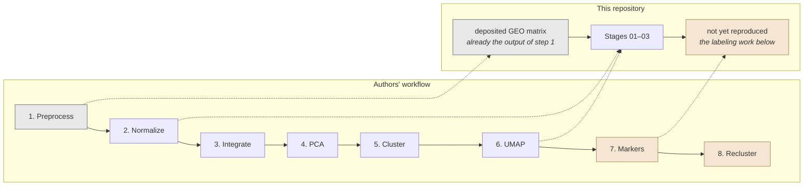
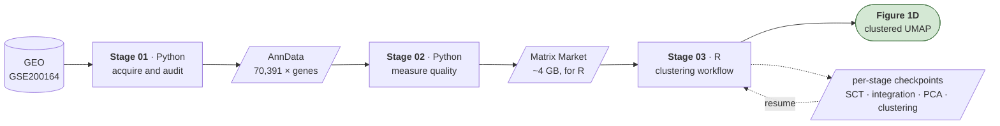
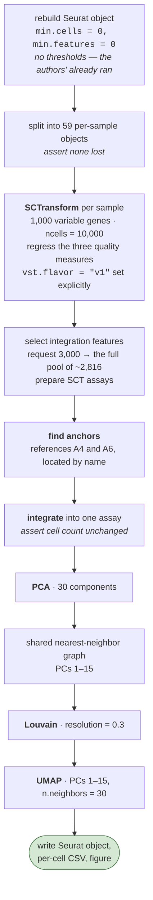
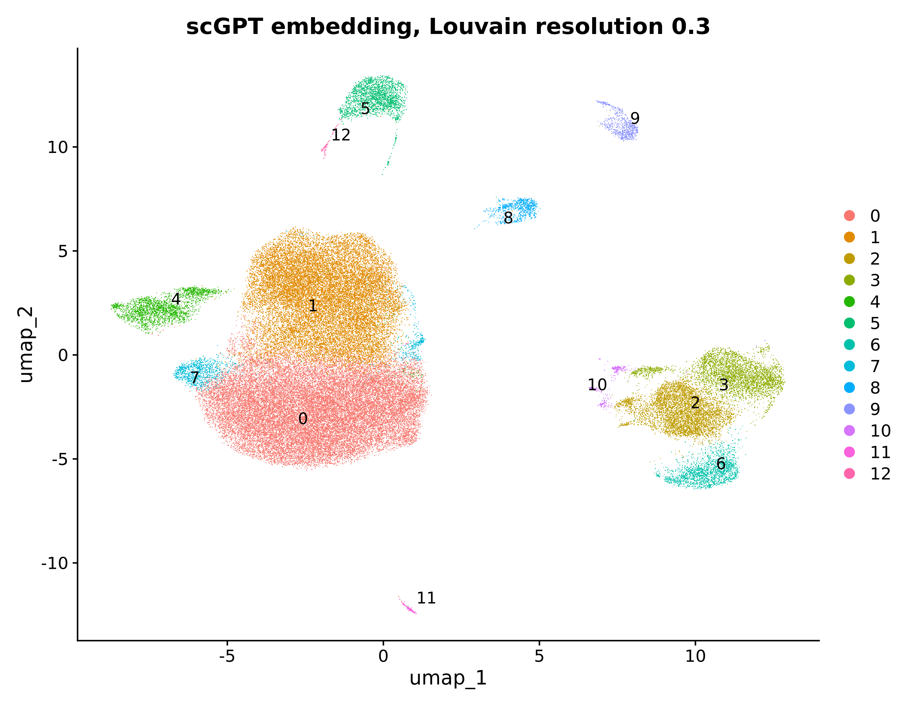
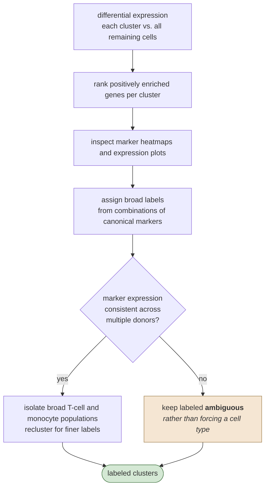

# GSE200164 Figure 1D Reproduction

This repository reproduces the clustering workflow used for Figure 1D of Piehl et al. from the public GSE200164 single-cell RNA-seq dataset: **70,391 CSF immune cells from 59 individuals**.

The reproduction generates an integrated UMAP of unsupervised clusters. The published figure is a later, annotated result, in which the authors used marker genes and separate reclustering of T cells and monocytes to assign final cell-type labels.

The image below is the corrected pipeline's own result: 12 unsupervised clusters over all 70,391 cells, after the integration-feature correction described in [Result and the cluster-count difference](#result-and-the-cluster-count-difference).


**Stage 03, the Seurat arm.** SCTransform per sample, integration over the full 2,816-gene candidate pool, PCs 1–15, Louvain at resolution 0.3. Clusters are numbered, not identified — the authors' cell-type names come from the marker and reclustering steps this reproduction stops short of. Cluster sizes run from 18,533 cells down to 787, the two smallest being the 976-cell cluster 10 and the 787-cell cluster 11; the earlier 2,000-feature run bottomed out at 671 with nothing below it.

## What the authors did


The public expression matrix used here is already the output of step 1.

**PCA feeds clustering and UMAP separately.** UMAP visualizes the cells; the clusters come from the neighbor graph, not from the two-dimensional UMAP coordinates.

Markers used in step 7:

```text
CD3D, CD4, CD8A, CD8B, FOXP3    T cells and regulatory T cells
NKG7, GNLY                      NK cells
FCER1A                          dendritic cells
CD68, CD14, FCGR3A              monocytes
CD19, JCHAIN                    B cells and plasma cells
```

Step 8 produced the finer labels: CD4+, CD8+, CD4+/CD8+, and regulatory T cells; classical, intermediate, and non-classical monocytes.

## What this repository currently does

Our reproduction starts from the processed GEO matrix rather than the raw FASTQ files, so it picks up at the authors' step 2 and carries through their step 6.



The work is split across three scripts, run in order. Each writes its result to disk and the next reads that file, so a stage can be re-run without repeating the ones before it.



### Stage 01 — acquire the data and prove it is intact

`scripts/01_download_audit_build_anndata.py`

1. downloads the GEO expression matrix and series metadata, verifying each archive's gzip integrity and recording a SHA-256 digest, so a later run can prove it started from identical source data;
2. converts the very large dense CSV into a sparse matrix, storing only nonzero measurements, in both row and column orientations;
3. re-reads the original download and verifies the conversion changed no value — everything downstream depends on this holding;
4. binds measurements, gene names, and cell barcodes into a single AnnData object;
5. parses the patient table from the series matrix and copies each person's age, sex, and diagnosis onto every one of their cells.

The SoupX-adjusted values are fractional, not integer counts. They are preserved exactly at every step; rounding them would silently undo the authors' ambient-RNA correction.

### Stage 02 — measure cell quality and prepare the hand-off

`scripts/02_prepare_figure1d.py`

1. opens Stage 01's result and confirms its dimensions are unchanged;
2. computes the three quality measures the authors regressed out — `nCount_RNA`, `nFeature_RNA`, `percent.mt`;
3. reconciles GEO's accession-based sample names against the authors' `A1`–`H8` labels, and writes a 59-row summary of the study;
4. saves its own checkpoint so a re-run need not repeat the above;
5. exports the matrix in Matrix Market form for R — skipped when Stage 03 already has a checkpoint to resume from, since the export is roughly 4 GB;
6. confirms R and its packages are present now, rather than discovering they are not once Stage 03 is hours into the analysis.

**No cells are removed.** Thresholds are recomputed and reported, but nothing is filtered: `percent.mt` maxes at 9.9979 and `nFeature_RNA` bottoms at 202 — the fingerprints of the authors' filters having already run. Filtering again would diverge from the published dataset.

### Stage 03 — the clustering workflow

`scripts/03_reproduce_figure1d.R`, started automatically by `scripts/03_reproduce_figure1d.py`

The direct counterpart of the authors' steps 2 through 6:



The expensive steps are checkpointed, so `--restart-from` controls how far back a re-run goes:

| `--restart-from` | redoes | keeps | cost |
| --- | --- | --- | --- |
| `none` *(default)* | nothing | the most advanced checkpoint | — |
| `clustering` | neighbors, Louvain, UMAP | the PCA checkpoint | minutes |
| `pca` | PCA onward | the integrated object | ~30 min |
| `integration` | anchors, `IntegrateData` | the 59 SCT checkpoints | hours |
| `all` | everything, including per-sample SCTransform | nothing | many hours |

Each level discards its own checkpoint and every later one, so asking for a cheap re-run never triggers an expensive step.

### Result and the cluster-count difference

The result contains all 70,391 cells in 12 clusters. The authors reported 13.

The resolution is not tuned to force 13, and `vst.flavor = "v1"` stays set. Cluster count is a diagnostic, not a target: a run with no small clusters means rare cell types were lost during feature selection, and that is where to look.

## Stage 04 — the scGPT comparison

This arm replaces the PCA-based cell representation with a frozen scGPT embedding and keeps everything downstream identical. It has been run: `scripts/04_scgpt_figure1d.py` starts `04_scgpt_figure1d.R`, and the results are in `Age_trajectory/results/figure1d_scgpt/`.

The diagram below shows **both arms side by side**, not Stage 04 alone. Stage 04 is only the right-hand branch; the left-hand branch is Stage 03, a separate script. Neither arm is batch-corrected against the other's method here — that asymmetry is what Stage 06 later exists to remove.


Only the representation differs. Both arms run the same Seurat 5.5.1 code at the same settings with the same seed, so a difference in the result points at the representation rather than at the tooling.

**One departure is unavoidable.** Stage 03 takes principal components 1–15, which is meaningful because PCA orders its output by variance captured — the tail is discardable noise. An scGPT embedding has no such ordering: its 512 dimensions are learned jointly and none is privileged, so there is no leading 15 to take. All 512 are used, as these embeddings are normally consumed. The vectors are unit length, so no dimension dominates the distance through scale alone.

**The two arms skip very different amounts of work.** Stage 04 runs only the bottom row of the diagram — no SCTransform, no anchor finding, no integration, no PCA. It finished in about 7 minutes against Stage 03's roughly 90, but the comparison is not like for like: the embedding itself cost 618 seconds on an L4 GPU in a separate session. The deeper difference is that scGPT never performs explicit batch correction. It is trusted to place a CD8 T cell in a similar region regardless of which of the 59 samples it came from, because it was pretrained across tens of millions of cells. That assumption is one of the things this comparison exists to test — if the scGPT clusters segregate by `internal_sample_id`, the speed came at the cost of uncorrected batch effects.



**Stage 04, the scGPT arm — the same 70,391 cells, grouped from a frozen embedding instead of from PCA.** Read against the Seurat figure above, which is drawn at the same size, palette, and settings so the two can be compared directly. This arm returns 13 clusters to Stage 03's 12, and splits them further at the small end: five clusters under 1,000 cells against Stage 03's two, down to 103 cells in cluster 12. Whether that finer division reflects real populations the PCA arm merged, or uncorrected batch structure of the kind Stage 03 removes explicitly, is not settled by the layout alone — cluster labels have not been assigned from marker genes in either arm, and the donor-mixing check that would distinguish the two readings is the comparison this figure sets up rather than one it answers.

### The genes scGPT never saw

scGPT does not consume expression as a vector in the dataset's column order. It reads genes as tokens looked up in a vocabulary frozen at pretraining. Of this dataset's 19,689 gene symbols, **15,960 (81.1%) matched a token and 3,729 did not** — and the unmatched ones were dropped before the model saw a single cell. Because this is a frozen zero-shot embedding, nothing downstream compensates.

That made the loss look severe, and it is worth recording why it is not, because the raw gene count is misleading by a factor of sixteen.

**Which genes were dropped.** The vocabulary is in this repository at `archive/vendor/scGPT-main/scgpt/tokenizer/default_census_vocab.json`. Its 60,694 tokens reproduce the run's split exactly — 15,960 matched, 3,729 dropped — which identifies it as the gene content the run used, even though the model's own `vocab.json` carries a different checksum for prepending special tokens. The dropped set is 3,420 clone-based loci (`AC016831.7`), about 110 further lncRNAs, antisense transcripts, pseudogenes and uncharacterized ORFs, and **198 conventional HGNC-style symbols**. Not one of 65 canonical CSF and immune markers was dropped; `PPBP`, `HBB`, `PF4` and `SDC1` are absent from the dataset itself, unrelated to scGPT.

The 198 conventional symbols are nomenclature drift, not missing biology. The dataset's names come from a GRCh38 CellRanger reference predating HGNC renames the vocabulary already reflects — roughly 90 histone genes (`HIST1H2BK` → `H2BC12`, `H3F3B` → `H3-3B`), about 20 aminoacyl-tRNA synthetases that gained a numeric suffix (`AARS` → `AARS1`), the membrane-associated RING finger genes renamed away from Excel date coercion (`MARCH1` → `MARCHF1`), and characterized genes that outgrew placeholder names (`TMEM173` → `STING1`, `FAM49A` → `CYRIA`). scGPT knows every one of these genes under its current symbol.

**How much signal was lost.** Counting genes weights a never-expressed clone-based locus the same as a histone transcribed in every cell, so the more honest measure sums the expression behind each side of the split. Over the matrix scGPT actually ingested:

| | genes | share of total expression |
| --- | --- | --- |
| kept | 15,960 (81.1%) | **98.862%** |
| dropped | 3,729 (18.9%) | **1.138%** |

**scGPT retained 98.86% of the transcriptomic signal.** The dropped 1.1% is concentrated rather than diffuse: the top 20 dropped genes carry 47.6% of it, and they are almost entirely the renamed histones — `H3F3B` alone accounts for 0.148% of all expression in the dataset, an eighth of everything lost. The 3,420 clone-based loci together contribute less than the histone cluster, and 81 dropped genes have no expression anywhere at all.

**What this settles.** The concern that motivated the check was that a rare-population marker had fallen into the gap, giving any B-cell or plasma-cell difference between the arms two candidate explanations. It had precedent: cutting ~800 integration features destroyed exactly those populations, because which genes are dropped matters more than how many. That concern is now closed. No lineage marker was dropped, and 1.1% of signal cannot account for a population-level difference.

**What it does not settle.** The loss is not spread evenly across biology. Histones and tRNA synthetases are proliferation and translational-capacity signal, so if any cluster turns out to be defined by cell-cycle state, the scGPT arm saw a weakened version of that axis. That is a narrow caveat rather than the broad one it replaces, but it is the honest residue.

Every figure above is produced by `scripts/05_audit_scgpt_gene_coverage.py`, which reads the matrix scGPT was actually given and writes its full report — the dropped-gene list, the name classes, the per-gene expression ranking, and the marker check — to `scgpt_gene_coverage_audit.json`. It refuses to run if the vendored vocabulary does not reproduce the run's recorded matched-gene count, so a mismatched vocabulary fails loudly rather than producing a plausible wrong answer.

## Stage 06 — making the two arms comparable

Stages 03 and 04 cannot be compared directly. Stage 03 corrects for patient with integration anchors *before* reducing dimensions; Stage 04 does not correct at all, because scGPT expects count-scale input. One arm is batch-corrected and the other is not, so a clustering difference could be donor structure rather than the representation.

Stage 06 removes that confound by correcting *after* the representation exists, with Harmony, on both arms equally.


**Where each arm handles the problems SCTransform solves.** The PCA arm normalizes sequencing depth and stabilizes variance explicitly in SCTransform, then corrects patient separately in Harmony. The scGPT arm does neither of those first two as a step: its per-cell quantile binning is a *ranking within each cell*, so dividing a cell by its library size or taking a logarithm leaves every bin unchanged. Depth normalization is absorbed rather than skipped.

Two things binning does **not** absorb, and they remain as asymmetries: SCTransform also regressed out mitochondrial fraction, which ranking preserves, so that technical gradient survives only in the scGPT arm; and the two arms read different gene sets (15,960 vocabulary-matched against ~2,816 variable).

The PCA arm is rebuilt without anchors rather than reusing Stage 03's components. Reusing them would leave that arm corrected twice — once by anchors, once by Harmony — while scGPT is corrected once, and the comparison would confound representation with correction method.

**Stage 03 is not modified.** It remains the paper reproduction; Stage 06's PCA arm is a separate analysis that happens to share its per-sample normalizations, and its cluster count should not be read against the paper's.

### What the correction did

| arm | dims | clusters | smallest | donor mixing | donor NMI |
| --- | --- | --- | --- | --- | --- |
| `pca_raw` | 15 | 11 | 490 | 0.801 | **0.167** |
| `pca_harmony` | 15 | 12 | 109 | **0.959** | 0.051 |
| `pca_harmony_30dims` | 30 | 13 | 139 | 0.950 | 0.051 |
| `scgpt_raw` | 512 | 12 | 103 | 0.806 | **0.072** |
| `scgpt_harmony` | 512 | 11 | 110 | 0.867 | 0.051 |

Donor NMI is how much of a clustering is explained by which patient a cell came from; donor mixing is the fraction of a cell's 30 neighbours from other patients, against the 0.9726 ceiling the sample sizes allow.

**The confound was real, and asymmetric in scGPT's favour.** Uncorrected PCA leaked patient identity at NMI 0.167 against scGPT's 0.072 — the zero-shot embedding was already the more batch-robust of the two, the opposite of what motivated the check. Harmony brought both to 0.051, which is what makes the arms comparable.

**Harmony corrected PCA more effectively than the embedding** (mixing 0.801 → 0.959 against 0.806 → 0.867), consistent with centroid-based correction working less well in 512 concentrated dimensions. The scGPT clustering also moved less: ARI 0.853 between its raw and corrected forms, against 0.519 for the PCA pair.

**Correction recovered rare populations.** `pca_raw` had nothing smaller than 490 cells; after Harmony the smallest is 109. Per the diagnostic this repository uses throughout, that is the signature of rare cell types surviving rather than being absorbed. `pca_harmony` at 12 clusters with a 109-cell smallest also closely tracks Stage 03's anchor-corrected 12 and 120 — two unrelated correction methods converging on the same structure.

**Cross-arm agreement is moderate:** ARI 0.584 between `pca_harmony` and `scgpt_harmony`, NMI 0.694. Related but distinguishable structure.

### The age caveat

Each of the 59 samples is one patient, and age, diagnosis, sex and cognitive group are all constant within a patient. Patient identity therefore determines age exactly, so removing between-patient variation removes **all** age and diagnosis signal — by construction, not as a tunable side effect.

That is correct for grouping cells by type, which is all Stage 06 does. It makes the Harmony coordinates unusable for the age trajectory question: that analysis must return to uncorrected expression and test within clusters. The driver prints this warning on every run.

## Stage 08 — elbow-style compactness comparison

The elbow method plots how much of a dataset's spread a grouping accounts for against the number of groups, and looks for where adding groups stops helping. It normally runs with k-means, which takes the group count as an argument. **Louvain does not** — it takes a resolution, and the cluster count is an outcome.

So Stage 08 sweeps resolution 0.1 → 1.0 in steps of 0.1, records whatever cluster count each setting produced, and plots against that. No k-means, no re-clustering, no change to Stage 06.


The sweep passes through resolution 0.3, the setting every other stage reports, so the script hard-fails if it does not reproduce Stage 06's 13 and 11 clusters there. Without that check a silently different clustering procedure would still draw a plausible curve.

### PCA-Harmony, 30 dimensions

Total sum of squares: 24,683,610.

| resolution | clusters | normalized WCSS | dispersion explained |
| --- | --- | --- | --- |
| 0.1 | 8 | 0.4147 | 0.5853 |
| 0.2 | 12 | 0.3356 | 0.6644 |
| **0.3** | **13** | **0.3219** | **0.6781** |
| 0.4 | 13 | 0.3234 | 0.6766 |
| 0.5 | 15 | 0.3047 | 0.6953 |
| 0.6 | 17 | 0.2999 | 0.7001 |
| 0.7 | 18 | 0.2973 | 0.7027 |
| 0.8 | 17 | 0.2973 | 0.7027 |
| 0.9 | 19 | 0.2903 | 0.7097 |
| 1.0 | 18 | 0.2907 | 0.7093 |

**The bend sits at 12–13 clusters, and resolution 0.3 lands on it.** Going 8 → 13 clusters buys 0.093 of normalized WCSS; going 13 → 19 buys only 0.032 while adding nearly half again as many clusters — about three times the return per cluster before the bend as after.

That is an independent check on a parameter this project inherited rather than tuned: resolution 0.3 came from the authors, and the compactness curve agrees with it.

**Resolution is not monotonic in cluster count.** 0.7 → 18, 0.8 → 17, 0.9 → 19, 1.0 → 18. Louvain is a heuristic, so a higher resolution does not strictly mean more clusters, and normalized WCSS ticks up slightly twice for the same reason. Read the curve as a trend, not point by point.

### scGPT-Harmony, 512 dimensions

| resolution | clusters | normalized WCSS | dispersion explained |
| --- | --- | --- | --- |
| 0.1 | 8 | 0.4996 | 0.5004 |
| 0.2 | 10 | 0.4485 | 0.5515 |
| **0.3** | **11** | **0.4438** | **0.5562** |
| 0.4 | 13 | 0.4259 | 0.5741 |
| 0.5 | 15 | 0.4102 | 0.5898 |
| 0.6 | 16 | 0.4015 | 0.5985 |
| 0.7 | 18 | 0.3906 | 0.6094 |
| 0.8 | 20 | 0.3872 | 0.6128 |
| 0.9 | 19 | 0.3877 | 0.6123 |
| 1.0 | 20 | 0.3877 | 0.6123 |


### Reading the two curves

**Heights are not comparable.** The curves live in different spaces — 30 principal components against 512 learned dimensions — and squared distance is not the same quantity in each. Dividing by total spread puts both on 0–1 but does not fix that: dispersion distributes differently in high dimensions, so the vertical gap reflects dimensionality as much as compactness. **The PCA curve sitting below the scGPT curve is not evidence that PCA clusters better.**

**Shape is comparable**, and the two shapes differ:

| | PCA-Harmony | scGPT-Harmony |
| --- | --- | --- |
| WCSS at 8 clusters | 0.4147 | 0.4996 |
| WCSS at ~19–20 clusters | 0.2903 | 0.3872 |
| total drop across the sweep | **0.124** | **0.112** |
| drop by 13 clusters | **0.093 (75% of total)** | 0.074 (66% of total) |
| bend | **12–13 clusters** | **~16–18 clusters** |

**PCA bends earlier and harder.** It banks three quarters of its total improvement by 13 clusters and is flat thereafter — 13 → 19 buys only 0.032. scGPT keeps improving further out: it is still gaining measurably at 16 and 18 clusters, and only flattens near 20.

That is a real difference in how structure is organized. PCA-Harmony concentrates its separable structure into around a dozen groups; scGPT-Harmony's structure keeps subdividing usefully past that point, which is consistent with the embedding carrying finer distinctions that 30 principal components compress away.

**Resolution 0.3 sits differently on each curve.** For PCA it lands on the bend — an independent check on a parameter this project inherited from the authors rather than tuned. For scGPT it lands *before* the bend, at 11 clusters, on a part of the curve still descending. Applying the authors' resolution to the embedding therefore under-divides it relative to where its own compactness curve flattens.

**Neither curve reaches a low absolute value.** Both plateau around 0.29–0.39 normalized WCSS, meaning roughly a third of each representation's total dispersion remains within clusters at any resolution tried. Immune populations in CSF form gradients rather than isolated islands, so no partition into a dozen or two groups will be tight — the elbow locates where subdivision stops paying, not a point where the clusters become compact.

**Resolution is not monotonic in cluster count** in either arm (PCA: 0.7 → 18, 0.8 → 17; scGPT: 0.8 → 20, 0.9 → 19). Louvain is a heuristic, so the plotted lines double back slightly. Read the trend, not individual points.

```bash
python scripts/08_wcss_resolution_sweep.py
```

Outputs land in `Age_trajectory/results/wcss_sweep/` — `wcss_resolution_sweep.csv`, `wcss_compactness.png`, and `wcss_dispersion_explained.png`.

## Future — silhouette comparison

`scripts/07_silhouette_comparison.py` and its R companion are written but **not run**, and no results from them appear here.

Stage 08 measures compactness of the partition as a whole. Silhouette would measure it per cell — how far each cell sits from its own cluster against the nearest cluster it does not belong to — which gives a per-cluster breakdown and shows which specific populations are well-defined rather than one number for the partition.

The design scores each partition in **both** spaces, since distances in 30 principal components and 512 learned dimensions are not the same quantity:

| | scored in PCA space | scored in scGPT space |
| --- | --- | --- |
| **`pca_harmony_30dims` labels** | native | cross |
| **`scgpt_harmony` labels** | cross | native |

Comparisons run down a column, where the geometry is fixed. A partition winning in both columns is better defined regardless of where it is measured; one winning only in its own column shows the difference was geometry.

**A first run was discarded.** It rescaled every dimension to equal variance before measuring distance, which on the PCA side promotes the trailing components — mostly noise — to the same weight as the leading ones carrying the biology. The first principal component here spans about ten times the spread of the thirtieth, and measured that way the PCA clusters scored 0.008 with 54% of cells apparently misassigned, against 0.123 with 22% on the components as they are. The script now uses the coordinates exactly as the clustering used them.

Two limits would remain. Cluster counts are not equalized, 13 against 11, and silhouette rewards coarser partitions. And silhouette measures geometric separation, not biological correctness — which needs marker annotation that does not exist for these cells.

## Future cluster labeling from gene expression

Cluster labels should be assigned from the original normalized RNA expression values — not from UMAP coordinates or embedding dimensions alone. The same workflow applies to both the PCA and scGPT clusters, so the two can be compared on the same biological evidence.



## References

- Piehl N, et al. *Cerebrospinal fluid immune dysregulation during healthy brain aging and cognitive impairment.* Cell. 2022. DOI: 10.1016/j.cell.2022.11.019.
- Dataset: GEO accession **GSE200164**.
- Author code: `gatelabNW/csf_aging`.
